# Learn the whole project from zero

**Starting point:** you know Brooks' Law: *"Adding manpower to a late
software project makes it later."* Nothing else is assumed.

**How this guide works:**
- Every new word is explained the first time it appears (and again in the glossary at the end).
- Every graph has a step-by-step "how to read it" guide.
- Every result says plainly whether it's **good news or bad news, and for whom**.
- Read it in order; each lesson builds on the one before.

| lesson | topic |
|---|---|
| 1 | Why this project exists |
| 2 | What a "simulation" of a law is, using Brooks as the example |
| 3 | How we decide if a law "holds": the scoring rule |
| 4 | Your first piece of work (scenarios, 100,000 runs, team structures) |
| 5 | What was wrong with that first piece of work |
| 6 | The improved testing method (lawkit), test by test |
| 6b | Every data-free Forrester test, on every Brooks scenario |
| 6c | **The standard Brooks model**: every change from the original and why, every scenario, the 100,000-run Monte Carlo |
| 7 | Results from the simulations |
| 8 | Results from real projects (Helix and Aider) |
| 9 | The other two laws, AI work and design patterns, from zero |
| 10 | Nancy Cartwright's ideas: why the method is built this way |
| 11 | Final outcome: what's good, what's bad, what it all means |
| 12 | Glossary |

---

# Lesson 1: Why this project exists

### The problem

Software engineering has many "laws", like Brooks' Law. People quote them as if
they were always true. But:

- Are they always true, or only in some situations?
- If only in some, **which** situations?
- Is *my* project in one of those situations?

### The research project you joined

Professors Menzies and Kazman are writing a paper for a big conference (ICSE
2027). Its theme is **"what to measure next"**. The idea:

1. Turn each law into a small computer **simulation** (Lesson 2).
2. Use the simulation to find out **which numbers decide** whether the law is true.
3. Then go and **measure those numbers** in real software projects.

That way researchers don't waste time collecting data that doesn't matter.

### Your assignment

1. Take Brooks' Law, create variations ("what if the team works remotely?",
   "what if we hire earlier?") and test them in two ways:
   - **(a) Tests on the simulation itself.** Is the simulation built correctly?
   - **(b) Real-world tests.** Does real project data agree?
2. Do the same for two more laws already in the project: **aiwork** (about AI
   coding tools) and **archpat** (about design patterns).
3. From all of this, work out:
   - a **strategy**: which tests are worth doing, and in what order;
   - a **reusable method** for any future law;
   - and apply Nancy Cartwright's thinking on evidence (Lesson 10).

### Who did what (be precise about this when you present)

| part | who | what |
|---|---|---|
| **A** | already in the project when you got it | the simulations of ~35 laws, 8 basic tests, some measurements from 8 real projects |
| **B** | **you** | your Brooks' Law work: 14 scenarios, 100,000-run tests, Forrester tests, 5 team structures |
| **C** | done with Claude in this session | a review of B, a reusable testing toolkit ("lawkit"), aiwork and archpat tests, real-project measurements, the strategy and framework |

---

# Lesson 2: What a "simulation" of a law is

### The idea in everyday terms

A **simulation** is a small program that pretends to be a real situation and
moves forward step by step in time. A weather forecast and a video game are both simulations.

Here, the simulation pretends to be **a software team working on a project**.

### The building blocks: "stocks" and "flows"

The method is called **System Dynamics** (abbreviated SD). It describes the world
using two things:

- **Stock**: a quantity that piles up or drains, like water in a bucket.
- **Flow**: how fast something moves into or out of a stock, like a tap or a drain.

For Brooks' Law the stocks are:

| stock | meaning | starting value |
|---|---|---|
| `Vet` (veterans) | experienced developers | 10 people |
| `New` | newly hired developers who are still learning | 0 people |
| `Todo` | work still left to do | 500 work items |
| `Done` | work finished | 0 work items |

Time moves in **ticks**. One tick is one step of the simulation, like one week.
The simulation runs for **20 ticks**.

### The settings (the knobs you can turn)

| setting | meaning | default value |
|---|---|---|
| `comm_coef` | how much of a person's time one conversation-pair costs | 0.005 (0.5%) |
| `train_coef` | how much of a veteran's time each newcomer takes to train | 0.2 (20%) |
| `prod_rate` | work items one veteran finishes per tick when fully focused | 5 |
| `mature_rate` | fraction of newcomers who become veterans each tick | 0.1 (10%) |
| `boost` | how many people are hired at tick 10 | 0 or 10 (this is the thing we test) |

Each knob also has a **range**: the lowest and highest value the model's author
thought believable. For example, `comm_coef` can go from 0 to 0.05 and
`train_coef` from 0 to 1. Ranges matter a lot in Lesson 6.

### The rules (what happens each tick)

**Rule 1: communication cost.** Every pair of veterans needs to talk.

- Number of pairs in a team of V people = V × (V − 1) ÷ 2.
- 10 people → 45 pairs. Each pair costs 0.5% of time → 45 × 0.005 = **22.5%** of everyone's time is spent talking.

**Rule 2: training cost.** Each newcomer takes 20% of every veteran's time.

- 0 newcomers → 0%.
- 10 newcomers → 10 × 0.2 = **200%**, which is more than all the time veterans have.

**Rule 3: work done this tick.**

- work = veterans × (1 − talking − training) × 5.
- If that comes out negative, it is set to 0 (you can't do negative work). This "never below zero" rule is called a **clamp**. Remember that word.

**Worked example, tick 1, no hiring:**
10 × (1 − 0.225 − 0) × 5 = 10 × 0.775 × 5 = **38.75 work items per tick**.

**Worked example, tick 10, after hiring 10 people:**
10 × (1 − 0.225 − 2.0) × 5 = negative → clamped to **0**. The team produces *nothing*.

**Rule 4: learning.** Each tick, 10% of the remaining newcomers become veterans.
Veterans increase, newcomers decrease.

### Why is this "Brooks' Law in a computer"?

Brooks gave two reasons why adding people to a late project makes it later:
**training** new people takes the experts' time, and **communication**
grows with every new person. Rules 1 and 2 are exactly those two reasons.

---

# Lesson 3: How we decide if a law "holds"

### Step 1: run the simulation twice

- **Run A ("lever off"):** don't hire anyone.
- **Run B ("lever on"):** hire 10 people at tick 10.

The thing we change between the two runs (here, hiring) is called the
**lever**. The two settings (0 and 10) are called the **arms**, like the two
arms of a medical trial.

### Step 2: compute a score for each run

The original score was **Done − Todo at tick 20**: work finished minus work
still left. Higher is better.

### Step 3: compare

**gap** = score with hiring − score without hiring.

- The gap goes the way the law predicts (here, *down*: hiring makes things worse)
  by more than 5% of the no-hiring score → **CONFIRM** (the law held).
- The gap goes the other way (hiring made things better) by more than 5% →
  **REFUTE** (the law failed).
- The gap is smaller than 5% either way → **neutral** (no real difference).

### Why 5%? (a likely question)

**What it is.** A minimum size of difference before we call it a real
effect. Example: the no-hiring score is 1050, so 5% of it is 52.5.
- Hiring must lower the score by **more than 52.5** to count as CONFIRM.
- It must raise it by more than 52.5 to count as REFUTE.
- Anything in between is neutral.

There is also a minimum of 0.5. When the no-hiring score is close to 0,
5% of it would be tiny, so any difference of half a work item or less always counts as "no difference".

**Who decided it.** Not us. It is in the original project code,
`paper/sd.py`, function `verdict()`, written by Tim Menzies ("timm") in May 2026. The code
itself calls it a **"heuristic"**, meaning a practical rule of thumb, not
something derived from theory or data. No document in the repo justifies 5% over 1–4%.
The new toolkit (lawkit) uses **the same 5%** on purpose, so its numbers can be compared directly with the
original project's.

**Why have a threshold at all?** The simulation has no randomness inside a
single run, so even a difference of 0.001 is mathematically "real". But:
1. **A tiny difference doesn't matter in practice.** Finishing 0.1% later isn't "later" in any useful sense.
2. **The simulation has its own calculation error.** The time-step test
   (Lesson 6) showed that the Brooks answer changes by **3%** just from how
   finely time is sliced. A 1–2% threshold would let that calculation error decide verdicts. 5% sits above it.

**Does choosing 1, 2, 3 or 4% change the results?** We tested it on
1,000 random worlds per law. Numbers are % CONFIRM / % REFUTE:

| law, worlds | 1% | 2% | 3% | 4% | **5%** | 10% | 20% |
|---|---|---|---|---|---|---|---|
| brooks, ±15% (old method) | 82/0 | 80/0 | 78/0 | 77/0 | **75/0** | 68/0 | 50/0 |
| brooks, full range | 11/0 | 11/0 | 10/0 | 10/0 | **10/0** | 10/0 | 9/0 |
| brooks_late, full range | 12/0 | 12/0 | 12/0 | 12/0 | **12/0** | 12/0 | 11/0 |
| aiwork, full range | 89/9 | 89/9 | 89/8 | 88/8 | **88/7** | 85/6 | 79/4 |
| archpat, full range | 76/17 | 74/15 | 71/14 | 68/12 | **66/11** | 49/4 | 24/0 |
| archpat with migration cost, full range | 10/87 | 8/86 | 7/85 | 6/83 | **6/82** | 3/73 | 1/55 |

- **From 1% to 5%, every conclusion stays the same.** Numbers move by a few
  points, but no law changes from "mostly holds" to "mostly fails".
- Brooks barely moves at all, because most of its non-CONFIRM worlds have a
  difference of exactly zero (both teams stuck, or both finish on time).
- **At 10–20% things do change**, mainly for design patterns. Its effects are
  moderate in size, so a strict threshold reclassifies many of them as "no difference".
- At the default settings, every law gives CONFIRM at every threshold from 1% to 10%.

**How to say it in the presentation:** "5% is the original project's rule of
thumb. We kept it for comparability. It sits above the simulation's own
calculation error of about 3%, and our conclusions are the same for any threshold between 1% and 5%."

(Footnote: the original code also has a more statistical alternative,
`verdict_n()`. It compares many runs using Cliff's delta and a KS test, and
treats differences smaller than 0.35 × the spread of the no-hiring results as
"no difference". The single-run 5% rule is the one used throughout this work.)

### Colours used in every graph

| colour | means |
|---|---|
| **blue** | CONFIRM: the law held |
| **orange** | REFUTE: the opposite happened |
| **grey** | neutral: no real difference |

> Important: "blue = good" is **not** true. Blue only means "the law's
> prediction came true". For Brooks, blue means *hiring hurt*.

---

# Lesson 4: Your first piece of work (Part B)

### 4.1 The 14 "what-if" scenarios

A **scenario** is the same simulation with some starting values changed, to
represent a different business situation. You built 14:

The table below shows the **current, corrected result** for each scenario. The full
explanation is in "Corrected results" further down this section; the
originally reported verdict is kept in the last column for reference.

| scenario | what changed | median score | **current verdict** | what it means | originally reported |
|---|---|---|---|---|---|
| baseline | nobody hired (the comparison point) | 1049.0 | — | — | — |
| brooks_law | 10 hires at tick 10 | 351.8 | **CONFIRMED** | hiring makes the project finish later in 93% of runs | CONFIRMED |
| break_communication | talking costs nothing | 635.1 | **AMBIGUOUS** | usually no effect, because the project finishes about when the hires arrive; later in 21% of runs | CONFIRMED |
| break_training | training costs nothing | 1030.6 | **BROKEN, but negligible** | finishes sooner in 72% of runs, by only ~0.02 ticks | AMBIGUOUS |
| fast_onboarding | newcomers learn 5× faster | 394.8 | **CONFIRMED** | later in 93% | CONFIRMED |
| early_hire | hire at tick 2 | −267.4 | **CONFIRMED** | later in 100% (never finishes) | CONFIRMED |
| massive_surge | hire 50 people | 351.8 | **CONFIRMED** | later in 93% (identical to brooks_law because of the clamp) | CONFIRMED |
| micro_hire | hire 1 person | 930.4 | **CONFIRMED, small** | later in 93%, by about 0.6 ticks | CONFIRMED |
| high_productivity | everyone 3× faster | 2056.3 | **NOT TESTED** | project finishes at tick 4.3, before the hire at tick 10 | BROKEN |
| long_horizon | run 50 ticks instead of 20 | 423.0 | **CONFIRMED** | later in 93% | CONFIRMED |
| small_core_team | start with only 2 veterans | −276.7 | **CONFIRMED** | never finishes either way; less work done in 100% | CONFIRMED |
| steep_learning_curve | newcomers learn very slowly, train cost 40% | 351.8 | **CONFIRMED** | later in 93% (identical to brooks_law, clamp) | CONFIRMED |
| last_minute_panic | hire at tick 18 | 971.4 | **NOT TESTED** | project finishes at tick 12.9, before the hire at tick 18 | CONFIRMED |
| asynchronous_remote | talking costs 80% less | 561.5 | **AMBIGUOUS** | usually no effect; later in 34% of runs | CONFIRMED |

### What "median score" means, step by step

**1. The score of one run.** At the end of a run (tick 20; tick 50 for
long_horizon), the score is **Done − Todo**: work finished minus work still left.

**2. 100,000 runs, 100,000 scores.** Each run nudges the knobs randomly by up
to ±15% (the backlog by ±10%). So each scenario produces 100,000 slightly different scores.

**3. The median is the middle one.** Sort the 100,000 scores from smallest to
largest and take the one in the middle. Half the runs scored lower, half scored higher.
It is the **typical** result for that scenario.

**4. Why the median and not the average (mean)?** A few extreme runs can drag an
average up or down, but they barely move the median. Example: long_horizon has
median 423.0 but mean 472.7, because a minority of runs finished and got very
high scores, which pulls the average up. The median describes the typical run better.

**5. The score in the table is always for the run WITH hiring.** The
exception is "baseline", which is the reference run with no hiring (10
veterans, normal settings, 20 ticks). Each scenario's "hiring hurt in" column
compares its score with the baseline's score, run by run, using the same random nudges.

### How to turn a score into something you can picture

The backlog starts at about 500 items, so Todo = 500 − Done, and the score =
Done − (500 − Done) = 2 × Done − 500. Turned around:

> **work done ≈ (score + 500) ÷ 2**

| score | work done | meaning |
|---|---|---|
| −500 | 0 | nothing done |
| 0 | 250 | half the project done |
| **500** | **500** | **exactly finished** |
| above 500 | more than 500 | finished early, and the score keeps counting work that doesn't exist (the "phantom work" problem, Lesson 5) |

Applied to each scenario:

| scenario | median score | work done (of ~500) | runs that finished | plain meaning |
|---|---|---|---|---|
| baseline (no hiring) | 1049.0 | ~775 | 100% | finished around tick 13; the rest is phantom work |
| brooks_law | 351.8 | ~426 (85%) | 7% | hiring stopped the project from finishing |
| break_communication | 635.1 | ~568 | 86% | most runs finished, around tick 10 |
| break_training | 1030.6 | ~765 | 100% | almost the same as no hiring |
| fast_onboarding | 394.8 | ~447 | 21% | most runs didn't finish |
| early_hire | −267.4 | ~116 (23%) | 0% | hiring early wrecked the project |
| massive_surge | 351.8 | ~426 | 7% | identical to brooks_law (the clamp, Lesson 5) |
| micro_hire | 930.4 | ~715 | 100% | finished, slightly later than baseline |
| high_productivity | 2056.3 | ~1278 | 100% | finished very early; mostly phantom work |
| long_horizon (50 ticks) | 423.0 | ~461 | 36% | even after 50 ticks, most runs didn't finish |
| small_core_team | −276.7 | ~112 (22%) | 0% | 2 veterans can't finish 500 items in 20 ticks |
| steep_learning_curve | 351.8 | ~426 | 7% | identical to brooks_law (the clamp again) |
| last_minute_panic | 971.4 | ~736 | 100% | finished around tick 13, before the hires arrived at tick 18 |
| asynchronous_remote | 561.5 | ~531 | 69% | about two-thirds of runs finished |

The "runs that finished" column comes from `outputs/brooks_100k_stats.csv`
(`completed_pct`). The median, a 90% range (`p05`–`p95`) and the mean for every
scenario are in the same file.

### What the median tells you, and what it doesn't

**It does tell you** how far each project got by the deadline, in the typical run.

**It does not, on its own, tell you whether hiring hurt.** For that, the
scenario has to be compared with **the same world without hiring**. The table
compares every scenario with the baseline (10 veterans, normal settings, 20 ticks).
That is fair for only **5 of the 13** scenarios: the ones that change *only* the
hiring (brooks_law, early_hire, massive_surge, micro_hire, last_minute_panic).
The other 8 change the world as well as the hiring, so their comparison mixes
two effects. This is the same mistake as Problem 1 in Lesson 5.

Comparing scores is also affected by **phantom work** (Problem 2): when a
project finishes early, the score keeps counting work that doesn't exist.
The corrected results below fix both problems at once.

### Corrected results: what each scenario actually shows

**How the corrected results were obtained:**
1. **Compare like with like.** Each scenario's run with hiring is compared with **the same world without hiring**, not with the baseline.
2. **Measure what Brooks' Law talks about.** Instead of the score, use **the
   moment the project actually finishes**. "Did hiring make it finish later?"
   has no phantom work in it. If neither version finishes, compare how much real work was done by the deadline.
3. We re-ran your own simulator (`monte_carlo_brooks.py`) with 20,000 runs and the same ±15% random nudges.
4. We applied **your own verdict rule**: CONFIRMED if hiring made things worse in more than 70% of runs, BROKEN if
   better in more than 70%, AMBIGUOUS otherwise. We added one new category,
   **NOT TESTED**: the project finished before the hires arrived, so hiring couldn't matter.

**Why phantom work only sometimes matters.** Phantom work is only counted
*after* a run finishes the real work. If a run never finishes by the
deadline, its score has no phantom work in it: it honestly measures how much got done.
So:
- **If the run with hiring did NOT finish**, its score is honest, and "hiring hurt" is a real result.
- **If both runs finished**, the comparison is about how much **non-existent**
  work each team did after finishing. That says nothing about Brooks' Law.

**What we did.** We re-ran your own simulator (20,000 runs, the same ±15%
random nudges) and recorded **the exact moment each project finished**. Then we compared
each scenario's hiring run with **the same world without hiring**. "Finishing later" is exactly what Brooks' Law talks about.

**The baseline itself:** its median score of 1049 is **500 real + 549 phantom**.
It finishes at tick 12.9. More than half of the reference score doesn't exist.

**The baseline for reference:** 10 veterans finish the ~500 items at **tick
12.9** (median). Its score of 1049 is 500 real work + 549 phantom work.

| scenario | finish tick without hiring → with hiring (median) | hiring made it finish… later / no change / sooner | **current verdict** | interpretation |
|---|---|---|---|---|
| brooks_law | 12.9 → never (by tick 20) | 93% / 7% / 0% | **CONFIRMED** | Hiring 10 people at tick 10 stops the project from finishing. In the 7% "no change" runs, the team was fast enough to finish before tick 10. |
| massive_surge | 12.9 → never | 93% / 7% / 0% | **CONFIRMED** | Identical to brooks_law. 50 hires do no more damage than 10, because output is already at zero (the clamp, Problem 3). |
| steep_learning_curve | 12.9 → never | 93% / 7% / 0% | **CONFIRMED** | Identical to brooks_law, for the same clamp reason. |
| early_hire | 12.9 → never | 100% / 0% / 0% | **CONFIRMED** | Hiring at tick 2 freezes output early, so the project never finishes. The strongest harm of all scenarios. |
| fast_onboarding | 12.9 → never | 93% / 7% / 0% | **CONFIRMED** | Even with 5× faster learning, the hires still block the project from finishing in time. |
| long_horizon (50 ticks) | 12.9 → never (by tick 50) | 93% / 7% / 0% | **CONFIRMED** | Even with 50 ticks, the hired team doesn't finish: it hits the communication wall (Problem 8). Waiting longer doesn't help. |
| small_core_team | never → never | less work done by the deadline in 100% | **CONFIRMED** | 2 veterans can't finish either way, and with 10 hires they get even less done (about 87 fewer items). This is in the simulator; Part C shows that real small teams can benefit from hiring. |
| micro_hire | 12.9 → 13.5 | 93% / 7% / 0% | **CONFIRMED, small** | One extra person delays the finish by about **0.6 ticks**. Real, but tiny. |
| break_communication | ≈10 → ≈10 | 21% / 79% / 0% (14% never finish) | **AMBIGUOUS** | With no talking cost, the team finishes at about tick 10, right when the hires arrive. Usually that's too late to matter. When the project isn't done yet, the hires delay it, sometimes badly. |
| asynchronous_remote | ≈10.5 → ≈10.5 | 34% / 66% / 0% (31% never finish) | **AMBIGUOUS** | Same pattern: cheap talking means the team is nearly done when the hires arrive. Hiring hurts only the runs that aren't finished yet. |
| break_training | 12.9 → 12.9 | 2% / 27% / **72%** | **BROKEN, but negligible** | With no training cost, new hires add capacity without slowing veterans, so the project finishes slightly *sooner*: about 0.02 ticks, under 1% of the schedule. This is the only scenario where hiring helps, and the effect is practically zero. |
| high_productivity | 4.3 → 4.3 | 0% / 100% / 0% | **NOT TESTED** | 3× faster developers finish at tick 4.3, before the hires arrive at tick 10. Brooks' Law isn't tested here. |
| last_minute_panic | 12.9 → 12.9 | 0% / 100% / 0% | **NOT TESTED** | The project is done at tick 12.9; the hires arrive at tick 18, after it's finished. Brooks' Law isn't tested here. |

**Summary of the current status (for your presentation):**
- **8 CONFIRMED:** brooks_law, massive_surge, steep_learning_curve, early_hire,
  fast_onboarding, long_horizon, small_core_team, micro_hire (the last one with a very small effect).
  When hiring happens *before* the project is done, it delays the project in this simulator.
- **2 AMBIGUOUS:** break_communication, asynchronous_remote. When talking is
  cheap, the team is nearly finished when the hires arrive, so hiring usually doesn't matter.
- **1 BROKEN, negligibly:** break_training. Hiring helps only when it costs veterans nothing, and only by a sliver.
- **2 NOT TESTED:** high_productivity, last_minute_panic. The project is already finished when the hires arrive.
- **The pattern:** in this simulator, whether hiring hurts depends on **whether the project is still
  unfinished when the hires arrive**. That is Brooks' own condition, "a *late* project".
  It's also why Part C rebuilt the test around a project that really is late.

**Changes from the original report, in one line each:**
- break_communication and asynchronous_remote are AMBIGUOUS, not CONFIRMED.
- break_training is (negligibly) BROKEN, not AMBIGUOUS.
- high_productivity and last_minute_panic are NOT TESTED, rather than BROKEN and CONFIRMED.
- micro_hire's effect is very small.
- The other 7 keep their CONFIRMED verdict.

**About the median scores themselves:** for the 8 CONFIRMED scenarios, the
hiring run didn't finish, so its median score is honest: it measures real work done
(apart from micro_hire, whose hiring run did finish). For the other scenarios, the median
includes phantom work, so use the finish-time results above instead. That's why Part C
measures finish time instead of Done − Todo.

### 4.2 The 100,000 runs (Monte Carlo)

> **Historical:** this section describes your Part B runs on the original
> equations. The 100,000-run Monte Carlo has since been re-run on the standard
> Brooks model; see **Lesson 6c.7** and `outputs/brooks_std_100k_stats.csv`.

**Monte Carlo** means running a simulation many times, each time with slightly
random settings, like rolling dice. It's named after the casino.

What you did:
- Each run, every knob was multiplied by a random number between 0.85 and 1.15
  (that is, nudged up or down by at most **±15%**).
- 100,000 runs per scenario.
- Your verdict rule: if hiring made things worse in **more than 70%** of runs →
  CONFIRMED; better in more than 70% → BROKEN; otherwise AMBIGUOUS.

You also ran **statistics tests**. Section 4.2b explains each one and what it reported.

### 4.2b The statistical tests: what each one is, what it reported, what it means

#### Why use statistics at all?

Each scenario gives 100,000 scores, not one. To compare two scenarios you're
comparing two *piles* of numbers. Statistics answers two questions about two piles:

1. **Are they really different, or could the difference be random?** (a *significance* test: the KS test here)
2. **How big is the difference?** (an *effect size*: Cliff's delta here)

#### Where the tests come from

- `paper/stats.py` was in the project already (Part A). It's a small copy of
  Tim Menzies' `ezr` library, with two functions:
  - **`same(xs, ys, eps)`** answers "are these two piles the same?" in three steps:
    1. If the two medians are closer than `eps`, they count as **the same**. Here `eps` = 0.35 × the
       spread (standard deviation) of the results.
    2. Otherwise, if Cliff's delta is bigger than **0.195**, they count as **different**.
    3. Otherwise, run the **KS test**: if the biggest gap between the two piles' cumulative curves exceeds
       1.36 × √((n+m)/(n·m)), they count as **different**, otherwise **the same**. The 1.36 is the standard
       constant for 95% confidence (a 5% chance of a false alarm).
  - **`bestRanks()`** finds the group of treatments tied for best.
- Your `monte_carlo_brooks.py` uses them in three places:
  - `compute_cliffs_delta()`: your own Cliff's delta, on 2,000 randomly picked runs from each side;
  - `scott_knott_ranking()`: calls `bestRanks()` again and again to give ranks 1, 2, 3, …;
  - `same_as_base`: calls `same()` on the first 1,000 runs vs the baseline.

#### Test 1: Cliff's delta (effect size)

**What it is.** Pick one run at random from the scenario and one from the baseline. Cliff's delta (δ) =

> (chance the scenario run is higher) − (chance the baseline run is higher)

- **δ = −1**: *every* scenario run scored below *every* baseline run. Completely separated, worse.
- **δ = 0**: the two piles overlap completely. No difference.
- **δ = +1**: every scenario run scored higher.

**How big is big?** The usual rule (Romano et al. 2006): |δ| below 0.147 is
**negligible**, below 0.33 **small**, below 0.474 **medium**, and anything above is **large**.
`stats.py` treats anything above 0.195 as "different".

**What was reported** (`outputs/brooks_100k_report.md`, every scenario vs the baseline):

| scenario | Cliff's δ (reported, on scores vs baseline) | size | current verdict (Lesson 4.1, corrected) | does δ match the current verdict? |
|---|---|---|---|---|
| brooks_law, massive_surge, steep_learning_curve, fast_onboarding, early_hire, small_core_team | −1.000 | large | CONFIRMED | ✅ yes: hiring clearly hurts |
| long_horizon | −0.966 | large | CONFIRMED | ✅ yes |
| micro_hire | −0.449 | medium | CONFIRMED, small (~0.6 ticks later) | partly: the direction matches, but the real delay is small |
| asynchronous_remote | −1.000 | large | AMBIGUOUS (later in 34% of runs) | no: δ comes mostly from phantom work |
| break_communication | −0.991 | large | AMBIGUOUS (later in 21% of runs) | no: δ comes mostly from phantom work |
| last_minute_panic | −0.319 | small | NOT TESTED (finished before the hire) | no: δ comes entirely from phantom work |
| break_training | −0.075 | negligible | BROKEN, negligibly (~0.02 ticks sooner) | roughly: both say "almost no effect", but δ has the opposite sign |
| high_productivity | +1.000 | large | NOT TESTED (finished before the hire) | no: δ comes entirely from phantom work and the baseline comparison |

**Interpretation.** Cliff's δ is calculated correctly. But it measures the
difference between *the scores you give it*. When the score contains phantom work or
the baseline is the wrong world, a perfect effect size of a wrong score is still wrong.

#### Test 2: the KS test (Kolmogorov–Smirnov)

**What it is.** Line up each pile of numbers from smallest to largest and draw its
"running total" curve: what share of runs scored below each value. KS finds the **largest vertical
gap** between the two curves. A big gap means the piles have different shapes or positions.

**What was reported.** **No KS numbers were reported**: no gap size, no
p-value. KS runs only *inside* `same()`, and its effect shows up in two places:
- the `same_as_base` column of `outputs/brooks_100k_stats.csv`. It's **True** only for
  break_training (statistically indistinguishable from the baseline) and False for everything else;
- the rank ties (next test).

**Interpretation.** With 1,000 runs per side, KS calls a difference real if the curves differ by more than ~6%.
With 100,000 runs, almost *any* difference becomes "statistically significant". So
the significance test tells you very little here; **effect size (Cliff's δ) is
the informative number**, and so is whether the score is honest.

#### Test 3: Cohen's d

**Not computed anywhere** in your code or in `stats.py`. Cohen's d measures a
difference in units of standard deviation (0.2 small, 0.5 medium, 0.8 large).
It appears only *indirectly*: the `eps` = 0.35 × standard deviation inside
`same()` is a Cohen-style "smaller than this doesn't matter" threshold. The
project's design notes (`meta/` session log) describe it as "Cohen's-d style".
If someone asks about Cohen's d, the honest answer is "we used Cliff's delta
instead". Cliff's delta suits this data better because it doesn't assume a bell-curve shape.

#### Test 4: the ranking ("Scott-Knott")

**What it is.** It groups scenarios into ranks so that those whose results are
statistically the same share a rank. Rank 1 is the best.

**What was reported (Rank column):**

| rank | scenarios |
|---|---|
| 1 | high_productivity |
| 2 | baseline, break_training (tied) |
| 3 | last_minute_panic, micro_hire |
| 4 | break_communication |
| 5 | asynchronous_remote |
| 6 | long_horizon, fast_onboarding, brooks_law, massive_surge |
| 7 | steep_learning_curve |
| 8 | early_hire, small_core_team |

**Interpretation and two problems:**
1. **It's not the classic Scott-Knott method.** Classic Scott-Knott repeatedly
   splits the whole list into the two most different groups. Your function
   repeatedly takes "everything tied with the current best" using `bestRanks()`. It's
   a simplified ranking, so call it "a Scott-Knott-style ranking" in the presentation.
2. **It gave different ranks to identical results.** steep_learning_curve has *exactly* the same
   scores as brooks_law (median 351.8, mean 352.6), yet it got rank 7 while brooks_law got rank 6.
   `bestRanks()` compares each candidate only with the *top* member of the group (here long_horizon)
   and stops at the first one that differs. So the ranks depend on the order of near-ties and shouldn't be over-read.

#### One mislabel in the report

The report's column "**90% Confidence Interval**" (e.g. [827.3, 1279.8] for the
baseline) is actually **the range where 90% of individual runs landed**: the 5th to
95th percentile of outcomes. A *confidence interval* would describe how
precisely we know the median; with 100,000 runs, that would be very narrow. Call it a "90% range of outcomes".

#### The architectures' statistics (`outputs/modified_100k_comparison.csv`)

Each architecture's Cliff's δ is reported both vs the baseline and vs flat Brooks.
For example, ambassador squads have δ = +1.000 vs flat Brooks, so they're always better.
These numbers are computed correctly too, but they inherit Problem 1 (comparing with
the *flat* team, not the same structure without hiring) and phantom work. One label is
also too strong: staged waves are labelled "MITIGATES BROOKS (Significant
Recovery)" with δ = 0.272 (**small**) and only +39 points.

#### Bottom line on the statistics

- **Calculated correctly:** Cliff's δ and the KS-based "same" test.
- **Not reported:** KS statistics and p-values.
- **Not used at all:** Cohen's d.
- **Unreliable:** the ranking for near-ties.
- **The main issue isn't the statistics.** It's *what was fed into them*: a score with phantom work and the wrong baseline.
  As a rule: **statistics can tell you if two piles of numbers differ; they can't tell you if the numbers measure the right thing.**

### 4.3 How to read your dashboard graph

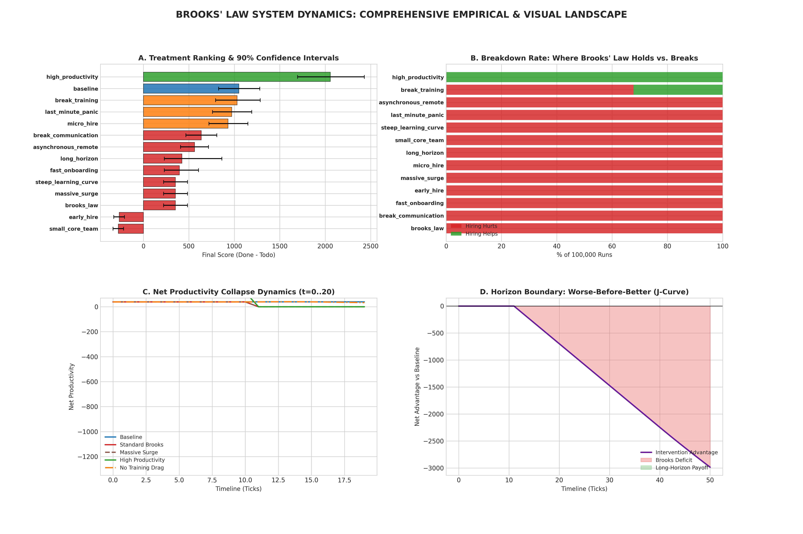

It has four panels, labelled A to D:

- **A. Ranking.** Each scenario's typical score, with a line showing the range
  that 90% of runs fell in. Further right = better final score.
- **B. How often hiring hurt** in each scenario. Almost every bar is at 100%.
- **C. Work done per tick over time.** Look at tick 10, the moment of hiring:
  output drops sharply.
- **D. The running advantage** of not hiring vs hiring, over 50 ticks. It never comes back, so
  the hired team never catches up.

### 4.4 The Forrester & Senge tests on your model

Jay Forrester and Peter Senge (1980) wrote a famous list of checks for whether
a system-dynamics simulation is built sensibly. John Sterman (2000) added more.

**The idea behind every test:** put the simulation in a situation where you
*already know* what must happen. If it does something else, the simulation is broken.

You ran **17 individual tests in 6 groups** (`forrester_brooks.py`, results in
`outputs/forrester_brooks_report.md`), plus **3 checks per team structure and a J-curve test**
for the structures (`forrester_modified.py`). Each test is listed below with:
- what it does;
- what it expects;
- what was reported;
- how strong the test is: could it have caught a real bug?

Unless stated otherwise, each test uses the default world (10 veterans, 500 items, 10 hires at tick 10, 20 ticks).

#### Group 1: Extreme conditions (9 tests)

"Feed the model absurd inputs and see if it behaves sensibly."

| # | test | setup | expected | reported | how strong is the test? |
|---|---|---|---|---|---|
| 1.1 | Zero workforce | 0 veterans, no hires | nothing ever gets done | PASS | ✅ good check |
| 1.2 | Novices only | 0 veterans, 10 hires at tick 10 | nothing done by tick 10, because newcomers don't produce | PASS | ⚠️ weak: true by construction, since only veterans produce |
| 1.3 | Mega hiring surge | 1,000,000 hires | no crash, no infinite or "not a number" values | PASS (Done = 426.2) | ⚠️ weak: checks only that numbers stay finite, not that they're sensible |
| 1.4 | Zero backlog | 0 items of work | Done ≥ 0, no crash | PASS | ❌ **missed a real bug**: with *zero* work, the model "finished" **426.2 items**. The test should have expected Done = 0; it would have exposed phantom work (Problem 2). |
| 1.5 | Extreme talking cost | comm_coef = 1.0 | production never negative | PASS | ⚠️ weak: guaranteed by the clamp ("never below zero") |
| 1.6 | Zero talking cost | comm_coef = 0 | Done > 400 | PASS | ⚠️ loose: any number above 400 passes |
| 1.7 | Zero training cost | train_coef = 0 | Done > 400 | PASS | ⚠️ loose, same reason |
| 1.8 | Nobody ever learns | mature_rate = 0 | still exactly 10 veterans and 10 newcomers at the end | PASS | ✅ good check |
| 1.9 | Instant learning | mature_rate = 1 | all hires become veterans in one tick: 0 newcomers, 20 veterans at the end | PASS | ✅ good check |

#### Group 2: Behaviour anomalies (4 tests)

"Check that nothing physically impossible happens."

| # | test | expected | reported | how strong is the test? |
|---|---|---|---|---|
| 2.1 | Causality | before tick 10, runs with and without hiring are identical (the future can't change the past) | PASS | ✅ good check |
| 2.2 | Work never un-done | Done never decreases | PASS | ⚠️ weak: guaranteed by the clamp |
| 2.3 | Headcount conservation | veterans + newcomers = 10 before the hire and 20 after (nobody appears or vanishes) | PASS | ✅ good check |
| 2.4 | Nothing negative | veterans, newcomers and Done never go below 0 | PASS | ❌ **missed a real bug**: it doesn't check **Todo**, which goes down to **−275** in the no-hiring run (phantom work again) |

#### Group 3: Boundary adequacy / J-curve (1 test)

"If we wait longer, does hiring eventually pay off?" A **J-curve** is the
shape you'd expect if hiring hurts at first and helps later: down, then up.

**What it does:**
- With a bigger backlog of 2,000 items, it compares hiring vs no hiring at horizons of 10, 20, 30, 40, 50 and 80 ticks.
- Then, with a 5,000-item backlog, it checks every tick from 15 to 119 for a crossover: the moment the hiring team pulls ahead.

**Reported:** PASS, "No crossover found within 120 ticks". The detailed numbers (in `outputs/forrester_brooks.json`):

| horizon | score without hiring | score with hiring | difference |
|---|---|---|---|
| 10 | −1225 | −1225 | 0 (hire hasn't happened yet) |
| 20 | −450 | −1147.5 | −697.5 |
| 30 | 325 | −1147.5 | −1472.5 |
| 40 | 1100 | −1147.5 | −2247.5 |
| 50 | 1875 | −1111 | −2986 |
| 80 | 4200 | −844 | −5044 |

**What it means:** the hiring team's score stays frozen at −1147.5 from tick 20 to tick 40. It produces **nothing for about 30 ticks**.
That's the communication wall (Problem 8): with 20 veterans, 95% of time goes to talking.

**How strong is the test?** ❌ It **cannot fail**: the code always writes PASS. "No
crossover" should have been a warning that something extreme was going on (Problem 5).

#### Group 4: Time-step check (1 test, from Sterman)

"Slice time more finely; the answer should barely change."

**What it does:** runs with 10 hires using time steps of 1, 0.5, 0.25, 0.1 and 0.05 ticks, and compares each with the finest one (0.05).
It passes if the error is within 5%.

**Reported:** **WARN**: the score is 352.5 with steps of 1 vs 275.0 with steps of 0.05, a **28.18% error**.

**What it means:** the answer depends heavily on a computing choice, not just
on the model's logic. In the fixed version (brooks_late in Part C), this error drops to **3%**.

**How strong is the test?** ✅ A real test, and it found a real problem. (It can only WARN, not FAIL.)

#### Group 5: Metamorphic monotonicity (1 test)

"More hires should never make the score *better*." (A metamorphic test checks
how the answer should change, without needing to know the answer.)

**What it does:** hires 0, 2, 5, 10, 20, 50 and 100 people.

**Reported:** PASS. Scores: **1050.0, 805.3, 423.8, 352.5, 352.5, 352.5, 352.5**.

**What it means:** the scores never go up, so the test passes. But look: from 10 hires to 100 the score is
**identical**. That's the clamp saturation of Problem 3: output already hits zero,
so more hires can't make it any worse. The test passed while showing the problem in its own numbers.

**How strong is the test?** ✅ A real test, but it should also flag "flat" as suspicious.

#### Group 6: Tipping points (1 test)

"Find the setting where hiring stops hurting."

**What it does:** compares hiring vs no hiring at tick 20 while sweeping three knobs one at a time:
- talking cost from 0.005 down to 0 (51 steps);
- learning speed from 0.1 up to 1.0 (46 steps);
- training cost from 0.2 down to 0 (41 steps).

It reports the first value where hiring helps.

**Reported:** PASS, with "none found" for all three knobs.

**What it means:**
- With talking cost at 0, hiring still hurts, because training alone (10 × 0.2 = 200%) freezes output.
- But for training cost, the score hides a real tipping point: with zero training cost, hiring actually
  makes the project **finish sooner** in 72% of runs (Lesson 4.1). Phantom work masked it.

**How strong is the test?** ❌ It **cannot fail**: always PASS (Problem 5).

#### Tests on the five team structures (`forrester_modified.py`)

For each of the 6 structures (flat + your 5), three checks:

| test | expected | reported | how strong? |
|---|---|---|---|
| Zero workforce | Done = 0 | PASS for all 6 | ✅ good check |
| Mega surge (100,000 hires) | no crash, no "not a number" | PASS for all 6 | ❌ **missed a real bug**: the synergistic structure reported **Done = 436,748** items for a project with only 500 items of work. Absurd, but it passed. |
| "Work monotonicity" | production never negative | PASS for all 6 | ⚠️ weak: guaranteed by the clamp (and the name doesn't match what it checks) |

The screen printout says "All physical invariants held" for every structure no matter
what (only the [PASS]/[FAIL] tag changes). Here everything passed, so the message happened to be true.

**J-curve test for the structures:** each structure *with* 10 hires is compared against the
**flat team without hiring** (backlog 4,000 items, 60 ticks):

| structure | catches up at | advantage at tick 60 |
|---|---|---|
| Standard (flat) | never | −3683.8 |
| Ambassador squads | tick 11 | +3550.3 |
| Mentor pods | never | −1497.3 |
| Async docs + CI | tick 11 | +1767.4 |
| Staged waves | never | −3663.8 |
| Synergistic | tick 11 | +4672.4 |

**What it means:** "catches up at tick 11" is just *one tick after hiring*. That's far too fast for
the hires to have paid off. It's the structure itself (squads talk less) beating
the flat team. This is the unfair comparison of Problem 1, so it says nothing about whether hiring pays off.

#### Summary of all the Forrester tests

| | count |
|---|---|
| good checks that passed | 6 (1.1, 1.8, 1.9, 2.1, 2.3, zero workforce for the structures) |
| real tests that found a problem | 1 (time step, WARN 28%) |
| weak tests that couldn't really fail (clamp-guaranteed or loose thresholds) | 7 |
| tests that **missed a real bug** they were in a position to catch | 3 (zero backlog → phantom work; non-negative → Todo −275; mega surge → Done 436,748) |
| tests that print PASS no matter what | 2 (boundary adequacy, tipping points) |
| passed, but its own numbers showed a problem | 1 (monotonicity → clamp saturation) |

**The lesson for the presentation:** "All tests passed" was true, but most of the tests
couldn't have failed. A good test states what *exactly* should happen and is able to fail.
That's why the new battery in Part C (Lesson 6) includes "dead knob", "unplug the cause", "can it ever fail?"
and a clamp-dependence check.

**"Metamorphic" test, explained:** sometimes you don't know the right answer, but
you know how the answer *should change*. Example: you don't know a
restaurant bill, but you know that ordering twice as much shouldn't make it
cheaper. If it does, something is broken.

### 4.5 Your five team structures ("architectures")

You asked: can a smarter team structure beat Brooks' Law?

| structure | idea | your reported score |
|---|---|---|
| Standard (flat) | everyone talks to everyone | 351.8 |
| Ambassador squads | groups of 10; only one "ambassador" per group talks across groups | 946.3 |
| Mentor pods | 1 veteran per 5 newcomers mentors full-time; the others aren't disturbed | 1038.5 |
| Async docs + CI | written docs and automation, so talking grows slowly and training is 40% cheaper | 671.7 |
| Staged waves | hire 2 people per tick over 5 ticks instead of 10 at once | 392.4 |
| Synergistic | squads + docs + mentor pods together | 1632.9 |

### 4.6 What you concluded at the time

1. Brooks' Law is "inviolable" (can't be broken) for flat teams: hiring hurt in 100% of 100,000 runs.
2. Even after 120 ticks, the hired team never catches up.
3. Only very high productivity breaks it.
4. Smart structures beat it; the combination is "super-additive" (better than the sum of its parts).

**Current status of these conclusions:**

| original conclusion | current status |
|---|---|
| 1. "Inviolable": hiring hurt in 100% | In this simulator, hiring delays the project **whenever it arrives before the project is finished** (8 scenarios CONFIRMED). But the "100%" comes from the clamp (Problem 3), and across the full range of believable settings the law holds in only ~10% of worlds (Lesson 7). |
| 2. Never catches up after 120 ticks | True in this simulator, but caused by the communication wall (Problem 8), which real large teams contradict. |
| 3. Only high productivity breaks it | **Not supported.** In high_productivity the project finishes before anyone is hired, so it's NOT TESTED. The only scenario where hiring helps is break_training, and the effect is negligible. |
| 4. Smart structures beat it | Structures **reduce** the harm a lot, but within each structure hiring still hurts in 5 of 6 (Problem 1). |

Lesson 5 explains the problems behind these corrections.

---

# Lesson 5: What was wrong with the first piece of work

Good research tests its own tests. Re-running your own code exposed eight
problems. This is the most important "story" in your presentation:
**the first conclusions were too confident, and here is exactly why.**

### Problem 1: an unfair comparison

**What happened.** Each structure *with* 10 hires was compared against the
**flat** team *without* hires. But some structures are just better teams,
even without hiring anyone. Squads with 0 hires score 1455 and async 1334, vs flat 1050.

**Everyday analogy.** You want to know if a new fertiliser helps. You put it on
a tomato plant in a greenhouse and compare it with an unfertilised plant
outdoors. The greenhouse plant wins, but was it the fertiliser or the greenhouse?

**The fair comparison:** each structure with 10 hires vs **the same structure** with 0 hires.

#### How to read this graph

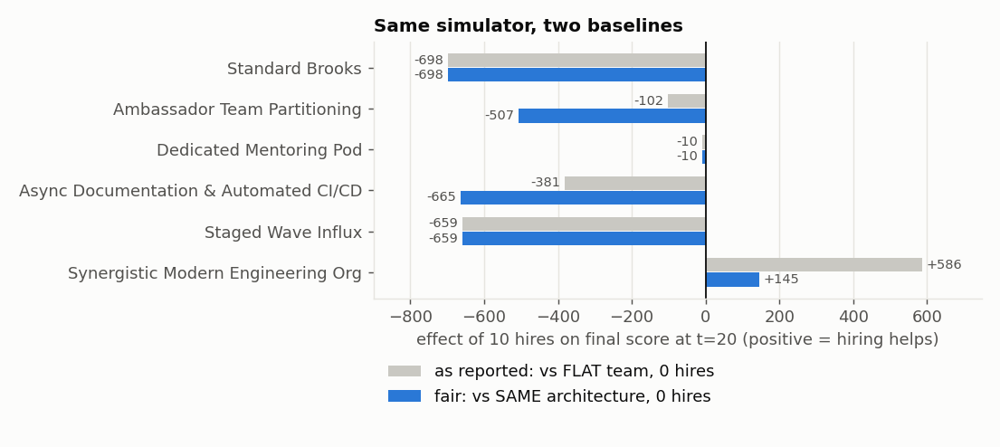

1. Each **row** is one team structure.
2. The **horizontal axis** is how much 10 hires changed the score. Right of the
   black zero line = hiring helped. Left = hiring hurt.
3. **Grey bar** = the unfair comparison (what was reported).
4. **Blue bar** = the fair comparison.

| structure | unfair (grey) | fair (blue) |
|---|---|---|
| Standard | −698 | −698 |
| Ambassador squads | −102 | **−507** |
| Mentor pods | −10 | −10 |
| Async docs | −381 | **−665** |
| Staged waves | −659 | −659 |
| Synergistic | +586 | **+145** |

**What it means:** inside each structure, hiring **still hurts in 5 of 6**. Only
the combined structure gains from hiring, and only +145, not +586.

**The same mistake affects 8 of the 14 scenarios** (see "What the median
tells you" in Lesson 4.1). After correcting for this and for phantom work (Problem 2), the
current verdicts are: 8 CONFIRMED, 2 AMBIGUOUS (break_communication,
asynchronous_remote), 1 negligibly BROKEN (break_training) and 2 NOT TESTED
(high_productivity, last_minute_panic). See "Corrected results" in Lesson 4.1.

**Good or bad?** Bad for the claim "smart structures beat Brooks' Law". Good
for the research, because the mistake was caught before publication.

### Problem 2: "phantom work"

**What happened.** The score was Done − Todo. When all the work was finished,
Todo went **below zero** (−275) and Done kept rising. The no-hiring score of
1050 is 775 done − (−275) left: the team got credit for 275 items that never existed.

**Fix used later:** measure **how long the project takes to finish**. That's
what Brooks actually talks about ("makes it *later*").

### Problem 3: the "100%" came from the clamp, not from the law

**What happened.** Remember Rule 2: each newcomer costs 20% of *every* veteran's time.
With just 5 newcomers that's 100% of their time, so work = 0 (clamped).
That means 5, 10 or 50 hires all give **exactly the same score** (352.6).

#### How to read this graph

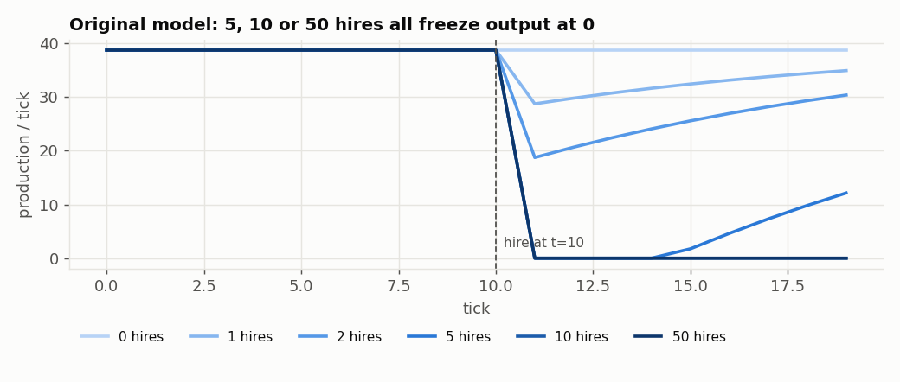

1. **Horizontal axis:** time (ticks).
2. **Vertical axis:** work done per tick.
3. **Each line** is a different number of hires (0, 1, 2, 5, 10, 50). Darker blue = more hires.
4. The **dashed line** at tick 10 is when the hiring happens.
5. Look just after tick 10: the lines for 5, 10 and 50 hires all fall to **zero** and stay there for a while.

**What it means:** the "100% confirmed" was produced by a math floor ("not below
zero"), not by the communication and training logic. Also, the 20% training
cost means each newcomer uses up **two full-time veterans**. Real data from
Helix (Lesson 8) says training costs about **17 times less**.

**Good or bad?** Bad for the "inviolable" claim.

### Problem 4: precision is not robustness

**What happened.** The ±15% random nudges only tested worlds very close to the
default settings. Running 100,000 nearly identical worlds tells you very
precisely what happens *in that one situation*. It tells you nothing about
other situations.

**Everyday analogy.** You test a bridge with 100,000 trucks, but every truck
weighs between 8.5 and 11.5 tonnes. You now know very well that it holds
10-tonne trucks. You know nothing about 40-tonne trucks.

**Key words:**
- **Precision**: how sure you are about the answer *in one situation*.
- **Robustness**: whether the answer stays the same *across many different situations*.

Testing across the full believable ranges (Lesson 6), Brooks' Law held in only
**about 10%** of worlds. Also, the project's own earlier test (the "2×2 stress
matrix") had already labelled Brooks **fragile**: only 12 out of 200 random worlds confirmed.

A small extra point: the random nudges were *uniform* (every value from 0.85 to 1.15
equally likely), while the report said *triangular*.

### Problem 5: tests that cannot fail

Two tests ("boundary adequacy" and "tipping points") printed **PASS even when
they found nothing**. The structures' test printed "All physical invariants
held" no matter what. A test that can never fail isn't testing anything.

**Fix adopted:** every test must state what result it expects *before* it runs.

### Problem 6: report text written by hand

The report always said that early_hire, break_training and fast_onboarding
"break the law", while the table right next to it said CONFIRMED, AMBIGUOUS and CONFIRMED.
**Fix:** generate the words from the data.

### Problem 7: the project wasn't actually late

**What happened.** 10 veterans do 38.75 items per tick, and 500 ÷ 38.75 ≈ 12.9. So
the project finishes at **tick 13**, before the tick-20 deadline. Brooks' Law
is about a **late** project, so this tested the law where its own condition was false.

The condition in the "if" part of a law is called the **antecedent**. Here:
"*if* the project is late".

**Fix used later:** "brooks_late", a version with 1000 items of work. Ten
veterans can only do about 775 by tick 20, so the project really is late.

### Problem 8: the "communication wall"

Using Rules 1 and 3, a flat team's output = V × (1 − 0.005 × V(V−1)/2).

| team size V | pairs | time lost talking | output (relative) |
|---|---|---|---|
| 3 | 3 | 1.5% | 2.96 |
| 10 | 45 | 22.5% | 7.75 |
| 12 | 66 | 33% | 8.04 ← the peak |
| 15 | 105 | 52.5% | 7.13 |
| 20 | 190 | 95% | 1.0 |
| 21 | 210 | 105% | **0** |

So any flat team above ~20 people produces **nothing**. That is why your
20 grown-up veterans "lose 95% to meetings forever", and why no catch-up
ever appeared. Real open-source projects with 20+ active developers clearly
still produce work, so this rule is too extreme for big teams.

#### How to read this graph

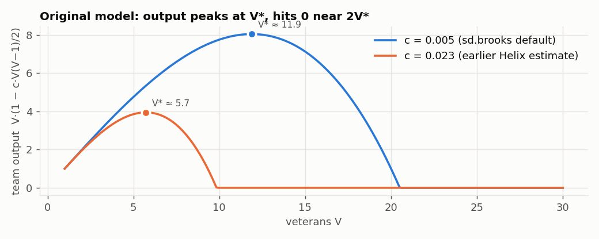

1. **Horizontal axis:** number of veterans (1 to 30).
2. **Vertical axis:** how much the whole team produces.
3. **Blue line:** talking cost 0.005 per pair (the textbook default). It rises,
   peaks at about **12 people**, then falls to zero near 20.
4. **Orange line:** talking cost 0.023, **measured in the real Helix project**
   (Lesson 8). It peaks at about **6 people** and hits zero near 10.
5. The **dots** mark the peaks. The peak team size is called **V\*** ("V-star"),
   the team's **sweet spot**. Formula: 3V² − 2V = 2 ÷ talking-cost.

**What it means:** adding people *helps* below the sweet spot and *hurts*
above it. This one curve explains most of the results in this project.

### What survived from Part B

Even after fixing everything: in a project that is *truly* late, adding
people *does* make it finish later, in the flat team and in all 7 structures
tested later. Good structures cut the damage by **8 to 40 times**, but don't
remove it. Your scenarios and structures were reused in Part C, now with
fair comparisons.

---

# Lesson 6: The improved testing method ("lawkit")

**lawkit** is a small Python toolkit (folder `lawkit/`) that runs the same
complete set of checks on any law. You give it a description of the law, and it
produces a report called an **evidence card** (`outputs/laws/<law>_card.md`).

Each step below answers one question.

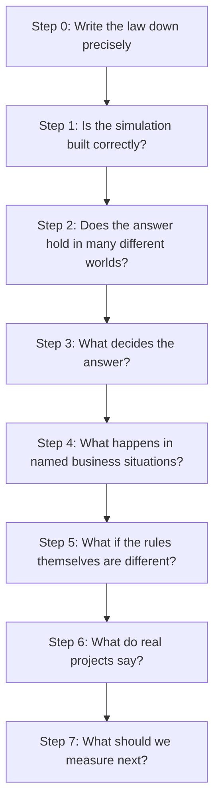

### Step 0: Write the law down precisely

For each law we write down:
- the **lever** and its two **arms** (e.g. hire 0 vs 10);
- the **expected direction** (e.g. the score should go down);
- the **support factors**: the other conditions that might matter (team size, training cost and so on);
- the **causal channels**: the specific reasons the law gives (for Brooks: talking and training).

### Step 1: Is the simulation built correctly? (10 tests)

Before trusting a calculator's answer, check the calculator. Each test has a
**PASS / WARN / FAIL** result.

| # | test | the question | why it matters |
|---|---|---|---|
| 1 | Units & dimensions | Does every number say what it measures (people, items, per tick), and does every equation add only like with like? | Catches mixing up apples and oranges. Brooks originally failed: its labels called the same people "devs", "vet" and "newhire", so the time lost to talking came out as dev²/pair while the time lost to training came out as dev/newhire, and the two can't be subtracted. Fixed by using one unit (devs) for all of them; the numbers are unchanged. aiwork and archpat still fail. |
| 2 | **Dead knobs** | Does every setting actually affect the result? | A knob that does nothing means the model doesn't do what its author thinks. |
| 3 | Extreme values | At the lowest and highest believable values, does it crash or give nonsense? | Basic sanity. |
| 4 | Clamp dependence | How many "law holds" answers only exist because of a "not below zero" rule? (Fail if more than 20%.) | Catches Problem 3 automatically. |
| 5 | Time step | With smaller time steps, is the verdict the same? | If not, the answer is a computing artefact. |
| 6 | Longer run | Run 4× longer: same verdict? | Checks whether the deadline choice drives the answer. |
| 7 | Dose-response | Pull the lever a little, more, a lot: does the result move steadily? | Odd jumps suggest bugs. |
| 8 | **Unplug the cause** ("knock-out") | Switch off the reasons the law gives. The effect should disappear. | If it doesn't, something hidden is causing it. |
| 9 | **Can it ever fail?** ("refutability") | Is there any believable world where the law fails? | If the answer is "never", the law is built in, not tested. |
| 10 | Double everything | Double all the stocks: does the verdict flip? | It shouldn't. This is a metamorphic test. |

The bold ones are new. The project's original 8 tests gave the design-pattern
law a **perfect score**, yet it had three hidden faults (Lesson 9). The new
tests caught all three.

### Step 2: Does the answer hold in many different worlds? (robustness)

We create 2,000 random "worlds" (sets of knob values) in **three different ways**:

| way | how values are picked | analogy |
|---|---|---|
| **±15% (the old way)** | close to the defaults only | trucks of 8.5–11.5 tonnes |
| **triangular ("prior")** | anywhere in the believable range, but values near the default are more likely | mostly normal trucks, sometimes heavy ones |
| **uniform** | anywhere in the believable range, all values equally likely | any truck at all |

In each world we run the lever-off/lever-on comparison and count how many are
CONFIRM, REFUTE or neutral. Results are in Lesson 7.

### Step 3: What decides the answer?

Two tools:

- **Tipping points:** change one knob at a time from low to high, keeping all others at
  default, and record where the verdict flips. For example, "with fewer than 5
  veterans, hiring helps; from 5 it hurts".
- **Decision tree:** the computer learns a short flowchart of yes/no
  questions ("Is the team bigger than 10? Is the backlog above 660?") that
  predicts the verdict from the knob values. **Importance** (0 to 1) is how much each
  knob is used in that flowchart. A higher number means that knob matters more.

### Step 4: Business scenarios

Same rules, different starting situation: "hire early", "tiny team",
"huge backlog", and so on. These include your Part B scenarios.

### Step 5: Rival mechanisms ("variants")

Same situation, **different rules**: "what if teams work in squads?", "what
if migrating code costs effort?". If a law only holds under one particular
set of rules, it is fragile.

**The fairness rule (fixes Problem 1):** lever-off and lever-on are always
compared *inside the same variant*.

### Step 6: What do real projects say? ("placement")

1. A small program (a **miner**, folder `mine/`) reads a real project's history
   from **git**. Git is the tool that records every code change ("commit"),
   who made it and when.
2. From that history it **measures** some knob values for that project. Each
   measurement comes with an uncertainty range (explained in Lesson 8).
3. Knobs that can't be measured are filled with random believable values.
4. We create 2,000 worlds this way, run the law in each, and count the verdicts.

The result is **"the chance the law holds for *this* project"**. We call it
**placement**: placing the project on the map of where the law holds.

### Step 7: What should we measure next? ("value of information")

For each knob we couldn't measure, we ask: *if we knew this knob's value,
how much more certain would the verdict become?* The knob with the biggest
gain is the one to measure next. This is exactly the paper's theme.

---

# Lesson 6b: Every no-data Forrester test, on every Brooks scenario

> **Current result (2026-11-06):** lawkit now keeps **one standard Brooks
> model** (Step 6 below). On it, every data-free Forrester test passes in all
> 15 worlds. Steps 1-5 record how we got there, with the numbers of the
> earlier models.

### What was run

Forrester & Senge (1980) list 17 tests. **9 need no project data**: they
check the simulation using only reasoning about what *must* happen. All 9
were run, plus two from other authors that also need no data:
- Sterman's (2000) time-step test;
- Chen et al.'s (1998) metamorphic relations.

**Where:** `forrester_all.py`. Run it with `python -B forrester_all.py` (about 4
minutes). Full results: `outputs/forrester_all.md` and `outputs/forrester_all.json`.

**Results at a glance (three runs):**

| run | model(s) tested | worlds | results | PASS | INFO | WARN | FAIL |
|---|---|---|---|---|---|---|---|
| 1. first run (Steps 1–4) | old `brooks` + `brooks_late`, unfixed | 29 | 551 | 272 | — | 212 | 67 |
| 2. after the fixes (Step 5) | four Brooks models | 58 | 1,102 | see Step 5 | | | |
| 3. **final (Step 6), current** | **the one standard Brooks model** | **15** | **285** | **244** | **41** | **0** | **0** |

**Every test, explained with an example and a link to its code: Step 8 below.**

**Only run 3 describes the model as it is now.** Runs 1 and 2 are kept
because they show what the tests *found*: the WARNs and FAILs in run 1 are the
defects that were then fixed (Step 5).

**The worlds in the first run (29 in total):**
- **`brooks`**, the original score (Done − Todo at tick 20): the default world + 13 scenarios = 14 worlds.
  These are the same 14 situations as your Part B work (break_communication = no_comm, break_training = no_training).
- **`brooks_late`**, the fixed version (backlog 1000, score = finish time): the default world + 14 scenarios = 15 worlds.
- In every world, the team structures (squads, mentor pods and so on) are also checked under "boundary adequacy (policy)".

19 test rows per world × 29 worlds = 551 results: 272 PASS, 212 WARN, 67 FAIL
(**historical**: before any fix).

### Step 1: Can these tests be trusted? (validation)

Before reading any result, we checked the test harness in two ways.

**Known answers.** We worked out five answers by hand and checked that the simulator reproduces them exactly:

| hand calculation | simulator | ok |
|---|---|---|
| work per tick with 10 veterans = 10 × (1 − 45 × 0.005) × 5 = **38.75** | 38.75 | ✅ |
| without hiring, a 1000-item project finishes at ⌈1000 ÷ 38.75⌉ = **tick 26** | 26 | ✅ |
| output freezes once hires ≥ (1 − 0.225) ÷ 0.2 = 3.875: **3 hires → some output, 4 → zero** | 3 → 8.75, 4 → 0 | ✅ |
| a flat team's sweet spot V\* (3V² − 2V = 2/c) at c = 0.005 is 11.9 → **12 people** | 12 | ✅ |
| lawkit's Brooks gap equals the original `sd.brooks` gap (**−147.5**) | −147.5 | ✅ |

**Deliberately broken models ("mutants").** A check is only useful if it *can*
fail. We built six broken versions of the model, each with one planted defect.
In every case, the correct model **passed** the check and the broken one was **caught**:

| planted defect | check that must catch it | correct model passes | defect caught |
|---|---|---|---|
| 10% of maturing newcomers vanish | headcount conserved | ✅ | ✅ |
| future hires lower today's output | causality | ✅ | ✅ |
| everyone works 1.5× full time | nobody exceeds full time | ✅ | ✅ |
| one finished item is un-done every tick | work never un-done | ✅ | ✅ |
| one extra item counted as done every tick | work conserved | ✅ | ✅ |
| a unit label says `vet` instead of `devs` | dimensional consistency | ✅ | ✅ |

**So the results below are trustworthy:** the checks measure what they
claim to measure, and each one is able to fail.

### Step 2: The results, test by test

How to read the "result" column: "29/29 PASS" means the test passed in all 29 worlds.

#### Structure tests (is the model built correctly?)

| F&S test | what it checks in plain words | result | meaning |
|---|---|---|---|
| **Dimensional consistency** | every equation only adds like with like (people with people, items with items) | **29/29 PASS** | ✅ after the unit-label fix |
| **Extreme conditions**, every setting at its lowest and highest value | no crash, no infinite or "not a number" values | **29/29 PASS** | ✅ the model never breaks numerically |
| **Extreme conditions**, known answers | 6 situations where we *know* the answer (see below) | **5/6 hold in every world; 1 fails in all 29** | ❌ **real defect**: see "Defect 1" |
| **Every parameter matters** | each setting changes the outcome in some way | **19 PASS, 10 FAIL** | ✅ in both default worlds. The 10 FAILs are scenarios where either the project still finishes on time whatever the setting (e.g. last_minute, high_prod, micro_hire, no_comm, async_remote) or output is frozen by the clamp whatever the setting (massive_surge). Learning speed, training cost or hire time then can't affect the result. That's a property of those scenarios, not a model defect. |
| **Declared causes do the work** (knock-out) | switch off talking and training costs; the harm must disappear | **29/29 PASS** | ✅ the harm comes only from the two reasons Brooks gave |
| **Boundary adequacy (structure)** | does the model contain the structures the literature says matter? | **29/29 WARN** | ⚠️ only **2 of 7** are present (see below) |

The six known-answer extreme conditions:

| situation | what must happen | result |
|---|---|---|
| no veterans, nobody hired | nothing ever gets done | ✅ always |
| **no work at all (backlog 0)** | **nothing ever gets done** | ❌ **fails in all 29 worlds**: the team still "completes" 500 items of work that doesn't exist |
| talking overload (each person loses 225% of their time) | nothing gets done | ✅ always |
| training overload (training cost 100%) | zero output right after the hire | ✅ always |
| nobody ever learns | veterans never change | ✅ always |
| instant learning | no newcomers left one tick after the hire | ✅ always |

Literature structures (Brooks 1975; Abdel-Hamid & Madnick 1991):

| structure | in the model? |
|---|---|
| talking cost grows with the number of pairs | ✅ |
| training takes veterans' time | ✅ |
| newcomers do some work while learning | ❌ |
| some work can't be split across people | ❌ |
| people leave (attrition) | ❌ |
| schedule pressure and overtime | ❌ |
| errors and rework | ❌ |

#### Behaviour tests (does the model behave sensibly?)

| F&S test | what it checks | result | meaning |
|---|---|---|---|
| **Behaviour anomaly**: 7 physical laws on every run | see the table below | **28 FAIL, 1 PASS** | ❌ **real defects**: "Defect 1" and "Defect 2" |
| **Behaviour anomaly**: negative effort hidden by the clamp | how often 1 − talking − training goes below zero (a team doing "negative work", silently set to 0) | **23 WARN, 6 PASS** | ⚠️ e.g. 29 of 160 steps in brooks_late; this is the saturation problem (Problem 3) |
| **Behaviour anomaly**: verdicts made by clipping | share of "law holds" results that only exist because a value was clipped | **29/29 WARN** | ⚠️ 14% in brooks_late, 9% in brooks: below the 20% FAIL line, but not zero |
| **Extreme policy** | hire 0 → no change; hire 100 → finite and no better than hiring 10; hire *after* the project is finished → no change | **29/29 PASS** | ✅ including "hiring after finishing has no effect", which the `sd.brooks` engine gets right (your Part B simulator didn't, Lesson 4.1) |
| **Boundary adequacy (behaviour)**: add each missing structure | does the outcome move by more than 10%? | **28 WARN, 1 PASS** | ⚠️ the missing structures matter: in brooks_late, newcomers at 50% productivity move the outcome 18%, 1%/tick attrition 56%, and 10% unsplittable work 92% |
| **Boundary adequacy in time** | does the verdict hold if we run 4× longer? | **26 PASS, 3 WARN** | ✅ for all brooks_late worlds. The 3 WARNs are in brooks. In default and fast_onboard, both teams eventually finish and the difference disappears. In **small_core** (2 veterans), hiring hurts at tick 20 but **helps by tick 40** (+204): a real J-curve, the only one in the model. |
| **Behaviour sensitivity** | across each setting's believable range, does the *shape* of the behaviour change ("no dip", "dip and recover", "dip, no recovery", "finished before the hire")? | **29/29 WARN** | ⚠️ expected: the shape depends on team size, backlog, talking cost, speed and hire time. The default shape is always "dip, no recovery". |
| **Time step** (Sterman) | smaller time steps, same answer? | **21 PASS, 8 WARN** | ✅ for brooks_late default (3%); ⚠️ brooks default 28% (known) |
| **Metamorphic MR1**: more hires | the harm never shrinks as hires increase | **29/29 PASS** | ✅ |
| **Metamorphic MR2**: double everything | doubling team and backlog shouldn't flip the verdict | **22 PASS, 7 WARN** | ⚠️ in 6 of the 7 flips (neutral → CONFIRM), the project wasn't late. Doubling the backlog makes it late, so the law starts to apply: the antecedent at work, not a defect. In the 7th (brooks_late/huge_backlog, CONFIRM → neutral), a 6000-item backlog is so far from done that the two runs differ by less than 5%. |

The 7 physical laws, checked on both runs (with and without hiring) in every world:

| law the runs must obey | result |
|---|---|
| people never negative | ✅ always |
| headcount conserved: veterans + newcomers = start + hires | ✅ always |
| causality: before the hire, both runs are identical | ✅ always |
| work is never un-done | ✅ always |
| nobody works more than full time | ✅ always |
| **no phantom work**: the equations never complete more work than exists | ❌ fails in 27 worlds (passes in the 2 where the project never finishes) |
| **work conserved**: done + left = the original backlog | ❌ fails in 15 worlds: all 14 brooks_late worlds with backlog 1000 or more, plus brooks/long_horizon |

#### Policy tests (is the recommendation trustworthy?)

| F&S test | what it checks | result | meaning |
|---|---|---|---|
| **Boundary adequacy (policy)** | add a missing structure or swap in a rival team structure: does the recommendation ("don't hire" / "hire" / "doesn't matter") stay the same? | **brooks: 13 WARN, 1 PASS. brooks_late: 12 WARN, 3 PASS** | ⚠️ in brooks_late default, "don't hire" survives **all 9** added or rival structures ✅. In other scenarios it changes under some: mentor pods often make hiring harmless; in small_core (brooks), newcomers at 50% productivity flip it to "hire" |
| **Policy sensitivity**: can any world refute? | is there any believable world where the recommendation fails? | **27 PASS, 2 WARN** | ✅ the claim is testable, not built in |
| **Policy sensitivity**: does the recommendation flip within believable ranges? | robustness over the full ranges + tipping points | **29/29 WARN** | ⚠️ expected: Brooks holds in only ~11–12% of believable worlds. It flips at **team size 5** (below: hiring helps) and **25** (above: the team is already stuck), at a **talking cost of 0.0225**, and at **backlog 450** (below that the project isn't late) |

### Step 3: What the results mean (classification)

Every FAIL and WARN falls into one of four groups.

**A. Real model defects (now fixed in `paper/sd.py`; see Step 5):**
1. **Defect 1: phantom work in the equations.** The production equation
   doesn't stop when the backlog is empty. Only the engine's "clip to range" rule
   stops it, by capping `Done` at 500. With **zero work**, the team still
   "completes" 500 items. *Fix:* production per tick = the smaller of (team output, work left).
2. **Defect 2: work not conserved when the backlog exceeds 500.** `Done` has a
   fixed upper limit of 500, so in any world with a bigger backlog, finished work
   is silently thrown away.
   - *Impact on reported results:* **none for brooks_late**, whose score uses `Todo` (finish time), not `Done`.
   - For **brooks/long_horizon** (backlog 2000), the gap was **−1549 instead of the true −2986** (now corrected). The verdict (CONFIRM) was right, but the size was understated by about half.
   - *Fix:* widen `Done`'s range to match the backlog.
3. **Clamp hides negative effort** (a WARN, already known as Problem 3). When
   talking + training exceed 100% of time, the equations produce negative work, and
   the clamp silently sets it to 0. That's why 5, 10 or 50 hires give the same result.
4. **Time-step error of 28%** for the original brooks score (already known). It drops to 3% with the finish-time score.

**B. Missing structure (a model limitation, not a bug):** only 2 of 7
literature structures are present. Adding them moves outcomes by 18–92%. In some
scenarios it changes the recommendation. So the model's answers are only as good
as the assumption that newcomers do no work, nobody leaves and all work can be split.

**C. Scenario properties (expected, not defects):**
- dead parameters in scenarios where the project finishes before the hiring matters, or output is frozen anyway;
- MR2 flips where the project wasn't late;
- time-horizon WARNs where both teams eventually finish.

These are mostly Brooks' own condition ("a *late* project") showing up. One
time-horizon WARN is genuinely interesting: small_core's J-curve (hiring onto a
team of 2 pays off by tick 40).

**D. The law is conditional (the main research finding, confirmed again):** behaviour
sensitivity and policy sensitivity WARN everywhere, because the answer genuinely
depends on team size, talking cost and backlog. That isn't a fault of the model. It is
exactly what Lessons 7–8 show.

### Step 4: Good or bad?

- **Good:**
  - The model is numerically sound: no crashes, causality holds, people and headcount behave correctly, and units are consistent.
  - The harm comes from the two causes Brooks named (knock-out passes).
  - Hiring after the project is finished correctly has no effect.
  - In the fixed `brooks_late` default world, "adding people to a late project makes it later" survives all 9 added or rival structures.
- **Bad:**
  - Two real defects in the shared model (phantom work; `Done` capped at 500).
  - Five missing structures that change outcomes substantially.
  - The clamp still hides negative effort.
  - None of this changes any brooks_late verdict, but Defect 2 halves one brooks number (long_horizon).
- **Compared with Part B:** your original suite reported all PASS (one WARN). This suite
  can fail, and it does, in places the old one couldn't see (Lesson 4.4).

### Step 5: Making the WARN and FAIL tests pass

Every non-PASS result was traced to its cause, then fixed or reclassified.
The decisions on the shared model and on reporting were yours, made in two
rounds; the final choices were:
- fix `paper/sd.py`;
- step 0.125;
- add the 5 missing structures as uncertain settings;
- a bounded overload formula;
- findings reported as INFO;
- a Helix-data test.

There are now **two Brooks models**:

| | original (`brooks`, `brooks_late`) | extended (`brooks_fixed`, `brooks_late_fixed`) |
|---|---|---|
| equations | `paper/sd.py`, **with the 2 defects fixed** | the same + 5 literature structures + bounded overload |
| time step | 1 tick | 0.125 tick |
| purpose | the paper's reference model | a model that passes every data-free test |

#### What was wrong and what was done

| cause | tests affected | what was done | why it is legitimate |
|---|---|---|---|
| **Real defects** in `paper/sd.py`: work kept being "done" after the backlog was empty; `Done` capped at 500 | known answers, invariants (57 FAIL) | **fixed in `paper/sd.py`**: each tick's work <= the work left, and `Done` can hold any backlog | they were bugs: work that didn't exist was counted |
| **5 missing literature structures** | boundary adequacy, structure + behaviour | extended model: newcomers do some work (up to 50%), veterans leave (up to 2%/tick), unsplittable work (Amdahl, up to 0.2 per extra person), overtime when behind (up to +20%), rework (up to 15%). **Each is off in the default world** and sampled up to that value. | the structures are now inside the model, and their influence is measured by the sensitivity tests. The ranges are **assumptions**, not data. |
| **Overload clamp**: over-100% overhead cut to zero | negative effort hidden by clamp | extended model: share of time left for work = e^(-overhead). It approaches zero but never goes negative, so no clamp is needed. | for small overhead it equals the original 1 - overhead |
| **Time step too coarse** | integration error | extended model uses steps of 0.125 | halving the step now moves no result by more than 10% (it moved up to 34% at step 1) |
| **Start-value range used as a hard cap** | verdicts made by clipping | in the extended model, teams may grow past 100 during a run; *starting* sizes are still sampled from 0-100 | 100 veterans is a belief about starting teams, not a law of physics |
| **Tests that didn't check what they claimed** | clipping, MR2, MR1, per-scenario dead parameters, one known answer | (1) clipping only warns when a "law holds" verdict depended on clipping. (2) MR2 only warns on a reversal, as its description says. (3) MR1 now allows one sweet spot (harm first falls, then grows) but never a second reversal. This is Brooks' V\* theory. (4) a setting inactive in one scenario is INFO when it's live in the default world. (5) the overload known-answer now remembers that output can't exceed the work left. | each test now checks what it says it checks |
| **The research result itself** | policy sensitivity, behaviour sensitivity, boundary adequacy (policy), deadline dependence, refutability in scenarios | **INFO**: "the law is conditional; resolving it needs real data", with the deciding thresholds listed | forcing PASS would hide the main finding |

#### Final results (`outputs/forrester_all.md`, 58 worlds, 1,102 results)

| model | worlds | PASS | INFO | WARN | FAIL |
|---|---|---|---|---|---|
| brooks (original, sd.py fixed) | 14 | 169 | 53 | 44 | **0** |
| brooks_late (original, sd.py fixed) | 15 | 194 | 46 | 45 | **0** |
| **brooks_fixed** (extended) | 14 | **220** | 46 | **0** | **0** |
| **brooks_late_fixed** (extended) | 15 | **243** | 42 | **0** | **0** |

- **The extended models pass every data-free test.** Only INFO findings remain.
- **The original models have no FAILs.** Their remaining WARNs are the reasons the extended model exists:
  - missing structures (two tests);
  - the overload clamp;
  - and, for `brooks`, the 1-tick time step.
- **Validation:**
  - all 5 hand calculations match;
  - all 6 planted defects are caught on **both** models (12/12);
  - the clean versions of both pass every one of those checks.

#### The test with real data (Helix)

Forrester & Senge's policy-sensitivity test passes when the recommendation stays
the same **within real-world values**. We re-ran it with Helix's measured talking cost,
training cost and learning speed (bootstrap samples):

| model | Helix team, doubled | law holds | opposite | no difference | status | measure next |
|---|---|---|---|---|---|---|
| original | 3 | 1% | **81%** | 19% | WARN | hire timing |
| original | 6 | **82%** | 0% | 18% | WARN | backlog |
| original | 8 | **89%** | 0% | 11% | WARN | backlog |
| extended | 3 | 0% | **90%** | 10% | **PASS** | - |
| extended | 6 | **72%** | 4% | 24% | WARN | backlog |
| extended | 8 | **86%** | 0% | 14% | WARN | backlog |

**What it means:**
- With real data, the recommendation is **72-90% stable**.
- For Helix's usual team of 3, the extended model gives a clear answer (PASS): doubling helps.
- For teams of 6 and 8, the law probably holds, but not with >= 90% certainty.
- The measurement that would settle it is the **backlog**, i.e. whether Helix projects are actually late. That's the JIRA due-date measurement in Lesson 11.

#### Did the changes alter the conclusions?

- **Fixing `paper/sd.py`:** only the `brooks` (deadline-score) numbers move slightly, because the old score credited phantom work.
  - Robustness +-15% / triangular / uniform: 76/10/7% -> **68/7/4%** CONFIRM.
  - long_horizon gap: -1549 -> **-2986**.
  - No default verdict changes, and **`brooks_late` is unchanged**.
- **The extended model changes the picture substantially.** % CONFIRM / REFUTE / no difference over believable worlds:

| | original | extended |
|---|---|---|
| late project (finish time) | 11 / 0 / 88 | **44 / 16 / 40** |
| deadline at tick 20 | 7 / 0 / 93 | **19 / 51 / 30** |
| delay from hiring 10 in the default late project | ~88 ticks | **~11 ticks** |

- **Why:**
  - overloaded teams no longer freeze at zero output, so far fewer worlds are "no difference";
  - partly-productive newcomers and overtime mean that, judged at a fixed deadline, hiring more often helps.
- **What still holds:** for a project that is genuinely late, Brooks' Law still holds more often than not. It is still decided mainly by **team size** (importance 0.66) and **talking cost** (0.25), now joined by **veterans leaving** (0.09).
- **The caveat:** the extended numbers rest on the assumed ranges of the five added structures. They show what the literature's structures *imply*, not new evidence.

Note: the test refinements live in the shared `lawkit/battery.py`. The aiwork
and archpat evidence cards pick them up the next time they're regenerated (`make laws`).

### Step 6: The single standard Brooks model (final)

lawkit now keeps **one Brooks model**, `LAWS["brooks"]`, for every Forrester
test, report and future evaluation:
- the former `brooks_late_fixed`: a late project, scored by finish time;
- the five literature structures, each off at the default;
- bounded overload;
- time step 0.125.

The Helix and Aider evidence was **re-fitted with the same bounded formula**.
The earlier models and their results are archived in
`outputs/archive/2026-11-06_before_standard_brooks/`.

**Final Forrester results** (`outputs/forrester_all.md`, 15 worlds = default + 14 scenarios):

| PASS | INFO | WARN | FAIL |
|---|---|---|---|
| **244** | 41 | **0** | **0** |

- **Validation:** all 4 hand calculations match:
  - output 39.926 items per tick;
  - finish at tick 25.125 without hiring;
  - output 5.403 right after 10 hires (slowed, not frozen);
  - sweet spot 14 at the default talking cost.

  All 6 planted defects are caught, and the clean model passes every one of those checks.
- **The 41 INFOs:**
  - the "law is conditional" findings (policy and behaviour sensitivity, rival team structures);
  - settings that have no effect in a particular scenario.

  None is a model fault.
- **One test-design fix made along the way:** the dead-parameter test now counts a setting as live if it changes the outcome in
  *any* believable world, not only the default one. `deadline` matters only once overtime is switched on. A truly unused
  setting, such as archpat's `pat_strength`, is still caught.

**The test with real data (Helix, re-fitted):**

| Helix team, doubled | law holds | opposite | no difference | status | measure next |
|---|---|---|---|---|---|
| 3 | 4% | **70%** | 26% | WARN | veterans leaving |
| 6 | **87%** | 1% | 13% | WARN | backlog |
| 8 | **94%** | 0% | 6% | **PASS** | backlog |

**What it means:**
- With Helix's real values, the recommendation is clear (≥ 90%) for a team of 8.
- It is fairly clear for 6 (87%) and for 3 (70% "hiring helps").
- The measurements that would settle the rest are **how many veterans leave** and **whether projects are actually late** (the backlog).
- Both can be measured: veterans leaving from git activity, the backlog from JIRA due dates.

### Step 7: How the standard model differs from the original

This is now a lesson of its own: **Lesson 6c**, right after this one. It covers every change, why each was needed, every scenario, and the 100,000-run Monte Carlo.

### Step 8: Every test explained, with an example and where its code lives

This step explains each check in `outputs/forrester_all.md` on the **standard
model**. Each test has the same parts:
- **question:** what the test asks, in plain words;
- **how:** how it's run;
- **PASS rule:** what counts as PASS or FAIL;
- **example:** from the default world (10 veterans, backlog 1000, 10 hires at tick 10; finish at 25.1 without hiring, 36.1 with; gap −11);
- **what failing looked like,** where the original model failed;
- **code:** where the function lives.

#### How the code is wired

The tests live in two files:
- [`forrester_all.py`](../forrester_all.py): 9 tests of its own, plus validation, the Helix test and the report;
- [`lawkit/battery.py`](../lawkit/battery.py): the 10 general lawkit tests, which work on any law.

**One run of `python -B forrester_all.py`, step by step:**
1. **`main()`** ([forrester_all.py:485](../forrester_all.py#L485)) runs the validation first: `known_answers()` (L321) and `mutants()` (L375). Then the data test, `data_policy()` (L394).
2. **`worlds()`** (L41) builds the 15 worlds (default + 14 scenarios), using `world()` (L33).
3. **`suite(w)`** ([L310](../forrester_all.py#L310)) runs all 19 tests on one world:
   - first `battery.battery(w)`, the 10 lawkit tests;
   - each lawkit name is renamed to its Forrester name via `BATTERY_NAMES` (L277);
   - then its own 9 tests.
4. **`relabel()`** ([L298](../forrester_all.py#L298)) turns a WARN on a "finding" test (listed in `FINDINGS`, L291) into **INFO**.
5. **`report()`** (L416) writes `outputs/forrester_all.md` and `.json`.

**Shared helpers in `forrester_all.py`:**
- `traj()` (L52): runs one arm and returns every step;
- `hire_step()` (L65): which step the hire lands on;
- `first0()` (L69): the first step where `Todo` hits 0;
- `bg()` (L47): the world with some settings overridden;
- `row()` (L28): one result line.

---

#### V1. Known answers (validation): `known_answers()`, [forrester_all.py:321](../forrester_all.py#L321)

- **Question:** does the simulator reproduce numbers worked out by hand?
- **Example:** four hand calculations, all matching exactly.

  | check | hand calculation | simulator |
  |---|---|---|
  | output, 10 veterans | 10 × e^(−45 × 0.005) × 5 = **39.926** items per tick | 39.926 |
  | finish, no hiring | 1000 ÷ (39.926 × 0.125) → 201 steps = **tick 25.125** | 25.125 |
  | output right after 10 hires | 10 × e^(−(0.225 + 10 × 0.2)) × 5 = **5.403** (slowed, not frozen) | 5.403 |
  | sweet spot | V(2V − 1) = 2/0.005 → V = 14.4 → **14** | 14 |

#### V2. Planted defects (validation): `mutant()` [L347](../forrester_all.py#L347), `mutants()` [L375](../forrester_all.py#L375)

- **Question:** if the model had a bug, would the right test notice?
- **How:** `mutant(kind)` builds a broken copy of the model. `mutants()` checks two things for each: the matching check fails on the copy, and passes on the correct model.
- **Example:** all 6 caught.
  - newcomers vanish → caught by *headcount conserved*;
  - future hires lower today's output → *causality*;
  - 1.5× full time → *nobody over full time*;
  - the hire step undoes work → *work never un-done*;
  - one fake item every tick → *work conserved*;
  - wrong unit label → *dimensional consistency*.
- **Why it matters:** Part B's tests passed a zero-backlog run that "finished" 426 items. These mutants show this harness doesn't have that problem.

---

### A. Structure tests

#### 1. Dimensional consistency (F&S §3): `units()`, [lawkit/battery.py:20](../lawkit/battery.py#L20), which calls `check()` in [lawkit/units.py:63](../lawkit/units.py#L63)

- **Question:** do the units add up in every equation?
- **How:** the model is stepped once on unit-carrying numbers, the `Q` class at [units.py:31](../lawkit/units.py#L31). For example, `Vet` = "10 devs" and `comm_coef` = "0.005 per devs²". Every +, −, × checks the units, and a mismatch raises `DimError`.
- **PASS rule:** no unit errors, and every variable has a unit.
- **Example:**
  - talking = (per devs²) × devs² = a pure fraction ✅;
  - training = (per devs) × devs = a pure fraction ✅.

  So e^(−(talking + training)) is valid. Literal uses like `Vet − 1` are listed as notes rather than rejected.
- **What failing looked like:** the original's labels "per pair", "per new hire" and "items per vet" were three vocabularies for people. The checker couldn't verify that `1 − talking − training` was a pure fraction.

#### 2. Every parameter matters: `dead_params()`, [lawkit/battery.py:32](../lawkit/battery.py#L32)

- **Question:** does every setting actually change something?
- **How:** each setting is set to its low, default and high value, in each arm. If it changes nothing in the default world, it's tried in 20 random believable worlds.
- **PASS rule:** every setting is live somewhere.
- **Example:**
  - `prod_rate` changes the finish time in the default world: live.
  - `deadline` changes nothing in the default world (overtime is 0 there), but does once overtime is on: "live only together with another factor".
- **What failing looks like:** archpat's `pat_strength` is used by no equation, so it's reported as dead.

#### 3. Extreme conditions, every setting at min and max (F&S §3): `extremes()`, [lawkit/battery.py:52](../lawkit/battery.py#L52)

- **Question:** does anything crash or become infinite at the limits?
- **How:** each of the 12 uncertain settings is set to its low and then its high value, one at a time: 24 runs of both arms.
- **PASS rule:** all results are finite. It also *lists* the extremes where the claim isn't CONFIRMed, as information.
- **Example:** all 24 are finite. Not CONFIRMed at:
  - `Vet = 0`: REFUTE. Without veterans the project never finishes, so newcomers are the only hope.
  - `Todo = 0`: neutral (no work).
  - `train_coef = 0`: neutral (no training dip).
  - `prod_rate = 0.1`: neutral (hopelessly slow anyway).
  - `prod_rate = 20`: neutral (finished before the hire).
  - `Vet = 100`: neutral (already swamped by talking).

#### 4. Extreme conditions, known answers: `extreme_known()`, [forrester_all.py:75](../forrester_all.py#L75)

- **Question:** in six extreme cases we know the *exact* answer. Does the model give it?
- **How:** the cases are the list `cases` inside the function. `overload_ok()` (L112) checks the overload case, and `effic()` (L117) is e^(−overhead).
- **PASS rule:** all 6 exact.
- **Example:** 6/6.
  - no team, no hires → nothing done;
  - `Todo = 0` → nothing done;
  - `comm_coef = 0.05` → first-step output = capacity × e^(−2.25), under 15% of capacity;
  - `train_coef = 1` → the step after the hire = capacity × e^(−(0.225 + 10));
  - `mature_rate = 0` → veterans stay at exactly 10;
  - `mature_rate = 1` → newcomers shrink by exactly (1 − 0.125) per step.
- **Difference from test 3:** test 3 checks answers are *finite*; this one checks they're *exactly right*.

#### 5. Declared causes do the work (knock-out): `knockout()`, [lawkit/battery.py:123](../lawkit/battery.py#L123)

- **Question:** does the harm come from Brooks' reasons (talking and training), or from something hidden in the code?
- **How:** the declared channels (`channels={'comm_coef':0, 'train_coef':0}` in `lawkit/laws.py`) are set to 0.
- **PASS rule:** the harm disappears. A CONFIRM here would be a FAIL.
- **Example:** with both causes off, hiring finishes **2.2 ticks earlier** (REFUTE). All the harm came from talking and training.
- **What failing looks like:** archpat and `sd.debt` kept their "law" with the causes off, because of a hard-coded slowdown.

#### 6. Boundary adequacy, structure (F&S §3): `boundary_structure()` [forrester_all.py:130](../forrester_all.py#L130); the checklist is `BOUNDARY` [L121](../forrester_all.py#L121)

- **Question:** does the model contain every mechanism the literature says matters?
- **How:** the 7 structures in `BOUNDARY` are each paired with the setting that carries them: talking (`comm_coef`), training (`train_coef`), newcomer output (`newprod`), unsplittable work (`serial`), attrition (`leave`), overtime (`overtime`), rework (`rework`).
- **PASS rule:** all 7 present.
- **Example:** 7/7. **What failing looked like:** the original had 2 of 7.

#### 7. Boundary adequacy, behaviour (F&S §4): `boundary_behaviour_policy()`, [forrester_all.py:212](../forrester_all.py#L212) (first row)

- **Question:** is anything missing that would change the behaviour?
- **PASS rule:** no structure from `BOUNDARY` is missing.
- **Example:** PASS.
- **What failing looked like:** before the structures were added, this test switched each one on to measure its effect:
  - newcomers 50% productive moved the outcome 15–18%;
  - 1% of veterans leaving per tick: 56–62%;
  - 10% of the work unsplittable: 92%.

  That's more than the 10% limit for each.

#### 8. Boundary adequacy in time (F&S §3/§4): `horizon()`, [lawkit/battery.py:97](../lawkit/battery.py#L97)

- **Question:** is the run long enough to see a late payback (a J-curve)?
- **How:** the same world is run with horizons of 45, 80, 160 and 320 ticks.
- **PASS rule:** the same verdict at every length.
- **Example:** CONFIRM (−11) at all four lengths.
- **What failing looked like:** the original scored at tick 20. Part B needed a special `long_horizon` scenario.

---

### B. Behaviour tests

#### 9. Invariants (7 physical rules): `invariants()`, [forrester_all.py:140](../forrester_all.py#L140)

- **Question:** do basic facts of reality hold at every step?
- **How:** both arms are run **without clipping** (`traj(..., clip=False)`), so a bad equation can't hide. The 7 rules are the dictionary `checks` inside the function:
  1. people never negative;
  2. headcount conserved (veterans + newcomers = 10 + hires);
  3. causality (both arms identical before the hire);
  4. finished work never decreases;
  5. nobody works over full time;
  6. no phantom work (`Done` ≤ backlog);
  7. work conserved (`Done + Todo` = backlog).
- **PASS rule:** all 7 hold at every step.
- **Example:** 7/7.
- **What failing looked like:** the original broke rules 6 and 7. A zero backlog "finished" 426 items, and `Todo` reached −275 in Part B's copy of the equations.

#### 10. Negative effort hidden by clipping: also in `invariants()`, [forrester_all.py:140](../forrester_all.py#L140) (the variable `neg`)

- **Question:** does the raw formula ever give *negative* working time, with a floor hiding it?
- **PASS rule:** 0 such steps.
- **Example:** 0 of 1,280 steps.
- **Honest note:** with e^(−overhead) this can't happen, because the result is always positive. The test exists to catch the original's `1 − overhead`, which gave **−1.225** right after 10 hires and was floored to 0 (the frozen team).

#### 11. Verdicts made by clipping (F&S §4): `clamps()`, [lawkit/battery.py:70](../lawkit/battery.py#L70)

- **Question:** are any CONFIRMs produced only because a value hit a limit?
- **How:** 300 believable worlds are run normally, then in `mode="reject"`, which throws out any run where a value leaves its allowed range.
- **PASS rule:** no CONFIRM needs clamping. More than 20% is a FAIL.
- **Example:** 0% of worlds leave their range, and 0% of CONFIRMs need clamping.
- **What failing looked like:**
  - this is how we found that Part B's "100% hurts" came from the clamp;
  - in aiwork, 24% of CONFIRMs need clamping.

#### 12. Integration error (Sterman 2000): `dt_halving()`, [lawkit/battery.py:86](../lawkit/battery.py#L86)

- **Question:** is part of the answer an arithmetic error from time steps that are too big?
- **How:** run with step 0.125, then 0.0625, then 0.03125.
- **PASS rule:** the verdict never changes (otherwise FAIL), and the gap moves less than 10% (otherwise WARN).
- **Example:** −11.0 → −11.1, a **1%** change.
- **What failing looked like:** the original went from −147.5 (step 1) to −205.6 (step 0.25), a 28% change.

#### 13. MR1, more hires mean steadier harm (Chen et al.): `dose()`, [lawkit/battery.py:107](../lawkit/battery.py#L107)

- **Question:** does the harm behave sensibly as hiring grows?
- **How:** the gap at 0, 17, 33, 50, 67, 83 and 100 hires.
- **PASS rule:** the harm may first shrink (below the sweet spot, a few hires can help). Once it starts growing, it must never shrink again.
- **Example:**

  | hires | 0 | 17 | 33 | 50 | 67 | 83 | 100 |
  |---|---|---|---|---|---|---|---|
  | gap | 0 | −23 | −92 | −102 | −103 | −103 | −103 |

  The harm grows, then levels off.
- **What failing looked like:** in the original, 10 and 50 hires gave the *same* −147.5, because both froze the team.

#### 14. MR2, double everything, same verdict (Chen et al.): `scale()`, [lawkit/battery.py:145](../lawkit/battery.py#L145)

- **Question:** does a project twice as big flip the answer?
- **How:** every stock is doubled: 20 veterans, backlog 2000.
- **PASS rule:** no reversal (CONFIRM ↔ REFUTE).
- **Example:** CONFIRM (−11) → CONFIRM (−50). Twenty veterans are already past the sweet spot, so 10 more hurt more.

#### 15. Extreme policy (F&S §4): `extreme_policy()`, [forrester_all.py:186](../forrester_all.py#L186)

- **Question:** do absurd *decisions* give sensible answers?
- **PASS rule:** all the "must" rows hold.
- **Example:**

  | decision | must | result |
  |---|---|---|
  | hire 0 | gap exactly 0 | 0 ✅ |
  | hire 100 | finite, no better than 10 | −103 vs −11 ✅ |
  | hire at tick 0 / 19 | (reported) | CONFIRM −12 / −8 |
  | hire after the project has finished (tick 26) | gap exactly 0 | 0 ✅ |

---

### C. Policy tests (where INFO appears)

**How INFO arises:** in these tests a non-uniform recommendation gives **WARN**.
`relabel()` ([forrester_all.py:298](../forrester_all.py#L298)) changes that WARN to
**INFO** for the tests listed in `FINDINGS` (L291). There the WARN *is* the
research result ("the law depends on X"), not a model fault. In the JSON and the
detail text these rows begin with *"finding: the law is conditional"*.

#### 16. Can any world refute it? (F&S §5): `free_lunch()`, [lawkit/battery.py:137](../lawkit/battery.py#L137)

- **Question:** is the law built in, so that it can never fail?
- **How:** 1,000 worlds with every setting drawn evenly across its range.
- **PASS rule:** at least one CONFIRM and at least one REFUTE.
- **Example:** 27% CONFIRM / 34% REFUTE / 39% neutral. PASS in all 15 worlds.
- **What failing looks like:** `sd.debt` gives 100% CONFIRM, because its "law" is hard-coded.

#### 17. Boundary adequacy, policy (F&S §5): `boundary_behaviour_policy()`, [forrester_all.py:212](../forrester_all.py#L212) (second row)

- **Question:** does "don't hire" survive a different team organisation?
- **How:** the 6 rival structures from `LAW.variants` (`lawkit/laws.py`). In each, no hire is compared with hire *inside* that structure.
- **PASS rule:** the same verdict under all 6.
- **Example:** CONFIRM under 4/6. The two exceptions:
  - mentor pods → neutral (+1);
  - shared mentoring → neutral (0).

  Both remove the training dip, so the result is **INFO**.
- **The 4 PASS worlds:** micro_hire, massive_surge, small_core and high_prod. There, every structure agrees.

#### 18. Behaviour sensitivity (F&S §4): `behaviour_sensitivity()` [forrester_all.py:246](../forrester_all.py#L246); shapes from `mode()` [L233](../forrester_all.py#L233)

- **Question:** does the *shape* of the response change across believable values?
- **How:** `mode()` classifies the hire run's output after the hire:
  - *finished before hire*;
  - *no dip* (never below 95% of the pre-hire output);
  - *dip then recovers* (climbs back to the pre-hire level);
  - *dip, no recovery*.

  Each setting is swept across 11 values (`the.oat`).
- **PASS rule:** the same shape everywhere.
- **Example:** the default is "dip, no recovery". It changes with:
  - `Vet` (no dip at 0);
  - `Todo` (finished before hire up to 400);
  - `comm_coef` (dip then recovers at 0);
  - `leave` (dip then recovers from 1% per tick).

  So it's **INFO**.

#### 19. Policy sensitivity (F&S §5): `policy_sensitivity()` [forrester_all.py:264](../forrester_all.py#L264); uses `robustness()` and `tipping()` in [lawkit/regimes.py](../lawkit/regimes.py#L11)

- **Question:** does the *recommendation* flip across believable values, and where?
- **How:** 1,000 believable (triangular) worlds and 1,000 evenly drawn worlds, plus a one-setting-at-a-time sweep that finds tipping points.
- **PASS rule:** at least 90% agree, and there are no tipping points.
- **Example:** 42% CONFIRM / 16% REFUTE / 42% neutral. Tipping points:
  - team size: helps below ~10, hurts from 10 to ~50, no difference above;
  - backlog: hurts above ~450;
  - training cost: hurts above ~0.05;
  - productivity: hurts between ~1.1 and ~13.

  So it's **INFO**: these *are* the conditions for Brooks' Law.

---

#### The data test (Helix): `data_policy()`, [forrester_all.py:394](../forrester_all.py#L394)

- **Question:** within Helix's *measured* values, is the recommendation stable?
- **How:** Helix's bootstrap estimates of talking, training and learning rates (`outputs/evidence/brooks_helix.json`) replace the assumed ranges. The team is doubled from sizes Helix actually had.
- **PASS rule:** at least 90% agree.
- **Example:**
  - team 3 → 70% "hiring helps" (WARN; measure attrition next);
  - team 6 → 87% "hurts" (WARN; measure the backlog next);
  - team 8 → 94% "hurts" (**PASS**).

#### Quick reference: test → function

| # | test (as named in the report) | function | file:line |
|---|---|---|---|
| V1 | known answers | `known_answers()` | [forrester_all.py:321](../forrester_all.py#L321) |
| V2 | mutants | `mutant()`, `mutants()` | [forrester_all.py:347](../forrester_all.py#L347), [:375](../forrester_all.py#L375) |
| 1 | dimensional consistency | `units()` → `units.check()` | [battery.py:20](../lawkit/battery.py#L20), [units.py:63](../lawkit/units.py#L63) |
| 2 | every parameter matters | `dead_params()` | [battery.py:32](../lawkit/battery.py#L32) |
| 3 | extreme conditions, min/max | `extremes()` | [battery.py:52](../lawkit/battery.py#L52) |
| 4 | extreme conditions, known answers | `extreme_known()` | [forrester_all.py:75](../forrester_all.py#L75) |
| 5 | declared causes do the work | `knockout()` | [battery.py:123](../lawkit/battery.py#L123) |
| 6 | boundary adequacy, structure | `boundary_structure()` + `BOUNDARY` | [forrester_all.py:130](../forrester_all.py#L130), [:121](../forrester_all.py#L121) |
| 7 | boundary adequacy, behaviour | `boundary_behaviour_policy()` (row 1) | [forrester_all.py:212](../forrester_all.py#L212) |
| 8 | boundary adequacy in time | `horizon()` | [battery.py:97](../lawkit/battery.py#L97) |
| 9 | invariants | `invariants()` | [forrester_all.py:140](../forrester_all.py#L140) |
| 10 | negative effort hidden by clamp | `invariants()` (`neg`) | [forrester_all.py:140](../forrester_all.py#L140) |
| 11 | verdicts made by clipping | `clamps()` | [battery.py:70](../lawkit/battery.py#L70) |
| 12 | integration error | `dt_halving()` | [battery.py:86](../lawkit/battery.py#L86) |
| 13 | MR1 dose–response | `dose()` | [battery.py:107](../lawkit/battery.py#L107) |
| 14 | MR2 scale | `scale()` | [battery.py:145](../lawkit/battery.py#L145) |
| 15 | extreme policy | `extreme_policy()` | [forrester_all.py:186](../forrester_all.py#L186) |
| 16 | can any world refute? | `free_lunch()` | [battery.py:137](../lawkit/battery.py#L137) |
| 17 | boundary adequacy, policy | `boundary_behaviour_policy()` (row 2) | [forrester_all.py:212](../forrester_all.py#L212) |
| 18 | behaviour sensitivity | `behaviour_sensitivity()`, `mode()` | [forrester_all.py:246](../forrester_all.py#L246), [:233](../forrester_all.py#L233) |
| 19 | policy sensitivity | `policy_sensitivity()` | [forrester_all.py:264](../forrester_all.py#L264) |
| D | Helix data test | `data_policy()` | [forrester_all.py:394](../forrester_all.py#L394) |
| — | WARN → INFO for findings | `relabel()`, `FINDINGS` | [forrester_all.py:298](../forrester_all.py#L298), [:291](../forrester_all.py#L291) |
| — | lawkit name → Forrester name | `BATTERY_NAMES` | [forrester_all.py:277](../forrester_all.py#L277) |

**How to say it in the presentation:** "We ran all nine data-free Forrester
tests, plus Sterman's time-step test and two metamorphic relations, on the
standard Brooks model in 15 worlds: 244 PASS, 41 INFO, 0 WARN, 0 FAIL. We
validated the harness with hand calculations and with six deliberately broken
models, all caught. The two conservation defects in `sd.brooks` are fixed, the five
literature structures are included as uncertain settings, and the harm still
comes from the causes Brooks named. Its recommendation depends on team size and
talking cost: exactly the conditions Brooks' Law implies."

---

# Lesson 6c: The standard Brooks model, explained from zero

> **This is the Brooks model the project uses now**, for every test, report and
> future evaluation: `LAWS["brooks"]` in `lawkit/laws.py`. This lesson explains:
> - **6c.1:** what it is;
> - **6c.2:** every way it differs from the original `brooks()` in `paper/sd.py`, and **why each change was necessary**;
> - **6c.3–6c.4:** what each change does to the answer, and whether the model is still Brooks;
> - **6c.5–6c.6:** every scenario and team structure, explained;
> - **6c.7:** the new 100,000-run Monte Carlo;
> - **6c.8:** the model's known limitations.

## 6c.1 The model in plain words

Think of the project as **two buckets of people** and **two buckets of work**:

| bucket ("stock") | means | starts at |
|---|---|---|
| `Vet` | veterans: people who know the code | 10 |
| `New` | newcomers: hired, still learning | 0 |
| `Todo` | work items not done yet (the backlog) | **1000** |
| `Done` | work items finished | 0 |

**The settings ("knobs").** Each one has a default (the "standard world") and a range of
believable values. The ranges are used when we sample random worlds.

| knob | meaning | default | believable range | from |
|---|---|---|---|---|
| `boost` | how many people we hire (**the lever**) | 0 vs **10** | — | Brooks |
| `hire_at` | when we hire (tick) | 10 | 0–19 | Part B scenarios |
| `comm_coef` | talking cost: share of a person's time lost per pair of veterans | 0.005 | 0–0.05 | Brooks (n(n−1)/2) |
| `train_coef` | training cost: share of a veteran's time each newcomer takes | 0.2 | 0–1 | Brooks |
| `prod_rate` | items one person finishes per tick, with no overhead | 5 | 0.1–20 | `sd.brooks` |
| `mature_rate` | share of newcomers who become veterans each tick | 0.1 (≈ 10 ticks to learn) | 0–1 | `sd.brooks` |
| `newprod` | how much a newcomer produces, compared with a veteran | **0** | 0–0.5 | Abdel-Hamid & Madnick 1991 |
| `leave` | share of veterans who leave each tick | **0** | 0–0.02 | Abdel-Hamid & Madnick 1991 |
| `serial` | how much work can't be split (per extra person) | **0** | 0–0.2 | Brooks ("nine women"), Amdahl |
| `overtime` | extra effort when the team is behind schedule | **0** | 0–0.2 | Abdel-Hamid & Madnick 1991 |
| `rework` | share of output that has to be redone | **0** | 0–0.15 | Abdel-Hamid & Madnick 1991 |
| `deadline` | the date "behind schedule" refers to (only matters with overtime) | 20 | 1–80 | — |

The last five settings are **off (0) in the standard world**. So the default
result uses only Brooks' own mechanisms. The five extras switch on only when we
sample random "believable worlds".

**The rules, one tick at a time** (a tick is one unit of time; the model takes 8 small steps of 0.125 per tick):

1. **Overhead** = talking + training
   = `comm_coef × Vet(Vet−1)/2` + `train_coef × New`.
   - Example: 10 veterans and no newcomers → 0.005 × 45 = **0.225**.
2. **Time left for real work** = e^(−overhead).
   - Overhead 0.225 → e^(−0.225) = **0.80**: 80% of the time is left for work.
   - Overhead 2.225 (just after 10 hires) → **0.11**: 11% is left. The team slows down a lot, but never to zero.
3. **Output per tick** = (veterans who can work in parallel × time left + `newprod` × newcomers) × `prod_rate`.
   - Then adjusted for overtime (if behind) and rework.
   - It never exceeds the work that's left.
4. **Work moves:** output leaves `Todo` and goes into `Done`.
5. **People move:** at `hire_at` the hires land in `New`. Each tick 10% of newcomers become veterans, and a share `leave` of veterans leaves.
6. **The score is the finish time:** the tick when `Todo` reaches 0.
   - Without hiring, 10 veterans finish at **tick 25.1**. The deadline is 20, so **the project is late**. That's Brooks' condition.
   - If the project still isn't done at tick 80, the remaining time is estimated at the planned pace.

**The verdict** (the same 5% rule as Lesson 3): run the world twice, once without hiring and once with 10 hires.
- If hiring makes the finish **later** by more than 5% → CONFIRM (Brooks holds).
- If it makes it **earlier** by more than 5% → REFUTE.
- Otherwise → neutral (no real difference).

**The default answer:** without hiring the project finishes at **tick 25.1**; with
10 hires at tick 10 it finishes at **tick 36.1**. Hiring makes it **11 ticks later**: CONFIRM.

**Why it happens, step by step:**
1. At tick 10, 10 newcomers arrive. Each takes 20% of a veteran's time, so the
   overhead jumps from 0.225 to 2.225. The veterans' output falls from **~40 to ~5 items per tick**.
2. The newcomers learn slowly: on average, 10 ticks to become veterans.
3. Once they have learned, the team has 20 veterans. That's **past the sweet spot** of about 14 people:
   20 people talking costs 0.95 overhead, so 20 people produce 38.7 items per tick, *less* than 10 people's 39.9.
4. So the bigger team never makes up the time lost in steps 1–2. That's Brooks' Law.

## 6c.2 Every change from the original `sd.brooks`, and why it was needed

The original model is the `brooks()` function in `paper/sd.py`, as it was committed:

```
talking  = comm_coef × Vet(Vet−1)/2
training = train_coef × New
output   = Vet × (1 − talking − training) × prod_rate    (never below 0)
Todo goes down by output; Done goes up by output          (Done can't exceed 500)
at tick 10 exactly: New gets 10 people;  10% of New become Vet each tick
score    = Done − Todo at tick 20          (backlog 500, steps of 1 tick)
```

Each change below has the same five parts:
- **what the original did**;
- **what went wrong** (with the number that showed it);
- **what changed**;
- **why it was necessary**;
- **is it still Brooks?**

### Change 1: Consistent unit labels

- **Original:** the talking cost was labelled "fraction per pair", training "fraction
  per new hire", and output "items per veteran per tick". These are three different
  vocabularies for people.
- **What went wrong:** the **dimensional-consistency test** (Forrester's
  test 2: "do the units add up?") couldn't check that `1 − talking − training`
  is a pure fraction. It flagged the model.
- **Change:** everything is measured in `devs` (people). The talking cost becomes
  fraction per devs², training fraction per devs, output items per devs per tick.
- **Why necessary:** a model whose units don't add up can hide a wrong equation.
  Once the labels were consistent, the checker confirmed every equation adds like with like.
- **Still Brooks?** Yes. This changes text only; **no number changes** (the paper's −147.5 stays −147.5).

### Change 2: Work can't be done twice; finished work isn't thrown away

- **Original:** each tick `Done` went up by the team's output **even after `Todo` hit
  0**. And `Done` was capped at 500.
- **What went wrong:**
  - **Phantom work:** in Part B's zero-backlog test, the model "finished" **426 items** of work that didn't exist.
    In Part B's own copy of the equations (which didn't stop `Todo` at 0), `Todo` went down to **−275**.
  - **The cap:** if the backlog were bigger than 500, the extra finished work would simply vanish.
- **Change:** output is limited to the work that's left (`output ≤ Todo`), and the cap on `Done` is removed.
  This bug fix was also made in `paper/sd.py`, pending Tim's review.
- **Why necessary:** the most basic rule of any work model is **conservation**:
  you can't finish more work than exists. Without it, a team that's finished keeps
  scoring points, and comparisons between scenarios measure fake work.
- **Still Brooks?** Yes, and this has nothing to do with Brooks; it's bookkeeping. The paper's default
  result (−147.5) doesn't change, because there both arms reach the 500 cap.

### Change 3: When we hire is a setting (`hire_at`)

- **Original:** hiring happened at `t == 10` exactly, hard-coded.
- **What went wrong:**
  - Part B had to write its **own copy** of the equations to test early and last-minute hiring.
  - With small time steps and a sampled hire time like 10.4, `t == 10.4` would never be true, so nobody would ever be hired.
- **Change:** `hire_at` is a setting (default 10). The hires arrive on the first whole tick at or after it.
- **Why necessary:** the scenarios (early hire, last-minute hire) and the random worlds need the hire time to vary.
- **Still Brooks?** Yes. Identical at the default.

### Change 4: The project is actually late (backlog 1000)

- **Original:** a backlog of 500. Ten veterans produce 38.75 items per tick, so they
  finish at **tick 13**, seven ticks **before** the deadline of 20.
- **What went wrong:** Brooks' Law is about a **late** project. The original
  tested a project that was early, so it tested a situation Brooks' Law doesn't cover.
- **Change:** a backlog of 1000. Without hiring, the team finishes at **tick 25.1**: 5 ticks late.
- **Why necessary:** a law should be tested where it claims to apply. The
  `on_time_project` scenario (backlog 500) keeps the old situation, as a comparison.
- **Still Brooks?** Closer to Brooks than the original was. The exact number (1000) is a choice: big enough to be late, small enough to finish within the run.

### Change 5: The score is the finish time

- **Original:** score = `Done − Todo` at tick 20.
- **What went wrong:**
  - **It measures the wrong thing.** Brooks says hiring makes a project *later*. The original measured how much was done on one particular day.
  - **It's blind after tick 20.** A team that would recover at tick 30 looked identical to one that never recovers. Part B needed a special `long_horizon` scenario to look further.
  - **It hides the difference between two finished projects.** If both runs finish before tick 20, both score the same, however much earlier one finished.
  - **It added phantom work** (Change 2) into the score.
- **Change:** the score is **the tick when the work runs out**. The run lasts 80 ticks.
  If a project still isn't done at tick 80, the remaining time is estimated at the planned pace.
- **Why necessary:** the score must measure the claim. "Later" means a finish date.
- **Still Brooks?** Yes, and closer to him than the original. The estimate for unfinished projects is an assumption, but it applies only to very slow worlds.

### Change 6: Smaller time steps (0.125 instead of 1)

- **Original:** the model moved forward one whole tick at a time.
- **What went wrong:** **Sterman's time-step test**: if you halve the step size,
  a well-built model should give nearly the same answer. Going from step 1 to 0.25
  moved the size of the effect by **28–34%** (the default gap went from −147.5 to −205.6).
  The verdict stayed CONFIRM, but the size was unreliable. At step 0.25 the model still failed the test.
- **Change:** steps of 0.125 (8 per tick). Halving again now moves results by under **1%**.
- **Why necessary:** with big steps, the answer is partly an error of the arithmetic, not of the law.
  (Sterman's rule of thumb: the step should be no more than a quarter of the fastest delay.)
- **Still Brooks?** Yes: this is purely numerical.

### Change 7: Overloaded teams slow down instead of freezing (bounded overload)

- **Original:** time left for work = `1 − overhead`, and output can't go below 0.
- **What went wrong:**
  - Just after 10 hires the overhead is 2.225, so `1 − 2.225 = −1.225`, and **output = 0**.
    The whole team **freezes**: nobody finishes anything until enough newcomers have learned.
  - **50 hires look the same as 10.** In the original, hiring 10 and hiring 50 give exactly the same
    result (−147.5), because both freeze the team. The model couldn't tell a big mistake from a huge one.
  - **The "100% hurts" came from the freeze.** The clamp-dependence test showed Part B's
    "hiring hurts in 100% of runs" was produced by output being stuck at 0, not by the law.
  - **Brooks' own picture disagrees.** His Figure 2.4 (*Mythical Man-Month*, ch. 2) shows that, past the best team
    size, the schedule gets **longer but stays finite**. It never becomes infinite.
- **Change:** time left = **e^(−overhead)**.
  - For small overhead this is almost the same as `1 − overhead`: 0.80 vs 0.775 at the default.
  - For large overhead it gets small but never reaches 0: 0.11 instead of 0 after 10 hires.
- **Why necessary:** the original's most important verdicts came from an arithmetic floor, not from talking or training.
- **Still Brooks?** Closer to his figure than the freeze was. **But this is the biggest choice in the model.**
  Other smooth shapes, such as 1/(1 + overhead), would also be defensible.
  It's also the change that matters most: the default delay drops from ~90 ticks to 11 (6c.3).

### Change 8: Five structures from the literature, off by default

- **Original:** only talking and training.
- **What went wrong:** the **boundary-adequacy tests** (Forrester) ask: "is anything the
  literature says matters missing from the model?"
  - The *structure* test found five missing structures (table below).
  - The *behaviour* test switched three of them on to a literature-like value and measured how far the outcome moved:
    - newcomers 50% productive: 15–18%;
    - 1% of veterans leaving per tick: 56–62%;
    - 10% of the work unsplittable: **92%**.

  So leaving them out was not harmless.
- **Change:** each became a setting, **off (0) in the standard world** and sampled up to an
  assumed maximum in random worlds:

| structure | in plain words | why it belongs | range |
|---|---|---|---|
| `serial` | some work can't be split: one more person speeds things up by less than one person | **Brooks himself**: "the bearing of a child takes nine months, no matter how many women are assigned" | 0–0.2 |
| `newprod` | newcomers do *some* useful work while learning | Abdel-Hamid & Madnick: new hires aren't useless, just less productive | 0–50% of a veteran |
| `leave` | veterans leave the project | Abdel-Hamid & Madnick: turnover | 0–2% per tick |
| `overtime` | when behind schedule, people work harder | Abdel-Hamid & Madnick: schedule pressure | up to +20% |
| `rework` | some work is wrong and must be redone; more so with newcomers | Abdel-Hamid & Madnick: error generation | up to 15% |

- **Why necessary:** without them, the model would answer "does hiring hurt?" in a world
  that leaves out things real projects have. With them off by default, the
  **default answer is still Brooks-only**, and the random worlds show what happens when they're present.
- **Still Brooks?** `serial` is Brooks. The other four **go beyond Brooks**:
  they come from Abdel-Hamid & Madnick (1991), and the simple formulas and ranges are **my assumptions**, not measured values.

### Change 9: Team size isn't capped at 100 during a run

- **Original:** the range 0–100 people was also applied as a hard limit while the simulation ran.
- **What went wrong:** in random worlds, a team of 95 plus 10 hires was silently cut back to 100 people.
- **Change:** the 0–100 range is used only to *choose* starting teams; during a run, teams can grow past it.
- **Why necessary:** "we believe teams start between 0 and 100" isn't a law of physics.
- **Still Brooks?** Yes. Nothing changes at the default.

### Change 10: Real-project data re-fitted with the same formula

- **Original:** Helix's talking and training costs were fitted with the straight-line formula.
- **Change:** re-fitted with the bounded formula of Change 7. Helix's talking cost is now 0.038 and training 0.008.
- **Why necessary:** if the model and the evidence use different equations, the
  measured numbers mean something different inside the model.
- **Still Brooks?** Yes. Only consistency.

## 6c.3 How much each change matters

We added the changes **one at a time** to the original and measured each step. "Believable worlds" = 500 random worlds per step.

| step | result in the default world | believable worlds (holds / opposite / no difference) |
|---|---|---|
| 0. original `sd.brooks` | hurts: −147.5 (score units, not ticks) | 10% / 0% / 90% |
| 1. + no phantom work, no cap | −147.5 (unchanged) | 7% / 0% / 93% |
| 2. + late project, finish-time score | **88 ticks later** | 13% / 0% / 87% |
| 3. + time step 0.125 | 91 ticks later | 13% / 0% / 86% |
| 4. **+ bounded overload** | **11 ticks later** | **36% / 1% / 63%** |
| 5. + five structures in random worlds (= standard) | 11 ticks later (they're off at the default) | **41% / 16% / 43%** |

**What this tells you:**
- **Steps 1–3** fix the bookkeeping, the question and the arithmetic. The answer stays "hiring hurts, a lot".
- **Step 4** is the big one. Under the freeze, a swamped team did nothing, so the delay
  was enormous (~90 ticks). With slowing instead of freezing it's 11 ticks. It also makes "no difference"
  much rarer (90% → 63%), because worlds no longer all freeze to the same zero.
- **Step 5** changes nothing in the default world. It's where the "hiring helps" worlds (16%) come from. Section 6c.8 explains why.

## 6c.4 Is it still Brooks' Law?

| what Brooks wrote (*Mythical Man-Month*, 1975, ch. 2) | original | standard |
|---|---|---|
| the claim is about a **late** project getting **later** | ⚠️ the project was early; it measured work done, not lateness | ✅ |
| training newcomers takes the experts' time | ✅ | ✅ unchanged |
| communication grows as n(n−1)/2 | ✅ | ✅ unchanged |
| some tasks can't be split ("nine women") | ❌ | ✅ `serial` (off by default) |
| newcomers aren't productive at once | ✅ (produce nothing) | ✅ same by default; partly productive in some random worlds |
| his Figure 2.4: past the best size, schedules get longer **but finite** | ❌ output hits zero | ✅ |
| repartitioning the work after hiring costs effort | ❌ | ❌ still missing |
| attrition, overtime, rework | ❌ | ➕ **not Brooks**: Abdel-Hamid & Madnick (1991) |

**Verdict:**
- **The core is Brooks, unchanged:** the claim, the lever, the training cost and the n(n−1)/2 talking cost.
- **Several changes bring the model *closer* to what Brooks wrote:** a project that's really late, scoring by lateness,
  unsplittable work, and slowing rather than freezing, as in his own figure.
- **Four of the five structures go *beyond* Brooks.** They don't affect the default result,
  but they do affect the "believable worlds" percentages. So when you quote those, say
  "Brooks plus Abdel-Hamid & Madnick", not "Brooks".

## 6c.5 Every scenario, explained

A **scenario** changes the *world* (the inputs) but keeps the same rules. In
each, we compare **no hiring vs hiring, inside that same scenario**. "Gap" = how
many ticks later the project finishes because of hiring (negative = later, positive = earlier).

**Summary** (standard world of each scenario; gap in ticks):

| scenario | no hire → hire finishes at | gap | standard model | original `sd.brooks` (fair) | Part B reported |
|---|---|---|---|---|---|
| `default` | 25.1 → 36.1 | -11.0 | CONFIRM | CONFIRM (−147.5) | CONFIRMED, hurts in 100% |
| `early_hire` | 25.1 → 37.1 | -12.0 | CONFIRM | CONFIRM (−767.5) | CONFIRMED, 100% |
| `last_minute` | 25.1 → 34.1 | -9.0 | CONFIRM | neutral (0) | CONFIRMED, 100% |
| `micro_hire` | 25.1 → 26.2 | -1.1 | neutral | neutral (0) | CONFIRMED, 100% |
| `massive_surge` | 25.1 → 127.4 | -102.3 | CONFIRM | CONFIRM (−147.5), **exactly the same as hiring 10** | CONFIRMED, 100% |
| `small_core` | 96.3 → 45.5 | +50.8 | REFUTE | **CONFIRM (−178)** | CONFIRMED, 100% |
| `high_prod` | 8.4 → 8.4 | 0.0 | neutral | neutral (0) | BROKEN |
| `fast_onboard` | 25.1 → 27.9 | -2.8 | CONFIRM | CONFIRM (−119.7) | CONFIRMED, 100% |
| `steep_learning` | 25.1 → 89.5 | -64.3 | CONFIRM | CONFIRM (−147.5), the same as the default (frozen either way) | CONFIRMED, 100% |
| `async_remote` | 21.0 → 27.4 | -6.4 | CONFIRM | neutral (0) | CONFIRMED, 100% |
| `no_training` | 25.1 → 23.9 | +1.2 | neutral | neutral (0) | AMBIGUOUS |
| `no_comm` | 20.0 → 25.9 | -5.9 | CONFIRM | neutral (0) | CONFIRMED, 100% |
| `light_mentoring` | 25.1 → 25.4 | -0.2 | neutral | — (scenario added in Part C) | — |
| `on_time_project` | 12.6 → 18.4 | -5.8 | CONFIRM | — (scenario added in Part C; this *is* the original's situation) | — |
| `huge_backlog` | 75.2 → 89.2 | -13.9 | CONFIRM | — (scenario added in Part C) | — |

Read the summary row by row: the last two columns show how differently the original model answered.

#### `default`: The textbook case

- **Real life:** a late project (backlog 1000, deadline 20), 10 people added at tick 10.
- **What changes:** nothing (the standard world).
- **Result:** without hiring it finishes at tick **25.1**; with hiring at tick **36.1**. Gap -11.0 ticks → **CONFIRM (Brooks holds)**.
- **Why:** Explained step by step in 6c.1: the training dip cuts output from ~40 to ~5 items per tick, and once the newcomers have learned, the 20-person team is past the sweet spot (≈14), so it produces *less* per tick than the original 10 (38.7 vs 39.9). It never catches up.
- **Nearby worlds** (every setting ±15%, 100,000 runs): 100% later / 0% earlier / 0% no difference.
- **Believable worlds** (this scenario's own settings fixed, everything else sampled; 100,000 runs): 45% later / 15% earlier / 40% no difference.
- **Original model, compared fairly** (no hire vs hire in the same scenario, score Done − Todo at tick 20): CONFIRM (−147.5): the hire run never finishes by tick 20.
- **Part B reported:** CONFIRMED, hurts in 100%.

#### `early_hire`: Hire early

- **Real life:** the lateness is noticed at the start, and 10 people are added at tick 2.
- **What changes:** `hire_at` = 2.
- **Result:** without hiring it finishes at tick **25.1**; with hiring at tick **37.1**. Gap -12.0 ticks → **CONFIRM (Brooks holds)**.
- **Why:** The training dip happens early, but the 20-person team is past the sweet spot for the *whole* project, so it's permanently a bit slower. Hiring early doesn't rescue it.
- **Nearby worlds** (every setting ±15%, 100,000 runs): 100% later / 0% earlier / 0% no difference.
- **Believable worlds** (this scenario's own settings fixed, everything else sampled; 100,000 runs): 49% later / 15% earlier / 36% no difference.
- **Original model, compared fairly** (no hire vs hire in the same scenario, score Done − Todo at tick 20): CONFIRM (−767.5).
- **Part B reported:** CONFIRMED, 100%.

#### `last_minute`: Panic hire

- **Real life:** management panics 2 ticks before the deadline.
- **What changes:** `hire_at` = 18.
- **Result:** without hiring it finishes at tick **25.1**; with hiring at tick **34.1**. Gap -9.0 ticks → **CONFIRM (Brooks holds)**.
- **Why:** By tick 18 about 720 of the 1000 items are done. The remaining work is done by a team swamped by training. The newcomers learn only after the work is nearly gone. It hurts a little less than at tick 10 because less work is left to slow down.
- **Nearby worlds** (every setting ±15%, 100,000 runs): 99% later / 0% earlier / 1% no difference.
- **Believable worlds** (this scenario's own settings fixed, everything else sampled; 100,000 runs): 40% later / 15% earlier / 45% no difference.
- **Original model, compared fairly** (no hire vs hire in the same scenario, score Done − Todo at tick 20): neutral (0): both runs had **already finished at tick 13**, so the tick-18 hire came after the work was done.
- **Part B reported:** CONFIRMED, 100% (δ −0.32, all phantom work).

#### `micro_hire`: Hire one person

- **Real life:** a single extra person.
- **What changes:** hire 1 instead of 10.
- **Result:** without hiring it finishes at tick **25.1**; with hiring at tick **26.2**. Gap -1.1 ticks → **neutral (no real difference)**.
- **Why:** One newcomer raises the overhead only from 0.225 to 0.425 for a few ticks, and 11 people are still below the sweet spot. About 1 tick later, below the 5% threshold.
- **Nearby worlds** (every setting ±15%, 100,000 runs): 33% later / 0% earlier / 67% no difference.
- **Believable worlds** (this scenario's own settings fixed, everything else sampled; 100,000 runs): 25% later / 2% earlier / 73% no difference.
- **Original model, compared fairly** (no hire vs hire in the same scenario, score Done − Todo at tick 20): neutral (0): both runs finish (13 vs 14) and the score can't see the difference.
- **Part B reported:** CONFIRMED, 100%.

#### `massive_surge`: Hire 50 people

- **Real life:** a huge hiring surge.
- **What changes:** hire 50 instead of 10.
- **Result:** without hiring it finishes at tick **25.1**; with hiring at tick **127.4**. Gap -102.3 ticks → **CONFIRM (Brooks holds)**.
- **Why:** Training overhead jumps to 10.2: veterans keep e^(−10.2) ≈ 0.004% of their time, effectively stopped. Once the 50 have learned, a 60-person team has a talking overhead of 8.85, leaving 0.01% of the time for work. The project crawls.
- **Nearby worlds** (every setting ±15%, 100,000 runs): 100% later / 0% earlier / 0% no difference.
- **Believable worlds** (this scenario's own settings fixed, everything else sampled; 100,000 runs): 36% later / 43% earlier / 21% no difference.
- **Original model, compared fairly** (no hire vs hire in the same scenario, score Done − Todo at tick 20): CONFIRM (−147.5), **exactly the same as hiring 10**: both freeze the team at zero output.
- **Part B reported:** CONFIRMED, 100%.

#### `small_core`: Tiny team

- **Real life:** a core of only 2 veterans gets 10 newcomers.
- **What changes:** `Vet` = 2.
- **Result:** without hiring it finishes at tick **96.3**; with hiring at tick **45.5**. Gap +50.8 ticks → **REFUTE (hiring helps)**.
- **Why:** Two veterans alone make ~10 items per tick and would need ~96 ticks. The hires slow them briefly. But once the newcomers have learned, the 12-person team is *below* the sweet spot of ~14 and makes ~43 items per tick. Finish at 45.5 instead of 96: **hiring helps a lot**. This is the main case where Brooks' Law fails.
- **Nearby worlds** (every setting ±15%, 100,000 runs): 0% later / 100% earlier / 0% no difference.
- **Believable worlds** (this scenario's own settings fixed, everything else sampled; 100,000 runs): 20% later / 67% earlier / 13% no difference.
- **Original model, compared fairly** (no hire vs hire in the same scenario, score Done − Todo at tick 20): **CONFIRM (−178)**: training (10 × 0.2 = 2) exceeds 1, so the 2 veterans freeze completely, and the score stops at tick 20 before the newcomers pay back.
- **Part B reported:** CONFIRMED, 100% (compared with the 10-veteran baseline: unfair).

#### `high_prod`: Very productive developers

- **Real life:** each person does 15 items per tick, 3× the default.
- **What changes:** `prod_rate` = 15.
- **Result:** without hiring it finishes at tick **8.4**; with hiring at tick **8.4**. Gap 0.0 ticks → **neutral (no real difference)**.
- **Why:** The team finishes at tick 8.4, *before* the hires arrive at tick 10. There's nothing left to slow down. The project was never late, so Brooks' Law doesn't apply.
- **Nearby worlds** (every setting ±15%, 100,000 runs): 3% later / 0% earlier / 97% no difference.
- **Believable worlds** (this scenario's own settings fixed, everything else sampled; 100,000 runs): 44% later / 23% earlier / 33% no difference.
- **Original model, compared fairly** (no hire vs hire in the same scenario, score Done − Todo at tick 20): neutral (0): finished at tick 5, before the hire.
- **Part B reported:** BROKEN (hiring helps), 100% (compared with the normal-speed baseline: unfair).

#### `fast_onboard`: Fast learning

- **Real life:** newcomers learn in ~2 ticks instead of ~10.
- **What changes:** `mature_rate` = 0.5.
- **Result:** without hiring it finishes at tick **25.1**; with hiring at tick **27.9**. Gap -2.8 ticks → **CONFIRM (Brooks holds)**.
- **Why:** The training dip is short, but the 20-person team is still past the sweet spot. A smaller harm in the same direction.
- **Nearby worlds** (every setting ±15%, 100,000 runs): 83% later / 0% earlier / 17% no difference.
- **Believable worlds** (this scenario's own settings fixed, everything else sampled; 100,000 runs): 47% later / 6% earlier / 46% no difference.
- **Original model, compared fairly** (no hire vs hire in the same scenario, score Done − Todo at tick 20): CONFIRM (−119.7).
- **Part B reported:** CONFIRMED, 100%.

#### `steep_learning`: Messy ('spaghetti') code

- **Real life:** newcomers take ~50 ticks to learn, and each takes 40% of a veteran's time.
- **What changes:** `mature_rate` = 0.02, `train_coef` = 0.4.
- **Result:** without hiring it finishes at tick **25.1**; with hiring at tick **89.5**. Gap -64.3 ticks → **CONFIRM (Brooks holds)**.
- **Why:** Training overhead is 4.2, so veterans keep about 1.5% of their time, and it lasts a long time because the newcomers learn so slowly.
- **Nearby worlds** (every setting ±15%, 100,000 runs): 100% later / 0% earlier / 0% no difference.
- **Believable worlds** (this scenario's own settings fixed, everything else sampled; 100,000 runs): 32% later / 54% earlier / 14% no difference.
- **Original model, compared fairly** (no hire vs hire in the same scenario, score Done − Todo at tick 20): CONFIRM (−147.5), the same as the default (frozen either way).
- **Part B reported:** CONFIRMED, 100%.

#### `async_remote`: Remote / asynchronous team

- **Real life:** talking is 5× cheaper (written, asynchronous communication).
- **What changes:** `comm_coef` = 0.001.
- **Result:** without hiring it finishes at tick **21.0**; with hiring at tick **27.4**. Gap -6.4 ticks → **CONFIRM (Brooks holds)**.
- **Why:** Without hires the team finishes at tick 21. The sweet spot rises to ~32 people, so 20 would be fine *eventually*, but the training dip comes first and the project is almost done before the newcomers pay back.
- **Nearby worlds** (every setting ±15%, 100,000 runs): 100% later / 0% earlier / 0% no difference.
- **Believable worlds** (this scenario's own settings fixed, everything else sampled; 100,000 runs): 61% later / 5% earlier / 34% no difference.
- **Original model, compared fairly** (no hire vs hire in the same scenario, score Done − Todo at tick 20): neutral (0): both finish at tick 11; the project was never late.
- **Part B reported:** CONFIRMED, 100%.

#### `no_training`: No training cost

- **Real life:** newcomers need no help from veterans.
- **What changes:** `train_coef` = 0.
- **Result:** without hiring it finishes at tick **25.1**; with hiring at tick **23.9**. Gap +1.2 ticks → **neutral (no real difference)**.
- **Why:** This is the **'unplug the cause' check**. Without training, the dip disappears; the newcomers become veterans and the bigger team is only slightly past the sweet spot. About 1 tick *earlier*, below the 5% threshold. So the harm in the default world comes from training: one of Brooks' two reasons.
- **Nearby worlds** (every setting ±15%, 100,000 runs): 0% later / 43% earlier / 57% no difference.
- **Believable worlds** (this scenario's own settings fixed, everything else sampled; 100,000 runs): 41% later / 17% earlier / 42% no difference.
- **Original model, compared fairly** (no hire vs hire in the same scenario, score Done − Todo at tick 20): neutral (0).
- **Part B reported:** AMBIGUOUS (68% / 32%).

#### `no_comm`: No talking cost

- **Real life:** people never lose time to coordination.
- **What changes:** `comm_coef` = 0.
- **Result:** without hiring it finishes at tick **20.0**; with hiring at tick **25.9**. Gap -5.9 ticks → **CONFIRM (Brooks holds)**.
- **Why:** Without talking costs, 10 veterans make 50 items per tick and finish exactly at tick 20. Hires still cost training time, and they learn too late to help. So the training cost alone is enough to make hiring hurt here.
- **Nearby worlds** (every setting ±15%, 100,000 runs): 100% later / 0% earlier / 0% no difference.
- **Believable worlds** (this scenario's own settings fixed, everything else sampled; 100,000 runs): 33% later / 5% earlier / 61% no difference.
- **Original model, compared fairly** (no hire vs hire in the same scenario, score Done − Todo at tick 20): neutral (0): both finish at tick 10.
- **Part B reported:** CONFIRMED, 100%.

#### `light_mentoring`: Light mentoring

- **Real life:** each newcomer needs only 2% of a veteran's time (not 20%).
- **What changes:** `train_coef` = 0.02.
- **Result:** without hiring it finishes at tick **25.1**; with hiring at tick **25.4**. Gap -0.2 ticks → **neutral (no real difference)**.
- **Why:** The training dip almost vanishes (overhead 0.425 instead of 2.225). No real difference.
- **Nearby worlds** (every setting ±15%, 100,000 runs): 12% later / 2% earlier / 86% no difference.
- **Believable worlds** (this scenario's own settings fixed, everything else sampled; 100,000 runs): 41% later / 17% earlier / 42% no difference.
- **Original model, compared fairly** (no hire vs hire in the same scenario, score Done − Todo at tick 20): — (scenario added in Part C).
- **Part B reported:** — (new scenario).

#### `on_time_project`: Project not late

- **Real life:** backlog 500: without hiring it finishes at tick 12.6, before the deadline.
- **What changes:** `Todo` = 500.
- **Result:** without hiring it finishes at tick **12.6**; with hiring at tick **18.4**. Gap -5.8 ticks → **CONFIRM (Brooks holds)**.
- **Why:** Brooks' condition ("late") is false. Hiring still delays it, because the training dip hits while there's work left and nothing is gained. Brooks never said hiring *helps* an on-time project, and the model doesn't reward it either.
- **Nearby worlds** (every setting ±15%, 100,000 runs): 80% later / 0% earlier / 20% no difference.
- **Believable worlds** (this scenario's own settings fixed, everything else sampled; 100,000 runs): 46% later / 17% earlier / 37% no difference.
- **Original model, compared fairly** (no hire vs hire in the same scenario, score Done − Todo at tick 20): — (scenario added in Part C; this *is* the original's situation).
- **Part B reported:** — (new scenario).

#### `huge_backlog`: Huge project

- **Real life:** backlog 3000.
- **What changes:** `Todo` = 3000.
- **Result:** without hiring it finishes at tick **75.2**; with hiring at tick **89.2**. Gap -13.9 ticks → **CONFIRM (Brooks holds)**.
- **Why:** There's time for the newcomers to learn, but the 20-person team is past the sweet spot (38.7 vs 39.9 items per tick), so it never catches up.
- **Nearby worlds** (every setting ±15%, 100,000 runs): 94% later / 0% earlier / 6% no difference.
- **Believable worlds** (this scenario's own settings fixed, everything else sampled; 100,000 runs): 35% later / 4% earlier / 61% no difference.
- **Original model, compared fairly** (no hire vs hire in the same scenario, score Done − Todo at tick 20): — (scenario added in Part C).
- **Part B reported:** — (new scenario).


## 6c.6 Team structures

A **structure** changes the *rules* of how the team is organised. Again,
no hiring vs hiring is compared **inside each structure**.

| structure | how it works | no hire → hire | gap | verdict | nearby worlds (later / earlier / none) | believable worlds (later / earlier / none) |
|---|---|---|---|---|---|---|
| flat (reference) | Everyone talks to everyone (the standard model). | 25.1 → 36.1 | -11.0 | CONFIRM | 100/0/0 | 45/15/40 |
| squads of 10 | The team is split into squads of up to 10. People talk inside their squad, plus once between squads. For 20 people: 46 pairs instead of 190. | 25.1 → 29.8 | -4.6 | CONFIRM | 100/0/0 | 49/8/43 |
| mentor pods | For every 5 newcomers, one veteran mentors full-time. The other veterans have no training cost. | 25.1 → 24.2 | +0.9 | neutral | 0/22/78 | 39/18/43 |
| async docs + CI | Written docs and automation: talking cost grows like N·log N instead of N², and training is 40% cheaper. | 21.8 → 25.0 | -3.2 | CONFIRM | 97/0/3 | 63/6/31 |
| staged waves | The 10 hires arrive 2 per tick over 5 ticks instead of all at once. | 25.1 → 36.5 | -11.4 | CONFIRM | 100/0/0 | 45/15/40 |
| per-person comm | Each person keeps only their own (V − 1) channels, not the whole team's V(V − 1)/2. Same cost as flat at 10 people. | 24.5 → 31.0 | -6.5 | CONFIRM | 100/0/0 | 62/8/30 |
| shared mentoring | Each newcomer's training cost is spread across all veterans instead of hitting each one. | 25.1 → 25.0 | +0.1 | neutral | 3/5/92 | 41/16/42 |

**Plain meaning:**
- Every structure that cuts the *training* dip removes the harm at the default: mentor pods and shared mentoring.
- Structures that cut *talking* (squads, async, per-person) halve it.
- Staged waves change almost nothing: the newcomers still arrive within five ticks.

Part B's structures were compared against the *flat* team without hiring, which mixes "the structure is better" with "hiring helps". Here each structure is compared with itself, so the two can't be confused.

## 6c.7 The 100,000-run Monte Carlo on the standard model

**What was run:** `python -B monte_carlo_standard.py` (about 10 minutes; `make mc-standard`).
- **100,000 random worlds** for each of the 15 scenario rows (default + 14 scenarios) and each of the 7 team structures.
- Each row is sampled **twice**, with two protocols (below). That's 44 rows × 100,000 worlds × 2 runs (no hire, hire) = **8.8 million simulations**.

**The files:**
- `outputs/brooks_std_100k_stats.csv`: one row per scenario and protocol.
- `outputs/brooks_std_100k_structures.csv`: one row per team structure and protocol.
- `outputs/brooks_std_100k_summary.json`: both, in one file.

**Two kinds of random worlds:**
- **`local` (nearby worlds):** every uncertain setting is nudged randomly by ±15% around the scenario. This is the Part B protocol, so it's directly comparable with your old 100k results.
- **`prior` (believable worlds):** every uncertain setting is drawn from its whole believable range (the table in 6c.1), most often near the default. The scenario's own settings stay fixed: in `small_core` the team really is 2.

**Is the fast code right?** The 100,000-run code is a fast NumPy copy of the standard model.
For every row, 150 of its worlds were re-run through lawkit itself, and the finish times and gaps had to match: largest difference **0** (an exact match).

**The columns** (in the CSV):

| column | meaning |
|---|---|
| `finish_no_hire_median`, `finish_hire_median` | the middle finish tick across the 100,000 worlds, without and with hiring |
| `delay_median`, `delay_p05`, `delay_p95` | how many ticks later hiring makes it finish (median, and the range covering 90% of worlds); **positive = later** |
| `pct_later` / `pct_earlier` / `pct_no_difference` | the **paired** verdict: in what share of worlds hiring made it more than 5% later (Brooks holds) / earlier (hiring helps) / neither |
| `cliffs_delta`, `cliffs_size` | Cliff's δ between the two piles of finish times (hire vs no hire): +1 = every hire run later than every no-hire run; sizes from Romano et al. 2006 |
| `ks_stat` | Kolmogorov–Smirnov statistic: the biggest gap between the two distributions (0 = identical, 1 = no overlap) |
| `same_by_stats_py` | `stats.same()` from `paper/stats.py`: are the two piles statistically indistinguishable? |
| `rank` | `stats.bestRanks` tiers on the gap, inside each protocol: 1 = least harm from hiring |
| `finished_by_80_*_pct` | share of worlds that finished within the 80-tick run; the rest are estimated at the planned pace |
| `verdict` | the Part B 70% rule: HOLDS if > 70% of worlds are later, BREAKS if > 70% earlier, else MIXED |
| `check_max_abs_error` | the lawkit cross-check above |

In the tables below, **gap = ticks earlier (negative = later)**, the same sign as everywhere else in this guide. The CSV's `delay` columns have the opposite sign.

### A. Scenarios, nearby worlds (±15%)

| row | median finish: no hire → hire | median gap [5%, 95%] | later / earlier / no difference | Cliff's δ (size) | KS | stats.py "same"? |
|---|---|---|---|---|---|---|
| `default` | 24.4 → 35.1 | -10.6 [-13.8, -8.1] | 100 / 0 / 0 | +0.99 (large) | 0.92 | no |
| `early_hire` | 24.4 → 36.1 | -11.8 [-16.0, -8.1] | 100 / 0 / 0 | +1.00 (large) | 0.95 | no |
| `last_minute` | 24.4 → 32.9 | -8.4 [-11.1, -4.6] | 99 / 0 / 1 | +0.87 (large) | 0.75 | no |
| `micro_hire` | 24.4 → 25.5 | -1.1 [-1.4, -0.8] | 33 / 0 / 67 | +0.22 (small) | 0.15 | no |
| `massive_surge` | 24.4 → 124.8 | -99.9 [-105.4, -93.9] | 100 / 0 / 0 | +1.00 (large) | 1.00 | no |
| `small_core` | 94.3 → 45.1 | +49.0 [+36.4, +59.1] | 0 / 100 / 0 | -1.00 (large) | 1.00 | no |
| `high_prod` | 8.1 → 8.1 | 0.0 [0.0, 0.0] | 3 / 0 / 97 | +0.00 (negligible) | 0.02 | yes |
| `fast_onboard` | 24.4 → 27.0 | -2.8 [-5.4, -0.4] | 83 / 0 / 17 | +0.50 (large) | 0.35 | no |
| `steep_learning` | 24.4 → 86.0 | -61.5 [-74.7, -49.2] | 100 / 0 / 0 | +1.00 (large) | 1.00 | no |
| `async_remote` | 20.4 → 26.8 | -6.2 [-8.0, -4.5] | 100 / 0 / 0 | +0.91 (large) | 0.77 | no |
| `no_training` | 24.4 → 23.1 | +1.1 [0.0, +2.5] | 0 / 43 / 57 | -0.23 (small) | 0.16 | no |
| `no_comm` | 19.4 → 25.4 | -5.8 [-7.4, -4.0] | 100 / 0 / 0 | +0.88 (large) | 0.73 | no |
| `light_mentoring` | 24.4 → 24.6 | -0.4 [-1.6, +1.1] | 12 / 2 / 86 | +0.06 (negligible) | 0.05 | yes |
| `on_time_project` | 12.2 → 16.8 | -4.5 [-7.8, 0.0] | 80 / 0 / 20 | +0.60 (large) | 0.62 | no |
| `huge_backlog` | 72.9 → 86.8 | -13.3 [-23.1, -3.5] | 94 / 0 / 6 | +0.73 (large) | 0.53 | no |

**How to read it:** look at the "later / earlier / no difference" column first.
- **The textbook case and most scenarios: hiring makes it later in 99–100% of nearby worlds.** That's the same as your Part B result for the default, now on the corrected model.
- **`small_core`: 100% earlier.** Hiring onto a team of 2 always helps. Part B reported the opposite, because it compared against a 10-veteran baseline.
- **`high_prod`: 97% no difference** (the project finished before the hire). Part B reported "hiring helps 100%", an artifact of comparing a fast team with a normal one.
- **`no_training`, `light_mentoring`, `micro_hire`: mostly no difference.** Remove the training dip, or hire one person, and the harm disappears.
- **Cliff's δ and KS agree with the paired percentages here:** large δ wherever the percentages are lopsided, small or negligible where they're mostly "no difference".

### B. Scenarios, believable worlds

| row | median finish: no hire → hire | median gap [5%, 95%] | later / earlier / no difference | Cliff's δ (size) | KS | stats.py "same"? | finished by tick 80 (hire) |
|---|---|---|---|---|---|---|---|
| `default` | 140.3 → 144.3 | -1.5 [-62.4, +22.8] | 45 / 15 / 40 | -0.07 (negligible) | 0.27 | yes | 24% |
| `early_hire` | 140.0 → 145.2 | -3.9 [-69.4, +23.1] | 49 / 15 / 36 | -0.06 (negligible) | 0.27 | yes | 23% |
| `last_minute` | 140.0 → 143.6 | 0.0 [-56.6, +22.6] | 40 / 15 / 45 | -0.09 (negligible) | 0.27 | yes | 25% |
| `micro_hire` | 140.3 → 142.5 | -0.4 [-7.8, +2.5] | 25 / 2 / 73 | -0.09 (negligible) | 0.22 | yes | 34% |
| `massive_surge` | 140.3 → 130.5 | +2.5 [-91.3, +133.5] | 36 / 43 / 21 | -0.18 (small) | 0.32 | yes | 22% |
| `small_core` | 51.4 → 38.9 | +8.6 [-20.2, +55.7] | 20 / 67 / 13 | -0.21 (small) | 0.16 | yes | 84% |
| `high_prod` | 114.8 → 128.2 | 0.0 [-66.0, +38.8] | 44 / 23 / 33 | -0.08 (negligible) | 0.28 | yes | 35% |
| `fast_onboard` | 140.0 → 150.3 | -3.0 [-65.3, +8.8] | 47 / 6 / 46 | -0.04 (negligible) | 0.26 | yes | 23% |
| `steep_learning` | 139.9 → 93.7 | +10.2 [-60.6, +124.5] | 32 / 54 / 14 | -0.30 (small) | 0.37 | no | 43% |
| `async_remote` | 17.6 → 22.0 | -3.4 [-22.5, +1.1] | 61 / 5 / 34 | +0.10 (negligible) | 0.10 | yes | 91% |
| `no_training` | 139.8 → 143.9 | 0.0 [-60.1, +23.9] | 41 / 17 / 42 | -0.09 (negligible) | 0.27 | yes | 25% |
| `no_comm` | 8.8 → 9.5 | 0.0 [-9.5, +2.0] | 33 / 5 / 61 | +0.05 (negligible) | 0.07 | yes | 99% |
| `light_mentoring` | 139.8 → 144.0 | -0.1 [-60.4, +23.9] | 41 / 17 / 42 | -0.09 (negligible) | 0.27 | yes | 25% |
| `on_time_project` | 134.9 → 141.3 | -1.5 [-65.0, +24.5] | 46 / 17 / 37 | -0.07 (negligible) | 0.28 | yes | 27% |
| `huge_backlog` | 155.8 → 156.9 | -1.0 [-37.8, +5.8] | 35 / 4 / 61 | -0.06 (negligible) | 0.28 | yes | 4% |

**How to read it:**
- **Brooks holds in about 45% of believable worlds, fails in 15%, no difference in 40%** (the default row).
  - Cheaper talking pushes it up: `async_remote` 61%.
  - Small teams push it down: `small_core` 20% holds, 67% helps.
- **`steep_learning` and `massive_surge` flip to mostly "helps" (54%, 43%).** That's surprising, and it comes from one simplification of the model: newcomers who do some work but add no talking cost. Limitation 1 in 6c.8.
- **Cliff's δ is "negligible" here, even where 45% of worlds are later. Why?** δ and KS compare the two *piles* of finish times without pairing worlds up.
  - In believable worlds, finish times range from a few ticks to hundreds, depending on team size and talking cost.
  - That spread between worlds swamps the effect of hiring inside each world.
  - So for this question, the **paired percentages are the right measure** and δ is not. This is the same lesson as Lesson 4.2b.
- **Most believable worlds are very slow.** Only about a quarter finish within 80 ticks (last column). The others are estimated.
  - Sampled teams of 30–100 people are heavily overloaded by talking costs.
  - Treat finish times above 80 as "very late", not as exact numbers.

### C. Team structures (default world)

Nearby worlds:

| row | median finish: no hire → hire | median gap [5%, 95%] | later / earlier / no difference | Cliff's δ (size) | KS | stats.py "same"? |
|---|---|---|---|---|---|---|
| `flat (reference)` | 24.4 → 35.1 | -10.6 [-13.8, -8.1] | 100 / 0 / 0 | +0.99 (large) | 0.92 | no |
| `squads of 10` | 24.0 → 29.2 | -5.1 [-7.1, -2.9] | 100 / 0 / 0 | +0.81 (large) | 0.66 | no |
| `mentor pods` | 24.4 → 23.5 | +0.8 [+0.1, +2.0] | 0 / 22 / 78 | -0.17 (small) | 0.12 | yes |
| `async docs + CI` | 21.1 → 24.4 | -3.2 [-4.5, -1.5] | 97 / 0 / 3 | +0.63 (large) | 0.48 | no |
| `staged waves` | 24.4 → 35.5 | -11.0 [-14.0, -8.5] | 100 / 0 / 0 | +0.99 (large) | 0.93 | no |
| `per-person comm` | 23.8 → 30.5 | -6.6 [-8.5, -4.4] | 100 / 0 / 0 | +0.90 (large) | 0.76 | no |
| `shared mentoring` | 24.4 → 24.2 | 0.0 [-1.1, +1.4] | 3 / 5 / 92 | -0.01 (negligible) | 0.02 | yes |

Believable worlds:

| row | median finish: no hire → hire | median gap [5%, 95%] | later / earlier / no difference | Cliff's δ (size) | KS | stats.py "same"? | finished by tick 80 (hire) |
|---|---|---|---|---|---|---|---|
| `flat (reference)` | 140.3 → 144.3 | -1.5 [-62.4, +22.8] | 45 / 15 / 40 | -0.07 (negligible) | 0.27 | yes | 24% |
| `squads of 10` | 21.4 → 25.0 | -1.5 [-14.9, +4.4] | 49 / 8 / 43 | +0.07 (negligible) | 0.07 | yes | 89% |
| `mentor pods` | 140.3 → 142.4 | 0.0 [-52.5, +23.8] | 39 / 18 / 43 | -0.10 (negligible) | 0.28 | yes | 27% |
| `async docs + CI` | 29.2 → 35.8 | -4.2 [-26.9, +4.8] | 63 / 6 / 31 | +0.08 (negligible) | 0.07 | yes | 73% |
| `staged waves` | 140.3 → 144.3 | -1.4 [-62.1, +22.9] | 45 / 15 / 40 | -0.07 (negligible) | 0.27 | yes | 24% |
| `per-person comm` | 54.9 → 70.6 | -6.0 [-32.1, +9.7] | 62 / 8 / 30 | +0.08 (negligible) | 0.07 | yes | 54% |
| `shared mentoring` | 140.3 → 144.0 | -0.1 [-60.2, +23.3] | 41 / 16 / 42 | -0.09 (negligible) | 0.27 | yes | 25% |

**How to read it:**
- In nearby worlds, flat, squads, async, staged waves and per-person teams are all **later in ≥ 97% of worlds**. Mentor pods and shared mentoring are mostly **no difference**.
- In believable worlds, every structure lands at roughly 40–63% later. **No structure makes hiring safe everywhere.**

### D. Old 100k (Part B) vs new 100k (standard model)

| question | Part B 100k (original equations) | standard model 100k |
|---|---|---|
| Does hiring hurt at the default? | yes, 100% of runs | **yes, 100% of nearby worlds**, by about 11 ticks |
| Is that true everywhere? | claimed "inviolable" | **no**: ~45% holds / 15% opposite / 40% no difference in believable worlds |
| Tiny team (2 veterans) | hurts, 100% | **helps, 100%** |
| Very productive developers | helps, 100% | **no difference** (finished before hiring) |
| No training cost | ambiguous (68 / 32) | **no difference or slightly helps** (0 / 43 / 57) |
| 50 hires vs 10 hires | the same as 10 in the original model (frozen) | **about 100 ticks later vs 11**: the dose now matters |
| What is compared | every scenario vs one default baseline | **no hire vs hire inside each scenario** (paired) |
| Score | Done − Todo at tick 20 (with phantom work) | finish tick |

**How to say it in the presentation:** "We re-ran the 100,000-run Monte Carlo on the standard model, with no hire vs hire paired inside every scenario.
Near the default, hiring delays a late project in 100% of worlds, as Part B found, by about 11 ticks.
Across believable worlds it holds in about 45%, fails in 15%, and makes no difference in 40%.
The scenario conclusions that changed (tiny team, very productive team, no training) were artifacts of the old baseline and score."

## 6c.8 Known limitations of the standard model

1. **Newcomers add no talking cost.** Talking is counted only among *veterans*
   (`Vet(Vet−1)/2`), as in the original `sd.brooks`. A newcomer costs training time,
   but joins the conversations only after becoming a veteran.
   - **Why it matters:** when newcomers do some work (`newprod > 0`), each one adds output
     but no talking cost. In an overloaded team, that makes hiring look good.
   - **Measured:** in the default world's random worlds, "hiring helps" is **18%** when `newprod ≥ 0.05`
     but only **2%** when `newprod` is near 0. In `steep_learning` it's 62% vs 20%; in `massive_surge` 51% vs 9%.
   - **So most of the 16% "hiring helps" comes from this one simplification.** A natural fix is to count talking among *all*
     people (`Vet + New`). That would change the standard model, so it's a decision for the team, not made here.
2. **Bounded overload is a chosen shape** (Change 7). It's the change that matters most.
3. **The five structures use simple formulas and assumed ranges** (Change 8). They're not measured.
4. **Repartitioning cost** (Brooks: splitting up the work again after hiring) is still missing.
5. **The 5% verdict threshold** is a heuristic (Lesson 3).
6. **Correct code ≠ true model.** All the Forrester tests pass, so the code does what the equations say.
   Whether the equations describe real teams is what Lesson 8 (real projects) is for.

---

# Lesson 7: Results from the simulations

> **Which Brooks model?** From here on, every Brooks result comes from the
> **standard Brooks model**, the single model lawkit keeps for all tests and
> reports (`LAWS["brooks"]`). It is:
> - a genuinely **late** project (backlog 1000), scored by **finish time**;
> - `sd.brooks`' talking and training costs, plus the **five structures** the
>   literature says matter, each **off by default** and sampled up to an assumed value;
> - the **bounded overload** rule (time left for work = e^(−overhead)), so teams slow down but never freeze;
> - time steps of **0.125**.
>
> What it is, how it differs from the original, and every scenario: Lesson 6c. Results from the four earlier
> Brooks models are archived in `outputs/archive/2026-11-06_before_standard_brooks/`.

### 7.1 Robustness: the most important graph about testing

#### How to read this graph

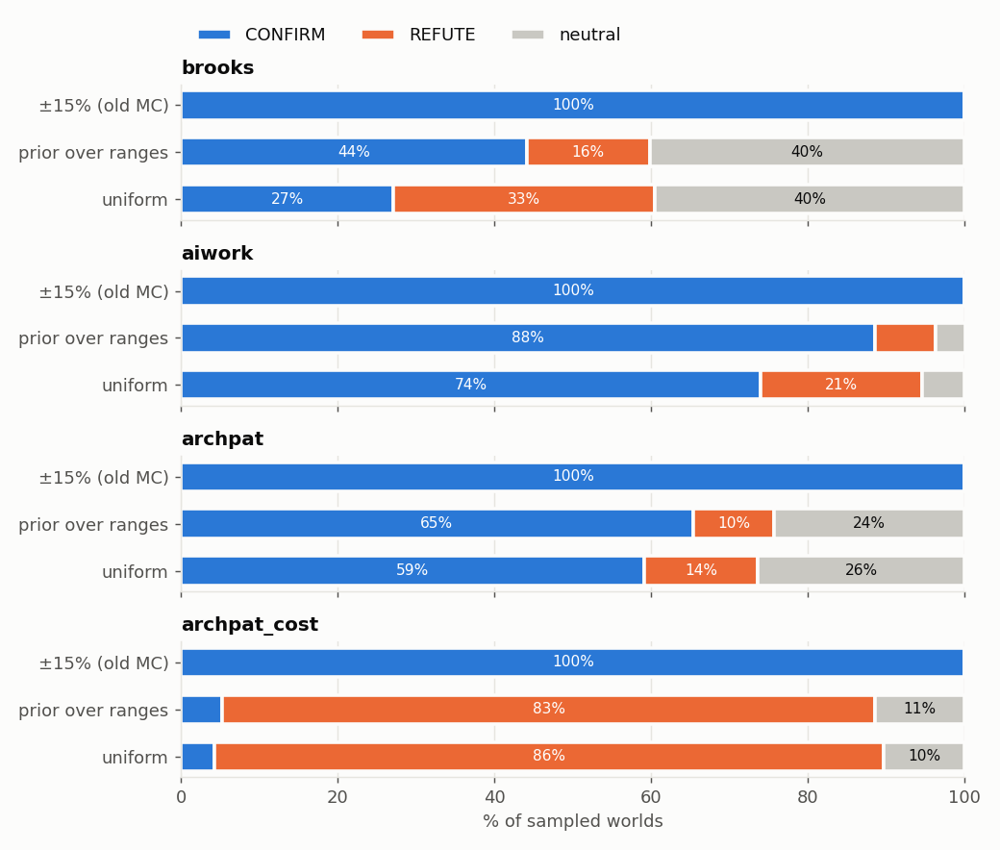

1. There are **4 panels**, one per law version:
   - `brooks`: the standard Brooks model;
   - `aiwork`;
   - `archpat`: design patterns;
   - `archpat_cost`: design patterns where migration costs effort.
2. Each panel has **3 bars**, one for each way of picking worlds (Lesson 6, Step 2):
   - top bar: ±15% (the old way);
   - middle bar: triangular over ranges;
   - bottom bar: uniform over ranges.
3. Each bar is split by colour into CONFIRM (blue), REFUTE (orange) and
   neutral (grey). The numbers are percentages and add to 100%.

**The numbers (% CONFIRM / REFUTE / neutral):**

| law | ±15% (old) | triangular | uniform |
|---|---|---|---|
| brooks (standard) | 100 / 0 / 0 | 44 / 16 / 40 | 27 / 33 / 40 |
| aiwork | 100 / 0 / 0 | 88 / 8 / 4 | 74 / 21 / 5 |
| archpat | 100 / 0 / 0 | 65 / 10 / 24 | 59 / 14 / 26 |
| archpat_cost | 100 / 0 / 0 | 5 / 83 / 11 | 4 / 86 / 10 |

**What it means:**
- With the old ±15% method, **every** law looks almost 100% true.
- With wider testing they separate:
  - **Brooks:** holds in 44% of believable worlds, the opposite in 16%, no
    difference in 40%. Under uniform sampling it is nearly a coin toss (27% vs 33%).
    The answer depends on the world, which is the point. (The earlier
    straight-line model was mostly grey, 88% no difference, because
    overloaded teams froze at zero output in both runs.)
  - **aiwork:** mostly holds (88%).
  - **archpat:** holds about 2 times in 3.
  - **archpat with a migration cost:** **flips**. It's now mostly orange: migrating hurts.

**Good or bad?** Bad for the old "100%" claims. Good as a discovery: the old
method could not tell a strong law from a fragile one, and the new one can.

### 7.2 What decides each law

#### How to read this graph

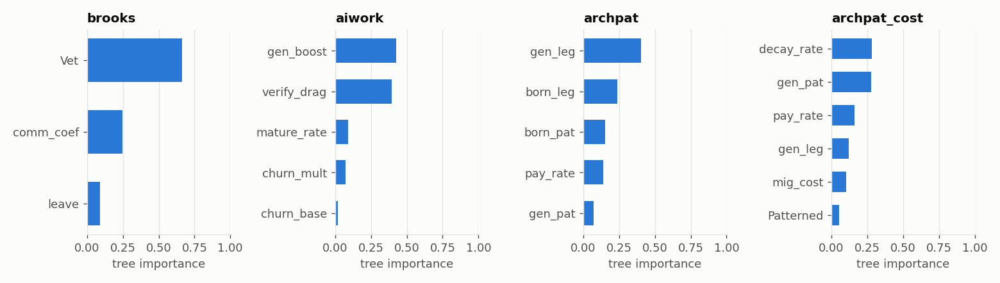

1. Four panels, one per law.
2. Each bar is a knob. The bar length (0 to 1) is how important that knob is for predicting the verdict.

| law | most important knobs |
|---|---|
| brooks | `Vet` (team size) **0.66**, `comm_coef` (talking cost) 0.25, `leave` (veterans leaving) 0.09 |
| aiwork | `gen_boost` (AI speed-up) **0.42**, `verify_drag` (time checking AI) **0.40**, `mature_rate` 0.09, `churn_mult` (AI code thrown away) 0.07 |
| archpat | `gen_leg` (speed in old code) **0.40**, `born_leg` (bugs in old code) 0.24, `born_pat` (bugs in pattern code) 0.15, `pay_rate` (debt repayment) 0.14 |
| archpat_cost | `decay_rate` (patterns decaying) 0.28, `gen_pat` (speed in pattern code) 0.28, `pay_rate` 0.16, `gen_leg` 0.12, `mig_cost` (migration cost) 0.10 |

**Plain meaning:** Brooks is decided by **team size** and **talking cost**, with veterans leaving a distant third. AI is decided by **speed
vs checking time**, not by how much AI code is thrown away. Design patterns
are decided by **how much better pattern code really is**, and by the migration cost once it's included.

### 7.3 Brooks (the standard model), all results

**Is the simulation built correctly?** Yes: **all 10 structure tests PASS.**
- Shrinking the time step 4× moves the result by only **1%**.
- "Unplug the cause" passes: switch off talking and training costs and hiring *helps* (+2). So the harm comes from the reasons Brooks gave.
- No verdict depends on clipping (0%).
- `deadline` is live, but only together with overtime (it says *when* a team counts as behind).

**Default world:** 10 hires make the project finish **11 ticks later** (finish
at tick 36 instead of 25). The earlier straight-line model said 88 ticks
later, because there overloaded teams froze at zero output.

**Tipping points for team size:**
- fewer than about **7.5** veterans: hiring 10 **helps**;
- from about 7.5 to about **47**: hiring **hurts** (Brooks holds);
- above ~47: the team is already so slowed by talking that the difference is under 5%.

**The sweet spot, in this model:** V\* solves **V(2V − 1) = 2/c**.
That's about 14 people at the default talking cost and **5.4 at Helix's** (Lesson 8).

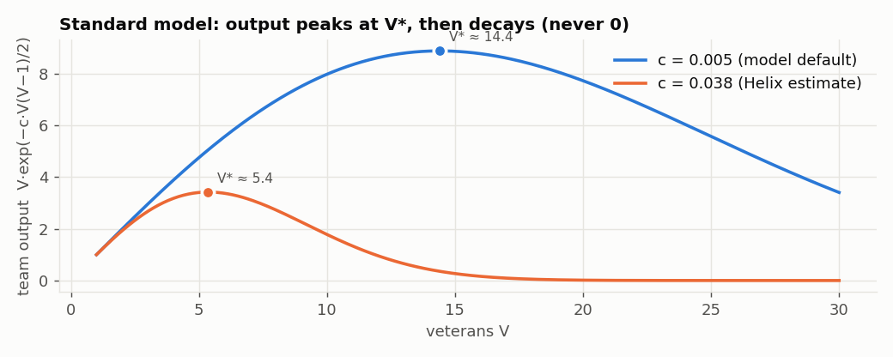

*How to read it:* horizontal axis = team size; vertical = team output. Blue
= default talking cost, orange = Helix's measured cost. Output rises to the
dot (the sweet spot), then decays, but never reaches zero.

**Scenarios and team structures:** every scenario is explained one by one in **Lesson 6c.5**, and every team structure in **6c.6**. Both include the 100,000-run results and the original model's answer.

**Plain meaning:**
- In a really late project, hiring makes it later in most worlds, but by much less than the old model said (11 ticks, not 88).
- Hiring many people at once (50) or into a hard-to-learn codebase does the most damage.
- Hiring onto a tiny team helps.
- Mentor pods and shared mentoring remove the damage at the default.

**Good or bad?** Good for Brooks' Law in the textbook setting, but it's a
*conditional* law: it depends on team size and talking cost. Lesson 8 tests that on real projects.

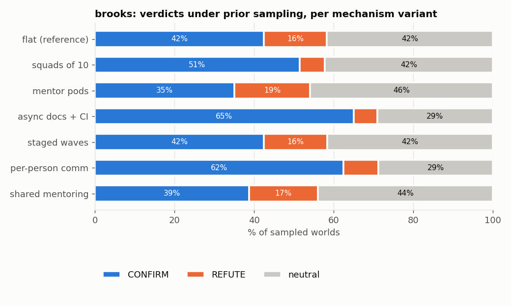

*How to read it:* one bar per structure, coloured CONFIRM/REFUTE/neutral
across random worlds (triangular sampling).

---

# Lesson 8: Results from real projects

### 8.1 The two projects

| project | what it is | why chosen |
|---|---|---|
| **Apache Helix** | a Java project for managing computer clusters; 4,948 commits since 2011 | long history, many developers coming and going; the project already had design-pattern data for it |
| **Aider** | an AI coding assistant; 13,138 commits | it **labels** commits written by AI ("(aider)" in the author name). This is very rare and lets us compare AI code with human code. |

We only **read** their histories. We never changed them.

### 8.2 Two statistics words you need

**Bootstrap.** We have, say, 151 months of data. Pick 151 months *at random
from them, allowing repeats*, and redo the calculation. Repeat 300 times. The
300 answers spread out a bit, and that spread shows how uncertain the result is.

**90% interval**, written like `0.023 [0.014, 0.032]`.
- First number: the best estimate.
- Brackets: the range that 90% of the bootstrap answers fell in.
- Read it as: "about 0.023, very likely somewhere between 0.014 and 0.032".

### 8.3 Brooks' Law on Helix

**What we did:**
1. Split Helix's history into months (1 month = 1 tick).
2. Each month, counted:
   - **veterans**: developers active for 6+ months;
   - **newcomers**: developers whose first commit was less than 6 months ago;
   - **work per veteran**: commits per veteran.
3. Found the talking cost and training cost that best explain why work per
   veteran goes up and down as the team changes. This is called **fitting**
   the model's own production equation to the data. We use the standard model's
   bounded formula, work = rate × e^(−(talking + training)), so the evidence
   and the model agree. (Re-fitted 2026-11-06; the earlier straight-line fit gave
   0.023 and 0.012.)
4. Bootstrapped 300 times for uncertainty.

#### How to read this graph

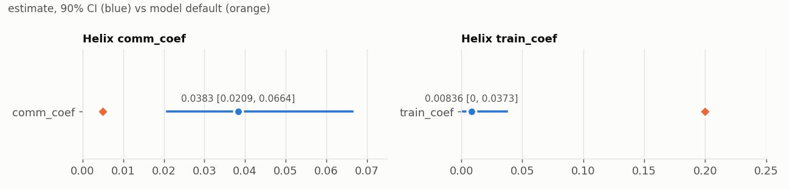

1. **Left panel:** talking cost per pair. **Right panel:** training cost per newcomer.
2. **Blue dot:** the best estimate from Helix. **Blue line:** the 90% interval.
3. **Orange diamond:** the value the simulation assumed by default.

| | Helix (measured) | model default | difference |
|---|---|---|---|
| talking cost | **0.038** [0.021, 0.066] | 0.005 | Helix is **7.7× higher** |
| training cost | **0.008** [0, 0.037] | 0.2 | Helix is **24× lower** |
| learning speed | newcomers who stayed were productive almost immediately | 10% per tick | much faster |
| team size | usually **3** veterans, at most 8 | 10 | smaller |

With talking cost 0.038, Helix's **sweet spot is about 5.4 people** (V(2V − 1) = 2/c; the orange line in the team-output graph in Lesson 7.3).

**Placement question:** *"If Helix's team were late, would doubling it make it later?"*

#### How to read this graph

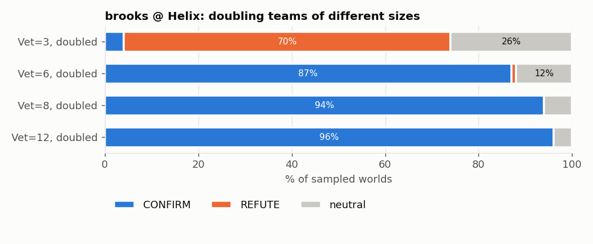

One bar per starting team size, each split into CONFIRM / REFUTE / neutral.

| Helix team, doubled | law holds (CONFIRM) | opposite (REFUTE) |
|---|---|---|
| 3 → 6 | 4% | **70%**: hiring **helps** |
| 6 → 12 | **87%** | 1% |
| 8 → 16 | **94%** | 0% |
| 12 → 24 | 96% (team is outside anything Helix has ever had, so don't trust this) | 0% |

**Plain meaning:** Helix's usual team of 3 is *below* its sweet spot of ~5.4.
Doubling it to 6 lands near the sweet spot, so it helps. A team of 6 or 8,
doubled, overshoots the sweet spot, so Brooks' Law holds.

**Aider:** basically one main developer plus occasional helpers. Placement:
**87% REFUTE** (hiring would help). Brooks' Law's conditions don't exist there.

**Good or bad?**
- Bad for "Brooks' Law always holds".
- Good for understanding it: we now know the **exact condition** and can test any team against it.

**Caveats to mention:**
- Commits are only a rough measure of work.
- Open-source projects don't have deadlines, so "late" is assumed, not observed.
- Only newcomers who stayed were counted.

---

# Lesson 9: The other two laws, from zero

## 9A. aiwork: "Does using AI mean you keep less code?"

### The background

- **GitClear (2024)** reported that since AI tools spread, more new code is
  thrown away or rewritten soon after being written. Code thrown away within a short time
  (here 14 days) is called **churn**.
- **METR (2025)** ran a study where experienced developers using AI were actually *slower*.
- **Peng et al. (2023)**, with GitHub Copilot, found developers were *55% faster*.

So the evidence points in different directions.

### The simulation, in plain words

Work flows through three buckets:

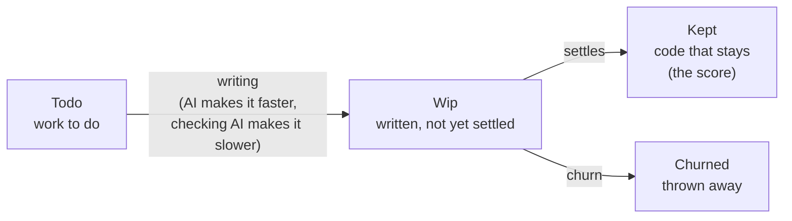

| knob | meaning | default |
|---|---|---|
| `ai` | how much AI is used: 0 = none, 1 = full (**the lever**) | 0 vs 1 |
| `gen_boost` | how much faster AI writes code | +30% |
| `verify_drag` | share of time spent checking AI output | 40% |
| `churn_mult` | extra churn caused by AI (2.0 means 3× the normal churn) | 2.0 |
| `churn_base` | normal churn rate without AI | 5% per tick |
| `mature_rate` | how fast written code settles into "kept" | 20% per tick |

The law says: full AI → **less kept code** (so CONFIRM = AI hurt).

### Simulation results

**Is the simulation built correctly?**
- "Unplug the cause" **passes**: switch off churn and checking time, and AI *helps* (+38). So the harm really comes from those two things.
- Clamp test **FAILS**: in one tick, more code can leave the "Wip" bucket than is in it.
  That's impossible, and 24% of "law holds" results depend on it. This is a real bug in the model.

**What decides it:** checking a simple formula. AI helps when:

> (1 + speed-up) × (1 − checking time) > 1 + (extra churn effect)

With the defaults: 1.3 × 0.6 = **0.78**, which is less than **1.40**. So by default AI hurts, mainly because
**checking eats more time than AI saves** (net speed 0.78, i.e. 22%
*slower*), with churn only a secondary reason.

**Business scenarios:**

| scenario | result |
|---|---|
| vibe coding (accept AI output with little checking) | AI **helps** (+50) |
| boilerplate (simple repetitive code, AI very fast) | AI **helps** (+94) |
| Copilot-study-like (+55% speed) | AI **helps** (+18) |
| strict review gate (slow checking) | AI **hurts** (−57) |
| experts in a big familiar codebase (METR-like) | AI **hurts** (−73) |
| half adoption | AI hurts (−26) |
| short sprint | AI hurts (−5) |
| slow review pipeline | AI hurts (−27) |

**Rival mechanisms:** results barely change, except "the team gets better at
using AI over time" (checking time shrinks), which lowers "AI hurts" from 88% to 69% of worlds.

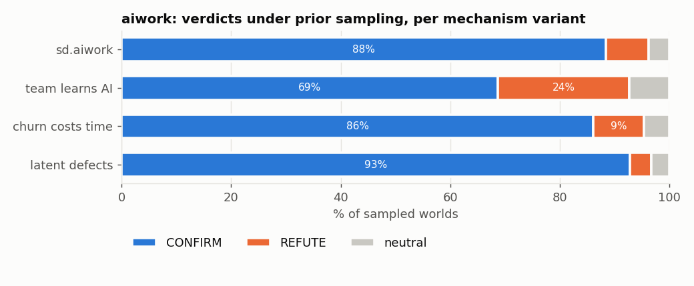

### Real-world test: Aider

**The design:**
- Only commits by **the same person** (Aider's main author), in **the same months**, to the same part of the code.
- Some of those commits were written by AI (labelled), others by hand.
- Comparing the same person in the same period removes differences in skill and timing.

**The measurement:**
- For a sample of changes, use **git blame** (a git command that shows, for each
  line, which commit last wrote it) **14 days later** to see how many of the added lines survive.
- Group changes by size (3–20 lines, 21–80 lines) so small and big changes are compared fairly.
- Drop groups with fewer than 15 examples on either side.
- Bootstrap 800 times.

Two periods were measured: **2024–25** (newer AI models such as Claude and GPT-4o) and
**2023–24** (GPT-4 era).

#### How to read this graph

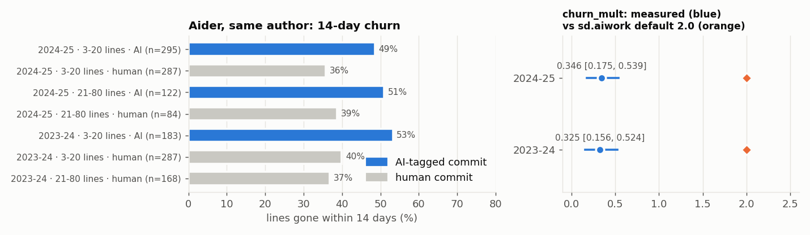

**Left panel:**
1. Each row is one group: period · change size · AI or human (n = number of examples).
2. Bar length = % of added lines gone within 14 days.
3. **Blue** = AI-written. **Grey** = human-written.

**Right panel:**
1. Each row is a period.
2. **Blue dot and line:** the measured extra churn from AI (`churn_mult`) with its 90% interval.
3. **Orange diamond:** the model's assumption (2.0).

| period | AI lines gone | human lines gone | extra churn from AI (`churn_mult`) |
|---|---|---|---|
| 2024–25 | 49.7% | 37.2% | **0.35** [0.18, 0.54] |
| 2023–24 | 53.2% | 39.9% | **0.32** [0.16, 0.52] |
| model assumed | | | 2.0 |

**Plain meaning:** AI code **is** thrown away more, about **1.33×** as much as
human code. That's the same in both AI generations, and about **6× less** extra churn than the model assumed.

**Placement for Aider:**

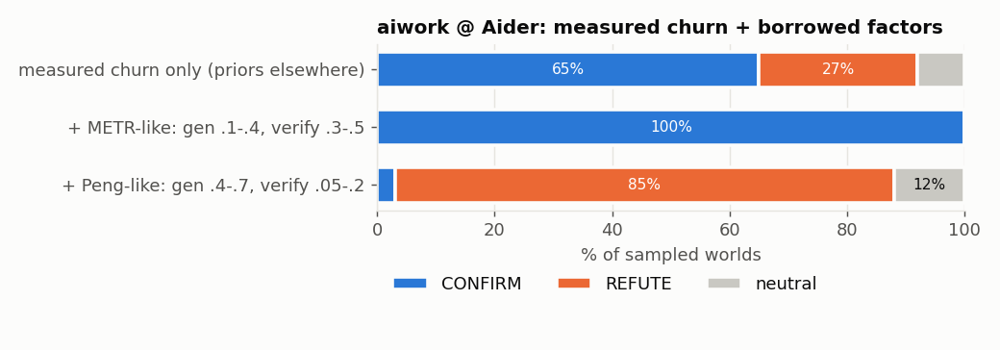

| what we plugged in | AI hurts (CONFIRM) | AI helps (REFUTE) |
|---|---|---|
| only the measured churn; everything else random | 65% | 27% |
| + speed and checking numbers borrowed from METR | **100%** | 0% |
| + speed and checking numbers borrowed from the Copilot study | 3% | **85%** |

**What to measure next (value of information):**
- **checking time** (gain 0.34): if it's in its lowest quarter, there's a 20% chance AI hurts; in the highest quarter, 100%;
- then **speed-up** (gain 0.15).

Git history doesn't record either one.

**Good or bad?**
- **Good:** this is the first real measurement of AI churn with the same author and period, and it's stable.
- **Bad:** we can't say whether AI helps Aider overall, because the deciding numbers (speed and checking) aren't in git.
  Borrowing them from other studies flips the answer completely.
- **Also:** we found no other public project that labels AI code. That rarity is itself a finding.

**Caveats:**
- The author chose which tasks to give the AI.
- Some "human" commits might secretly have used AI, which would shrink the measured difference.

## 9B. archpat: "Does moving code into design patterns repair a messy project?"

### The background

A **design pattern** is a standard, well-known way to structure a piece of code,
for example "Observer" (notify listeners when something changes) or "Factory"
(one place that creates objects). There are 23 classic ones (the "Gang of Four" patterns).
Many people believe that rewriting messy code ("legacy code") to use
patterns makes a project healthier. Moving code into patterns is called **migration**.

### The simulation, in plain words

| bucket | meaning | start |
|---|---|---|
| `Patterned` | code modules using patterns | 10 |
| `Legacy` | messy old modules | 90 |
| `Drift` | pattern modules that slowly decayed | 0 |
| `Debt` | **technical debt**: accumulated shortcuts and mess that slow everyone down | 40 |
| `Feat` | features delivered | 0 |

| knob | meaning | default |
|---|---|---|
| `migrate` | how aggressively legacy is moved to patterns (**the lever**) | 0.2 (slow) vs 1.5 (aggressive) |
| `gen_pat` / `gen_leg` | features per module per tick, pattern vs legacy | 1.0 vs 0.4 (patterns **2.5× faster**) |
| `born_pat` / `born_leg` | new debt per feature, pattern vs legacy | 0.05 vs 0.20 (patterns **4× cleaner**, i.e. 0.25×) |
| `decay_rate` | how fast pattern modules decay | 5% per tick |
| `pay_rate` | how fast debt is paid off | 15% per tick |
| `pat_strength` | "how strong patterns are" | 4 |

**Score:** features delivered minus average debt. The law says aggressive
migration → a **higher** score (so here CONFIRM = migration helped).

### Simulation results: three hidden faults

1. **A dead knob.** `pat_strength` is never used in the rules. The new
   "dead knobs" test caught it (FAIL).
2. **A hidden bonus.** "Unplug the cause" **FAILS**: make pattern code exactly as fast and as clean as
   legacy, and migration *still* helps (+27). Why? The rule for paying off debt has a fixed
   built-in bonus for patterns ("pay × (1 + 0.5 × share of pattern code)").
   The conclusion is partly built in.
3. **Free migration.** The model computes how much effort the team has
   (`available`) and then never uses it. Moving 90 modules into patterns costs **zero work**.

All 8 business scenarios said "migration helps", even "patterns are
over-engineered" and "patterns are no safer". That's another sign the answer was built in.

**Rival mechanisms: what if migration isn't free?**

#### How to read this graph

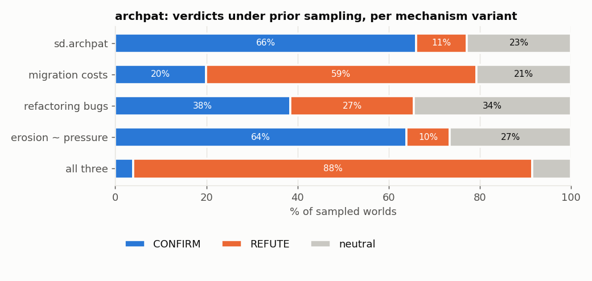

One bar per version of the rules, split into CONFIRM (blue, migration helps) / REFUTE
(orange, migration hurts) / neutral (grey), across random worlds.

| version of the rules | migration helps | migration hurts |
|---|---|---|
| original (free migration) | 66% | 11% |
| migrating costs 4 feature-items of work per module | 20% | **59%** |
| refactoring adds bugs (a finding by Bavota et al. 2012) | 38% | 27% |
| patterns decay faster under deadline pressure | 64% | 10% |
| all three together | **4%** | **88%** |

**Plain meaning:** the law flips once migration has a realistic cost.

### Real-world test: Helix

**What we did:**
1. Took 674 Java code files in Helix. A tool called **pattern4** (which detects
   design patterns in compiled Java) had already marked **149** of them as using patterns.
2. For each file, counted from git:
   - its size;
   - how often it was changed;
   - **bug-fix commits** (commits whose message says "fix", "bug" and so on);
   - **bug-introducing commits**, found with **SZZ**, a standard method that traces each bug fix back to the commit that caused the bug.
3. Compared pattern files with other files using a **negative-binomial regression**.
   That's a statistics method for counting things like bugs per file; it adjusts for
   file size and how often each file changes, so big busy files don't distort the comparison.
4. Bootstrapped 300 times.

We compare with "other" files rather than "legacy" files because legacy was
*defined* by having many bugs. Comparing bugs against it would be circular.

**A "rate ratio" of 0.83** means: pattern files get 83 bug fixes for every 100 that a comparable other file gets.

#### How to read this graph

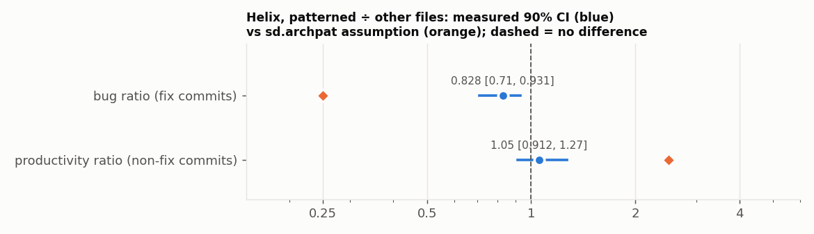

1. Two rows: bug ratio and productivity ratio.
2. The **horizontal axis** is a ratio. The dashed line at 1 means "no difference". Left of 1 = pattern files have less; right of 1 = more.
   The axis is stretched so that 0.5 and 2 are equally far from 1 (a "log scale").
3. **Blue dot and line:** measured in Helix, with its 90% interval.
4. **Orange diamond:** what the model assumed.

| measure | Helix measured | model assumed |
|---|---|---|
| bug fixes, pattern ÷ other | **0.83** [0.71, 0.93] | 0.25 |
| bugs introduced (SZZ), pattern ÷ other | **0.68** [0.54, 0.86] | 0.25 |
| productivity (non-fix commits), pattern ÷ other | **1.05** [0.91, 1.27] | 2.5 |

**Plain meaning:** pattern files have **somewhat fewer bugs** (17–32% fewer,
not 75% fewer) and are **no more productive** (the interval includes 1).

**Which assumption actually decides the Helix answer?**

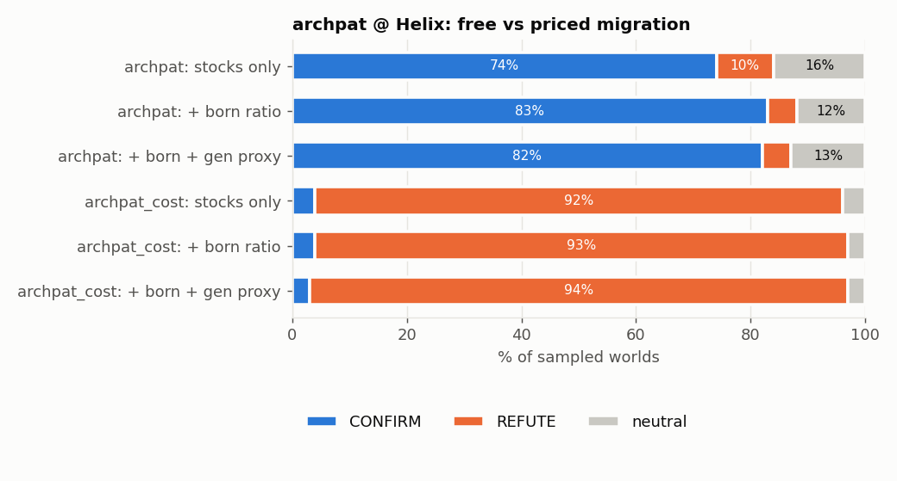

| version | what we plugged in | migration helps | migration hurts |
|---|---|---|---|
| free migration | Helix's bucket sizes only | 74% | 10% |
| free migration | + measured bug ratio | 83% | 5% |
| free migration | + bug and productivity ratios | 82% | 5% |
| migration costs effort | Helix's bucket sizes only | 4% | 92% |
| migration costs effort | + measured bug ratio | 4% | 93% |
| migration costs effort | + bug and productivity ratios | 3% | **94%** |

**Plain meaning:** the measured ratios barely change the answer. **Whether migration
costs effort decides everything.**

**Break-even: how cheap must migration be?**

#### How to read this graph

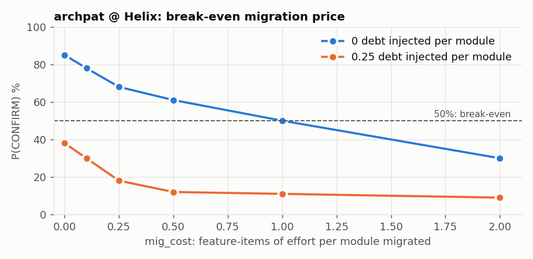

1. **Horizontal axis:** cost of migrating one module, in units of "one feature's worth of work".
2. **Vertical axis:** % chance that migration helps Helix.
3. **Blue line:** migration causes no new bugs. **Orange line:** each migrated module adds 0.25 units of debt.
4. **Dashed line at 50%:** the break-even point.

| cost per module | 0 | 0.1 | 0.25 | 0.5 | 1 | 2 |
|---|---|---|---|---|---|---|
| helps %, no new bugs | 85 | 78 | 68 | 61 | **50** | 30 |
| helps %, with new bugs | 38 | 30 | 18 | 12 | 11 | 9 |

**Plain meaning:** migrating to patterns is only worth it if moving a module
costs less than about **one feature's worth of work**. If migration also adds
bugs, the cost has to be **almost zero** (about 0.1, and even free migration only reaches 38%).

**Good or bad?**
- **Bad** for the law as stated, which depended on a free migration and a hidden bonus.
- **Good** because we know exactly what to measure: the real migration cost. That can be done with existing tools
  (**RefactoringMiner**, which detects code restructurings, plus SZZ).

**Caveats:**
- This compares files at one point in time, which is not the same as watching migration happen.
- 74% of Helix files fit none of the model's three buckets.

---

### 8.4 All real-project results on one graph

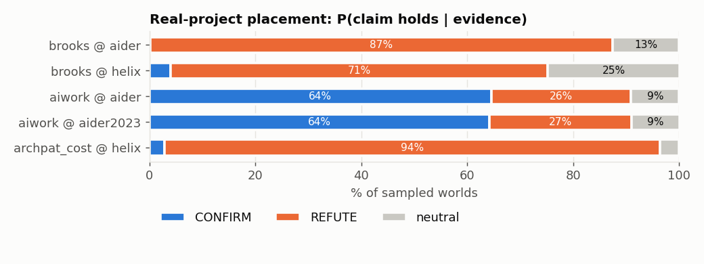

*How to read it:* each bar is one law tested on one project (`law @ project`).
Blue = the law holds there, orange = the opposite, grey = no difference.

| law @ project | law holds | opposite | plain meaning |
|---|---|---|---|
| Brooks @ Helix (team of 3, doubled) | 4% | 71% | hiring would help Helix's usual team |
| Brooks @ Aider | 0% | 87% | one-person project: Brooks doesn't apply |
| AI @ Aider (2024–25 data) | 64.5% | 26.4% | AI probably hurts kept code, but this hinges on unmeasured numbers |
| AI @ Aider (2023–24 data) | 64.2% | 26.8% | same as above |
| Patterns (with cost) @ Helix | 2.9% | 93.5% | migration would hurt unless it's nearly free |

---

# Lesson 10: Nancy Cartwright's ideas

### Who she is

Nancy Cartwright is a philosopher of science. In *Evidence-Based Policy* (2012,
with Jeremy Hardie) she asks: *when can evidence that something worked
somewhere tell you it will work for you?* Your supervisors asked for her way of
thinking to guide this work.

### Her ideas and where they show up here

**1. "It worked there" is not "it will work here".**
A study shows an effect in its own setting. That doesn't mean it carries over to yours.
→ *Here:* Brooks' Law holds in the textbook simulation but not for Helix's usual small team.
That's why Step 6 (placement) asks about a **named** project.

**2. Laws only work when their conditions are in place.**
She calls a law a **capacity**: a tendency that only shows up in the right setup
(she calls that setup a "nomological machine"). Like a recipe, it needs all its ingredients.
→ *Here:* Brooks needs a late project + a team pushed past its sweet spot + real training cost.
The tipping points and the decision tree (Step 3) **find** these conditions.

**3. Support factors (the "causal cake").**
The cause is just one slice of a cake. Other slices (support factors) must be
there too. This idea goes back to J. L. Mackie (1965), who called such a cause an "INUS condition".
→ *Here:* the "unplug the cause" test checks that the slices the model *says* matter are the ones doing the work.
Design patterns failed: a hidden slice (the built-in bonus) was doing it.

**4. Vertical search: describe the cause at a level that travels.**
→ *Here:*
- "adding people" → "adding communication load past the team's sweet spot";
- "using AI" → "trading checking time for writing speed";
- "migrating to patterns" → "paying a cost now for fewer bugs later".

These descriptions carry over to new projects better than the originals.

**5. Horizontal search: list everything else that has to be in place.**
→ *Here:* the business scenarios, rival mechanisms and "measure next" ranking.

**6. Evidence is a long chain, and every link must hold.**
→ *Here:* data → measurement → number → simulation → verdict. Each real-data
result lists its weak links (the caveats). The sensitivity tables show which link carries the most weight.
For design patterns it's the **unmeasured** migration cost.

**7. Borrowing numbers needs a reason.**
Using another study's numbers assumes your situation is like theirs.
→ *Here:* borrowing METR's or the Copilot study's numbers flips the AI answer from 100% to 3%.

**8. A rigorous study doesn't automatically carry over.**
→ *Here:* the Aider comparison (same person, same months) is very careful, but it still says nothing about teams that review each other's code.

### What changes in practice

Instead of saying "**the law is CONFIRMED**", we say:

> "The law works **when [condition] holds**. Project P meets that condition with
> probability **p**. The deciding unknown is **F**."

Example: "Brooks' Law works when the team is pushed past its sweet spot.
Helix's usual team of 3 isn't (about 70% chance hiring helps). The deciding unknown is whether Helix is actually late."

---

# Lesson 11: The final outcome

### 11.1 What we found, as short answers

| question | answer |
|---|---|
| Is Brooks' Law true? | **Only when** the project is really late **and** hiring pushes the team past its sweet spot. Helix's sweet spot is ~5.4 people; its usual team is 3. In the standard model it holds in 44% of believable worlds, and the delay is modest (11 ticks at the default). |
| Does AI make you keep less code? | AI code is thrown away **1.33×** more (measured), not 3× (assumed). Whether AI helps overall depends on **speed vs checking time**, which nobody has measured in git. |
| Do design patterns repair messy code? | Pattern files have **17–32% fewer bugs** and are **no faster**. Migration only pays off if it's **nearly free**, and nobody has measured its cost. |
| Did 100,000 runs prove anything? | Only that the answer is stable **near the defaults**. Over all believable settings, the original Brooks model held in ~10% of worlds and the standard model in 44%; neither is 100%. |
| Were the original tests good enough? | No. They gave a perfect score to a model with three hidden faults. |

### 11.2 Good news and bad news

| | good news | bad news |
|---|---|---|
| **For your Part B claims** | the core survives: in a truly late project, hiring hurts, and good structures cut the damage 8–40× | "100% inviolable" and "structures beat Brooks" do **not** survive; 8 problems found |
| **For the three laws** | each now has a precise condition for when it holds | none is a universal truth; real data contradicted most default assumptions |
| **For the simulations** | the new tests found 7 model faults that can now be fixed | the project's original models have real bugs (archpat ×3, aiwork overflow, Brooks clamp/late/wall) |
| **For the research paper** | this is exactly the paper's theme, "what to measure next", with concrete answers for each law | only two real projects were used; the toolkit is in Python, not yet in the kaiaulu R format the team wants |

**Overall verdict: the research is a success.** That's not because it proved the laws
true. It's because it showed **when** they hold, **what decides them**, and
**exactly what to measure next**. Finding that earlier claims were overconfident, and
showing why, is a strong result in itself.

### 11.3 The one big lesson: "price the lever first"

All three laws come down to the **cost of the action**:

| law | the action | its hidden cost |
|---|---|---|
| Brooks | hiring | communication and training |
| AI | using AI | time spent checking AI output |
| design patterns | migrating code | effort and bugs of migration |

In every case, the original simulation **got that cost wrong or left it out**,
and git history records it **worst**. So, for any future law, ask first:
1. What does doing this cost?
2. Is that cost in the simulation? (If not, the law's answer is built in, as with patterns.)
3. Is it in any data? (If not, the law can't be decided yet, as with AI.)

### 11.4 The strategy for testing any law (goal 1)

Do these in order, from cheapest to most expensive. If a step fails, stop and fix it before going on.

1. **Write the law down precisely.** Is the score what the law actually talks about?
   Is the "if" part true in the default setup? (Brooks: "late"? It wasn't.)
2. **Check the simulation** with the 10 tests.
3. **Test in three ranges of worlds.** Never report one number.
4. **Find what decides it**: tipping points, decision tree, and a formula if possible.
5. **Try rival rules**, especially for the cost of the action.
6. **Place real projects**: at least two that differ in the deciding factor.
7. **Rank what to measure next**, naming the tool and the data field.

Which test families actually changed a conclusion in this study:

| test family | changed a conclusion? |
|---|---|
| simulation-correctness tests (Forrester + metamorphic) | **yes**: 7 faults found |
| 100,000 runs at ±15% | **no**: always said 100% |
| testing over full ranges | **yes**: Brooks 100% → ~10% |
| tipping points + decision tree | **yes**: turned "true/false" into "true when…" |
| business scenarios | partly: revealed the project wasn't late |
| rival rules | **yes**: design patterns flipped |
| real projects | **yes**: Helix flipped Brooks and patterns |
| what to measure next | **yes**: always pointed to the cost nobody measures |

### 11.5 The reusable framework for future laws (goal 2)

That's **lawkit**. Adding a new law = writing one short description in
`lawkit/laws.py`, then running `python run_laws.py <law>`. As a test, we ran it
untouched on another law in the project (`debt`). It immediately found a hidden
built-in effect and a claim that could never fail, the same kinds of faults as design patterns.

Each run leaves reusable knowledge:
1. **A list of common simulation faults** to check automatically:
   - dead knobs;
   - hidden built-in effects;
   - answers made by clamps;
   - buckets that drain more than they hold;
   - a score that isn't what the law talks about;
   - an "if" condition that's false by default.
2. **Thresholds that carry over** between projects: the sweet spot V\*, the AI speed-vs-checking formula, the migration break-even cost.
3. **A to-measure list.**

### 11.6 What to do next

| law | missing number | how to measure it |
|---|---|---|
| design patterns | real migration cost and bugs | RefactoringMiner + SZZ on Helix and Ambari |
| AI | checking time | review times and review comments on AI vs human pull requests |
| Brooks | whether projects are actually late | release due dates in the JIRA issue tracker |

Also still to do:
- Rewrite the miners in the R format the team uses (kaiaulu `.Rmd` + `.R`).
- Fix the model faults in `paper/sd.py`.
- Commit the work to git (nothing from Parts B and C is committed yet).

---

# Lesson 12: Glossary

| word | meaning |
|---|---|
| **antecedent** | the "if" part of a law ("if the project is late") |
| **arms** | the two settings of the lever being compared (e.g. 0 and 10 hires) |
| **bootstrap** | redo a calculation many times on randomly re-picked data to see how uncertain it is |
| **bug-fix commit** | a commit whose message says it fixes a bug |
| **churn** | code thrown away or rewritten soon after being written (here, within 14 days) |
| **clamp** | a "never below zero" (or "never above max") rule in the simulation |
| **commit** | one saved change to the code, recorded by git |
| **CONFIRM / REFUTE / neutral** | the law's prediction came true / the opposite happened / less than 5% difference |
| **decision tree** | a computer-learned flowchart of yes/no questions that predicts the verdict |
| **design pattern** | a standard, well-known way of structuring code |
| **dead knob** | a setting that has no effect on the result |
| **evidence card** | the report lawkit writes for each law |
| **Forrester & Senge tests** | classic checks (1980) that a system-dynamics simulation is built sensibly |
| **gap** | score with the lever on − score with it off |
| **git / git blame** | the tool recording code history / the command showing which commit last wrote each line |
| **importance** | how much a knob matters for the verdict (0–1) |
| **knock-out ("unplug the cause")** | switch off the law's stated reasons; the effect should disappear |
| **lawkit** | the testing toolkit built in Part C |
| **lever** | the action the law is about (hiring, using AI, migrating) |
| **median** | middle value when sorted |
| **metamorphic test** | checks how the answer should *change* when the input changes, without knowing the answer itself |
| **miner** | a program that reads git history and measures things |
| **Monte Carlo** | running a simulation many times with random settings |
| **negative-binomial regression** | a statistics method for counts (like bugs per file) that adjusts for other factors |
| **pattern4** | a tool that finds design patterns in compiled Java code |
| **placement** | the chance a law holds for one specific real project |
| **precision vs robustness** | how sure you are in one situation vs whether the answer holds across many situations |
| **range** | the lowest and highest believable value of a knob |
| **rate ratio** | how many events one group has per event in the other (0.83 = 17% fewer) |
| **refutability** | whether any believable world could make the law fail |
| **RefactoringMiner** | a tool that detects code restructurings in git history |
| **rival mechanism / variant** | the same situation with different rules |
| **scenario** | the same rules with a different starting situation |
| **simulation** | a program that imitates a real situation step by step |
| **stock / flow** | a bucket that fills or drains / the rate of filling or draining |
| **support factor** | a condition that must be present for the law to show up |
| **SZZ** | a method that traces a bug fix back to the commit that caused the bug |
| **System Dynamics (SD)** | the stocks-and-flows way of building simulations |
| **technical debt** | accumulated shortcuts and mess that slow future work |
| **tick** | one time step of the simulation |
| **tipping point** | the value of a knob where the verdict flips |
| **triangular / uniform sampling** | picking random values favouring the default / with all values equally likely |
| **V\* (sweet spot)** | team size where a team's total output peaks; 3V² − 2V = 2 ÷ talking cost |
| **value of information (VOI)** | how much measuring a knob would reduce uncertainty about the verdict |
| **90% interval** | the range the true value very likely falls in |
