# Testing Software-Engineering Laws: the simple version

> **Note (2026-11-06):** these notes predate the single standard Brooks model. Brooks numbers here come from the earlier models (archived in `outputs/archive/2026-11-06_before_standard_brooks/`). For current results see `learn_from_zero.md` and `outputs/laws/brooks_card.md`.

*The easy-to-read version of my work. The full version with every number
is in [notes_detailed.md](notes_detailed.md). The graphs below are in
`site/img/`; if they don't show, run `python -B research_docs/build.py` once.*

---

## The big idea in three sentences

1. People in software engineering repeat "laws" like *"adding people to a
   late project makes it later"* as if they're always true.
2. I built small computer simulations of three such laws, tested whether
   the simulations were trustworthy, and then checked them against real
   project data from GitHub.
3. **Finding: none of the laws is always true. Each one is true only in
   certain situations, and real data shows many real projects are
   outside those situations.**

---

## ⭐ The results first

| law | what people believe | what we found | in one line |
|---|---|---|---|
| **Brooks' Law** | Adding people to a late project makes it later. | True only when the team is already **bigger than its "sweet spot"**. In Apache Helix the sweet spot is about **6 people**. | Doubling a team of 3 **helped** (80% of cases); doubling a team of 6–8 **hurt** (81–89%). |
| **AI work** | Using AI makes you keep less code, because AI code gets thrown away. | AI-written code *is* thrown away more, but only **1.33×** as much, not the **3×** the model assumed. What really decides it is **how fast AI writes code vs how long you spend checking it**. | Whether AI helps depends on your review process, and git history can't tell us that. |
| **Design patterns** | Moving code into design patterns fixes a messy project. | Pattern files in Helix have only **slightly fewer bugs** (about 17–32% fewer, not 75%) and are **no faster to work with**. The original model assumed migrating code is **free**. | If migration is free: 82% "it helps". If migration has a realistic cost: **94% "it hurts"**. |

**And about the testing itself:**

- Running a simulation **100,000 times** made every law look "100%
  confirmed". But that only tested settings very close to the defaults.
  Over the full range of believable settings, Brooks' Law held in
  only **~10%** of cases.
- The project's original 8 tests **passed** the design-pattern model,
  even though it had 3 serious bugs. My new tests caught all 3.

---

## Part 1: The three laws, explained simply

### What's a "simulation" here?

Imagine a set of **buckets and pipes**:

- Buckets hold things: *number of experienced developers, number of new
  developers, work done, work left*.
- Pipes move things between buckets each "tick" (one tick is roughly a week or month):
  *new people slowly become experienced; work flows from "left" to
  "done"*.

To test a law, we run the simulation **twice**: once **without** the
action (no hiring, no AI, no migration) and once **with** it. Then we compare the
final score.

- Score goes the way the law predicts → **CONFIRM** (blue in graphs)
- Score goes the opposite way → **REFUTE** (orange in graphs)
- Barely any difference (less than 5%) → **neutral** (grey in graphs)

### Brooks' Law in one picture

In the simulation, every pair of people on a team needs to talk. Team
of 3 → 3 conversations. Team of 10 → 45. Team of 20 → 190. Talking eats
working time. New people also take time away from experienced people
who have to train them.

So a team's output **rises, peaks, then falls** as it grows:

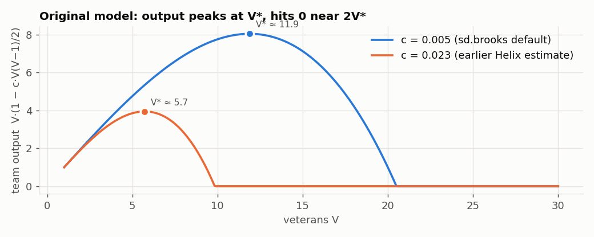

> **How to read it:** the blue line uses the textbook setting; its sweet
> spot is about 12 people. The orange line uses what we **measured in
> Apache Helix**: talking costs more there, so the sweet spot is about
> **6 people**. Past roughly twice the sweet spot, the team produces
> nothing.
>
> **Simple outcome:** Brooks' Law is really saying *"adding people
> hurts if it pushes the team past its sweet spot"*. Below the sweet
> spot, adding people helps.

---

## Part 2: My first Brooks' Law work (and what was wrong with it)

### What I did

- Built **14 "what-if" scenarios**: hire early, hire late, hire 50
  people, tiny team, remote team, and so on.
- Ran each **100,000 times** with small random changes.
- Ran the **Forrester & Senge tests**: classic checks that a simulation
  behaves sensibly (no negative people, no nonsense at extreme values,
  and so on).
- Designed **5 smarter team structures** (squads, mentor pods, async
  docs, hiring in waves, a combination of all of these).

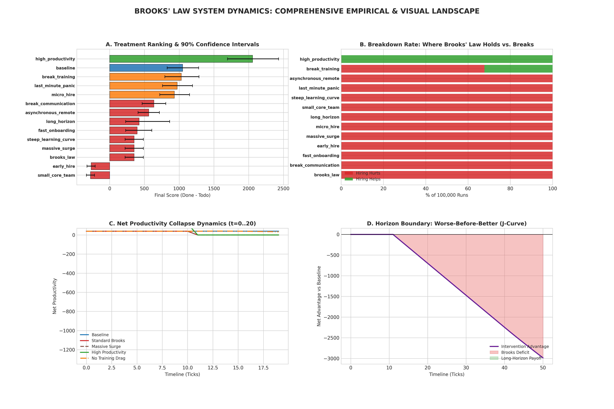

Original conclusion: *"Brooks' Law held in 100% of runs; smarter team
structures beat it."*

### What I found when I tested my own tests

| # | problem | in simple words |
|---|---|---|
| 1 | Unfair comparison | I compared "squads + hiring" against "**old-style team**, no hiring". Squads are just a better team shape. Compared fairly (squads + hiring vs squads without hiring), hiring **still hurt in 5 of 6** structures. |
| 2 | Fake work | The score kept counting "work done" after all the work was finished. |
| 3 | Everything hit zero | Hiring just 5 people made the old team produce **nothing**, so 5, 10 and 50 hires all gave the same result. The "100%" came from this, not from the law. |
| 4 | Too-narrow testing | The random changes were only ±15%, so 100,000 runs tested almost the same situation 100,000 times. |
| 5 | Tests that can't fail | Some tests said PASS even when they found nothing. |
| 6 | Report text written by hand | The text contradicted the table next to it. |
| 7 | Project wasn't late | The default team finished early, so it wasn't a "late project" at all. |
| 8 | Teams over 20 people produce nothing | That's clearly not true of real projects. |

**Problem 1, in a picture:**

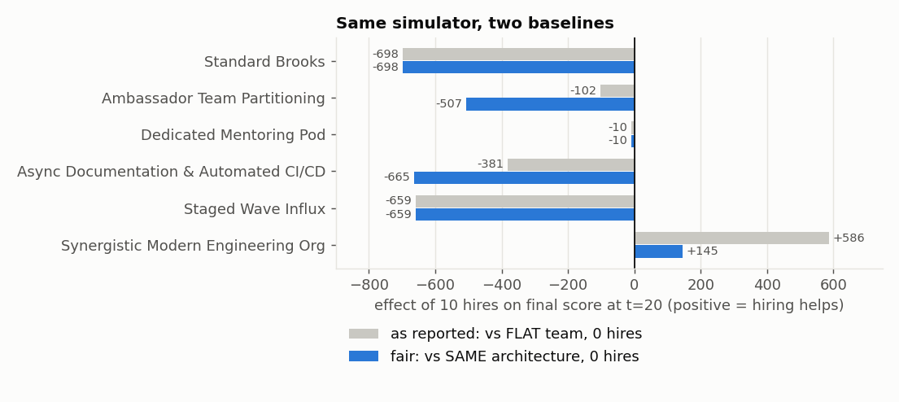

> Grey bars = how I reported it. Blue bars = the fair comparison.
> Most blue bars are well below zero: **hiring still hurts inside
> each structure**. Only the combined structure gains (+145).

**Problem 3, in a picture:**

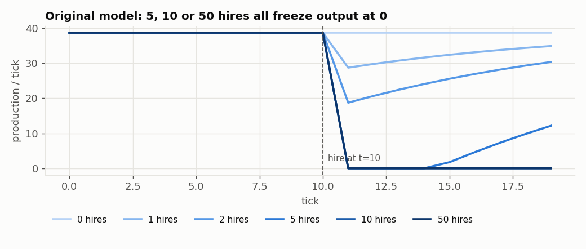

> 5, 10 or 50 hires all drop output to zero at tick 10. The "law" was
> really a math floor ("never below zero") being hit.

**What survived:** in a project that is *really* late, adding people
does make it finish later. Smarter structures cut the damage a lot
(8–40× less), but don't remove it.

---

## Part 3: How I tested the laws (the method, simply)

I built a reusable toolkit called **lawkit** that runs the same tests on any law:

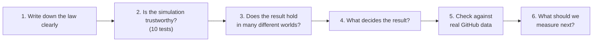

### Test type 1: Is the simulation trustworthy? (10 tests)

Like checking a calculator before trusting its answer.

| test | the question in simple words |
|---|---|
| Units | Does every number have a unit (people, hours, tasks)? |
| **Dead knobs** | Does every setting actually change anything? |
| Extremes | Does it crash or give nonsense at very high or very low values? |
| Floor hits | Is the answer only produced by "can't go below zero" rules? |
| Time step | Do smaller time steps give the same answer? |
| Longer run | Is the answer the same if we simulate for longer? |
| More = more | Does pulling the lever harder push the result steadily one way? |
| **Unplug the cause** | If we switch off the reason the law gives, does the effect go away? (It should.) |
| **Can it ever be wrong?** | Is there *any* believable world where the law fails? (If never, it's not really being tested.) |
| Double everything | Doubling all the buckets shouldn't flip the answer. |

The bold ones are new. They caught the design-pattern model's three
hidden bugs: a setting that did nothing, a built-in bonus for patterns,
and migration costing zero effort.

### Test type 2: Does it hold in many different worlds?

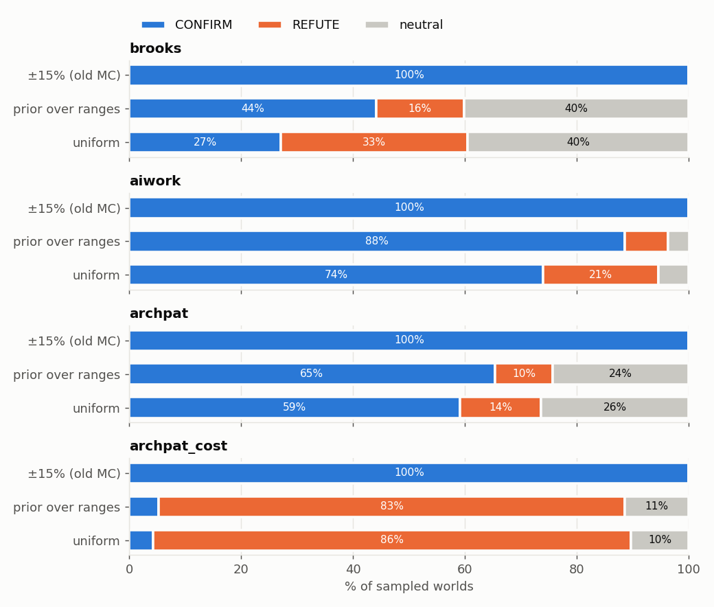

> **How to read it:** each panel is one law, and each bar is a different way of
> choosing random settings.
> - Top bar (the old way, ±15%): almost all blue, "always true".
> - Bottom two bars (the full range of believable settings): Brooks is
>   almost all grey (no clear effect), AI work stays mostly blue,
>   design patterns are mixed, and patterns-with-a-realistic-cost
>   turn orange (the law is wrong).
>
> **Simple outcome:** testing the same situation many times is not
> the same as testing many situations.

### Test type 3: What decides the result?

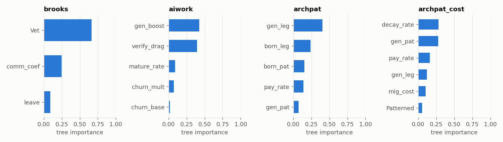

> - Brooks: **team size** decides almost everything.
> - AI work: **how fast AI writes** vs **how long checking takes**.
>   AI throwing away code barely matters.
> - Design patterns: how much better pattern code is, and (once
>   migration has a cost) the cost itself.

### Test type 4: Swap in a different explanation

Same situation, but different "rules" for how things work. If the law
still holds under other believable rules, it's sturdy.

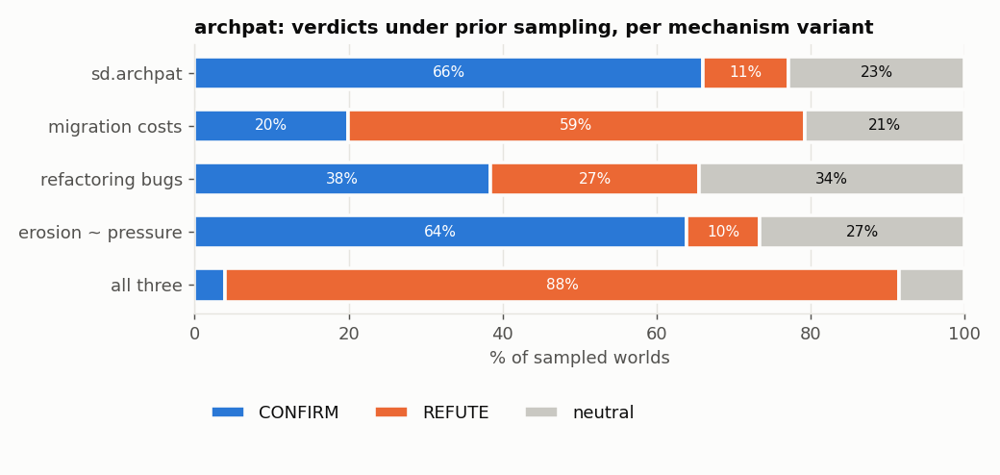

> If migration is free, migrating to patterns looks good. Add a cost,
> the bugs that refactoring introduces, and pattern erosion under
> pressure, and it **flips to mostly orange (hurts)**. The law depends
> entirely on the assumption that migration is free.

### Test type 5: Real data from GitHub

I read the full history of two real projects:

- **Apache Helix**: a long-running Java project (about 5,000 commits).
- **Aider**: an AI coding tool whose AI-written commits are labelled,
  which makes it rare and valuable.

---

## Part 4: The real-data results

### Brooks' Law on Apache Helix

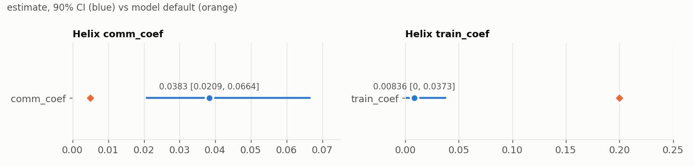

> - **Talking cost** (left): Helix is about **4.6× higher** than the textbook.
> - **Training cost** (right): Helix is about **17× lower** than the textbook.
>   New people who stay become productive almost immediately.

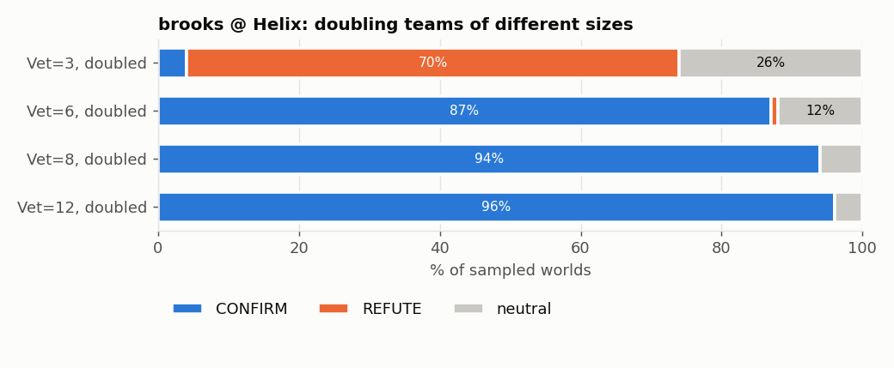

> - Team of 3, doubled: **mostly orange**, so adding people *helps*.
> - Team of 6 or 8, doubled: **mostly blue**, so adding people *hurts*.
>
> **Simple outcome:** Brooks' Law is true for Helix only once the team
> is past about 6 people.

### AI work on Aider

I compared code by **the same person, in the same months**, with and
without AI. Then I checked how much of each was gone 14 days later.

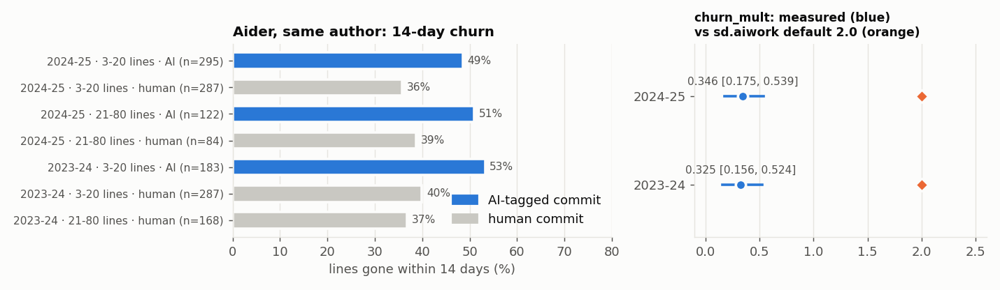

> - **Left:** about **50%** of AI-written lines vs **37%** of human
>   lines are gone after 14 days. The same pattern shows in both AI eras (GPT-4 and
>   Claude/GPT-4o).
> - **Right:** the measured extra throwaway (blue dots, about 0.3) is far below the
>   model's guess (orange, 2.0).

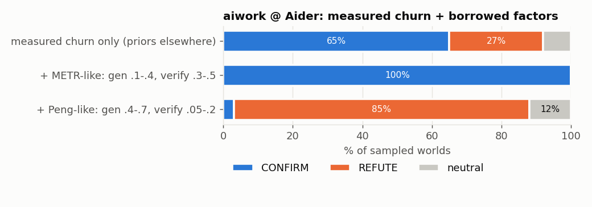

> The answer swings from "AI hurts" (100%) to "AI helps" (85%)
> depending on whose numbers we borrow for **speed** and **checking
> time**. Git history doesn't record those.
>
> **Simple outcome:** AI code is thrown away somewhat more, but whether AI
> helps overall depends on how fast it is and how long review takes.
> That's what we need to measure next.

### Design patterns on Apache Helix

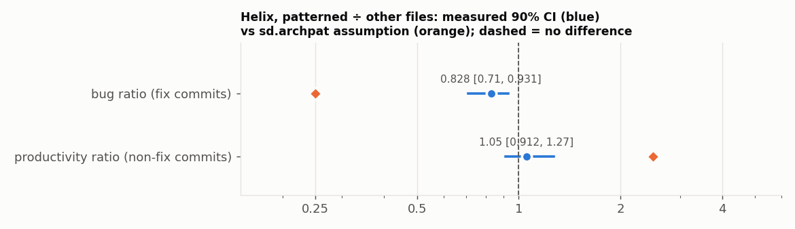

> - Bugs: pattern files have about **0.7–0.8×** the bugs of other files. The model assumed 0.25×.
> - Productivity: about **1.0×**, so no faster. The model assumed 2.5×.

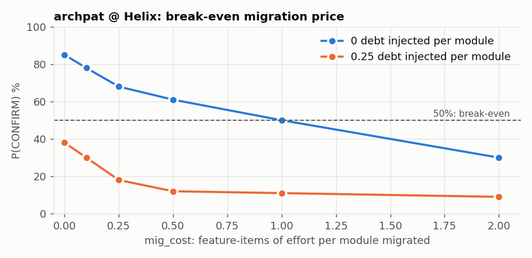

> As the cost of moving one module into a pattern rises, the chance that
> migrating helps falls. It crosses 50% at about **1 unit of work per
> module**, or about **0.1** if migrating also introduces bugs.
>
> **Simple outcome:** migrating to patterns only pays off if it's
> almost free. We haven't measured that cost yet, and it's the one
> number that decides the question.

### All real-project results together

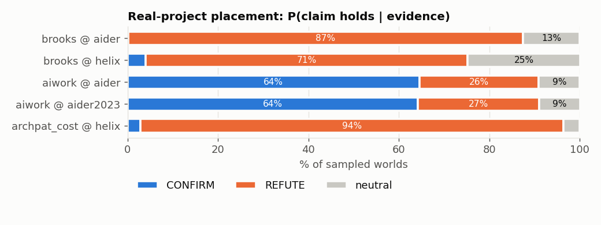

| project | law | chance the law holds there |
|---|---|---|
| Helix (team of 3) | Brooks | low: adding people helps (80%) |
| Helix (team of 6–8) | Brooks | high (81–89%) |
| Aider | Brooks | low: one main developer, so Brooks doesn't apply (71% "helps") |
| Aider | AI work | 65%, but swings from 3% to 100% depending on unmeasured speed and review time |
| Helix | Design patterns | 82% if migration is free, **3–4%** if it costs effort |

---

## Part 5: The thinking behind it (Nancy Cartwright, simply)

Cartwright is a philosopher who studies when evidence from one place
can guide decisions in another. Her main points, and how they show up here:

| her idea | simple meaning | in my work |
|---|---|---|
| "It worked **there**" ≠ "it will work **here**" | A result from one study or project doesn't automatically apply to yours. | Brooks holds in the textbook, but not for Helix's small team. |
| Laws only work when **conditions** are right | Like a recipe: you need *all* the ingredients, not just one. | Brooks needs: a late project + a team past its sweet spot. |
| Look for the **missing ingredients** | Ask what else must be true for the law to work. | My tests find the conditions (team size, review time, migration cost). |
| Every link in the evidence chain matters | Data → measurement → number → model → answer. Any weak link breaks it. | Each real-data result lists its weak points. |
| Borrowing numbers needs a reason | Using another study's numbers assumes your situation is like theirs. | Borrowed AI numbers flip the answer completely. |

**So instead of saying "the law is TRUE", I say:**
*"The law works **when X is true**. Project P meets X with probability
p. The thing we still need to measure is F."*

---

## Part 6: The outcome, in plain words

1. **No law is simply true or false.** Each one works only under
   certain conditions. The useful thing is knowing *those conditions*
   and *whether your project meets them*.

2. **All three laws come down to one hidden question: what does the
   action cost?**
   - Hiring costs **coordination** (talking).
   - AI costs **checking time**.
   - Migrating to patterns costs **migration effort**.

   The original simulations either guessed this cost wrong or left it
   out. It's also the hardest thing to see in git history.

3. **Real data changed the answers.**
   - Helix: adding people to a small team helps.
   - Aider: AI code is thrown away only a bit more than human code.
   - Helix: design patterns help only a little.

4. **Running more simulations ≠ more confidence.** You must test
   *different* situations, not the same one many times.

5. **Tests must be able to fail.** The old tests passed a broken model.
   Good tests say what they expect *before* they run.

6. **A reusable recipe for any future law** (the lawkit toolkit):
   - write the law down precisely;
   - check the simulation is trustworthy;
   - test it in many worlds;
   - find what decides it;
   - check real projects;
   - pick the next thing to measure.

   Golden rule: **"price the lever first"**, meaning figure out what the
   action costs before anything else.

### What to measure next

| law | the missing number | how to get it |
|---|---|---|
| Design patterns | the cost of migrating code | RefactoringMiner + SZZ (tools kaiaulu already supports) |
| AI work | how long AI code takes to review | review times on AI vs human pull requests |
| Brooks | whether the project was actually late | JIRA release due dates |

---

## One-line takeaways for slides

- "SE laws aren't universal truths. They're conditional."
- "100,000 runs of the same situation is still one situation."
- "A test that can't fail isn't a test."
- "Every law hides a price: coordination, checking, or migration."
- "Brooks' Law in Helix: helps below 6 people, hurts above."
- "AI code churns 1.33× more, not 3×. Review time is the real question."
- "Patterns pay off only if migration is nearly free."
- "It worked there ≠ it will work here (Cartwright)."
