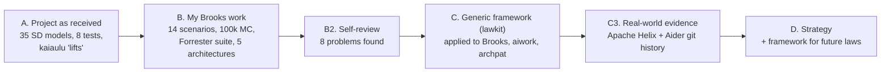
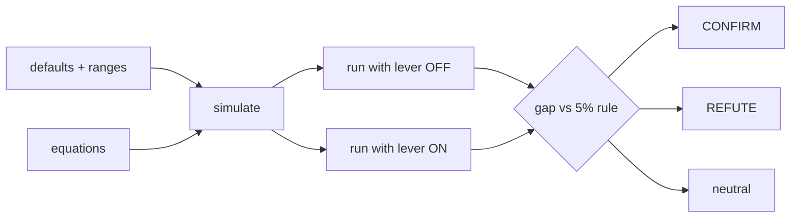
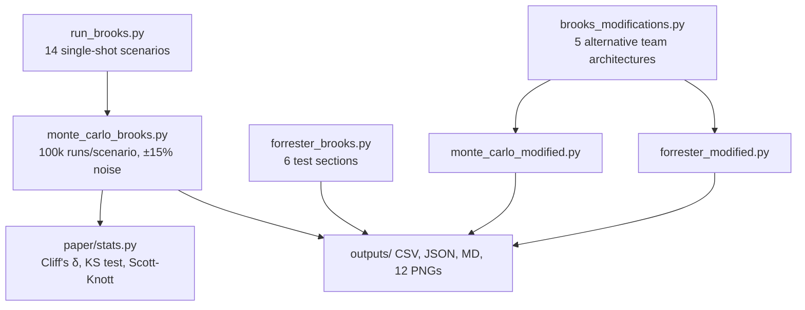
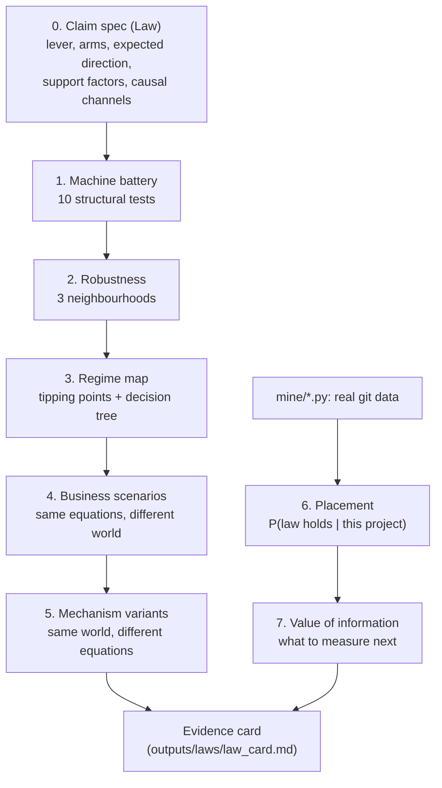
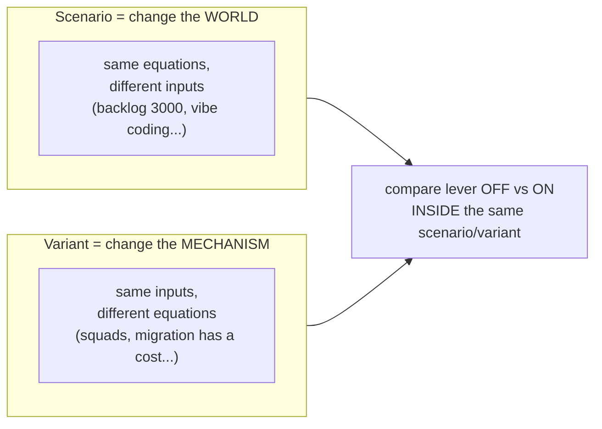
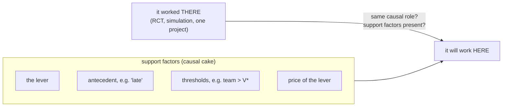
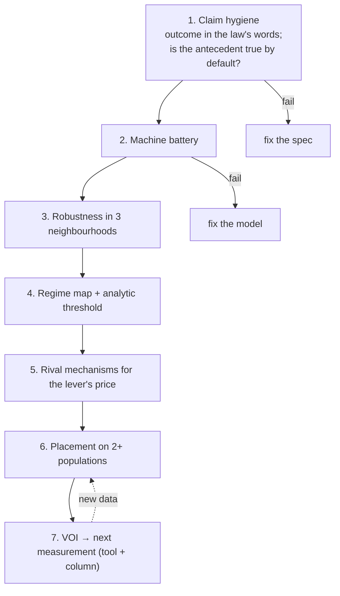

# Testing Software-Engineering Laws: my study notes

> **Note (2026-11-06):** these notes predate the single standard Brooks model. Brooks numbers here come from the earlier models (archived in `outputs/archive/2026-11-06_before_standard_brooks/`). For current results see `learn_from_zero.md` and `outputs/laws/brooks_card.md`.

*Personal notes. Every number here comes from `outputs/` (cards, `SYNTHESIS.md`,
`sensitivity.md`, `archpat_breakeven.txt`) or from re-running the
simulators. Charts referenced below live in `research_docs/site/img/`
(run `python -B research_docs/build.py` once if that folder is missing).
The live site version is at http://127.0.0.1:8765/ when served.*

---

## 0. The whole story in one minute

> Software-engineering "laws" (Brooks' Law, "AI makes code worse",
> "migrate to design patterns") are usually stated as if they are always
> true. I turned three of them into small simulations, attacked the
> simulations with structural tests, mapped *where* each law holds, and
> then measured real Git repositories to see which side of that map
> real projects fall on.
>
> Result: **none of the three laws is simply true or false.** Each holds
> only when certain conditions ("support factors") are present. Real
> data overturned most of the textbook defaults. And every law turned
> out to hinge on one thing the original models ignored or got wrong:
> **the price of pulling the lever** (coordination cost for Brooks,
> verification cost for AI, migration cost for patterns).



---

## 1. Background you need to explain first

### 1.1 What is the research project?

- ICSE 2027 methodology paper (Menzies, Kazman, with Umar; Carlos on
  tooling via **kaiaulu**, an R toolkit for mining software repos).
- Theme: **"what to measure next."** Instead of collecting new data
  blindly, build small simulations of SE laws and ask which parameters
  matter and which can be measured ("lifted") from open-source data.

### 1.2 What is a System Dynamics (SD) model? (simple version)

Think of bathtubs and pipes.

- **Stocks** = bathtubs, things that accumulate (veterans, new hires,
  work done, work left).
- **Flows** = pipes, rates that fill or drain the tubs (newcomers
  maturing into veterans, work being completed).
- Each tick, the simulator updates every tub by its flows (Euler steps).

In this repo, every law is one Python function in `paper/sd.py` that
returns `Model(init, step, y, rq, ctrl)`:

| piece | meaning in plain words |
|---|---|
| `init` | each variable's default value, allowed low/high range, and unit |
| UPPER-case names | the **world** (team size, backlog) |
| lower-case names | the **process** (how costly communication is, etc.) |
| `step` | the equations: how the tubs change in one tick |
| `y` | the success score (higher = better) |
| `rq` + `ctrl` | the research question: run with the lever at two settings, compare `y` |

**Verdict rule:** gap = y(lever on) − y(lever off).
If the gap moves in the direction the law predicts by more than 5% of
the baseline, it's **CONFIRM**; the opposite direction is **REFUTE**;
inside ±5% is **neutral**.



### 1.3 The three laws

| law | claim in plain words | lever | score |
|---|---|---|---|
| **Brooks** (1975) | "Adding people to a late project makes it later." | hire 0 vs 10 people at t=10 | Done − Todo at t=20 (later: completion time) |
| **aiwork** (GitClear 2024, METR 2025) | "Using AI fully lowers how much code you actually keep." | AI use 0 vs 1 | kept code |
| **archpat** (Perry & Wolf 1992) | "Aggressively migrating to design patterns repairs a bad codebase." | migration rate 0.2 vs 1.5 | features delivered net of debt |

**Brooks equations** (useful to put on one slide):

```
comm  = comm_coef · Vet·(Vet−1)/2     # every pair of veterans must talk
train = train_coef · New              # each newcomer taxes every veteran
prod  = Vet · (1 − comm − train) · prod_rate   (never below 0)
New → Vet at mature_rate per tick
```

### 1.4 What already existed (Part A)

- **8 internal tests** in `paper/tests.py` (Forrester & Senge-style and
  metamorphic): boundary adequacy, anomaly check, extreme equations,
  zero-input reproducibility, monotone response, dt-halving, clipping
  consistency, scale ×2.
- **2×2 stress matrix:** perturb the world and the process separately
  (200 random draws each), then label each model *universal*,
  *world-conditional*, *process-conditional* or *fragile*. As received:
  Brooks = **fragile** (only 12/200 world draws confirm), aiwork and
  archpat = **universal**.
- **Lifts:** kaiaulu notebooks measured some parameters on 8 OSS
  projects (Helix, Ambari, JUnit5, Tomcat, Camel, Airflow, OpenSSL,
  kaiaulu). Findings F0–F4, e.g. "Brooks effect varies 11× across
  projects". aiwork was marked "dark": no open dataset labels AI-written
  commits.

---

## 2. Phase B: my Brooks' Law work

### 2.1 What I built



### 2.2 The 14 business scenarios ("what-if worlds")

Defaults: 10 veterans, backlog 500, comm 0.005, train 0.2, prod 5,
mature 0.1, 10 hires at t=10, horizon 20. Verdict: CONFIRMED if more
than 70% of paired runs did worse than the baseline.

| scenario | change | median score | hiring hurts in | verdict |
|---|---|---|---|---|
| baseline | 0 hires | 1049.0 | — | control |
| brooks_law | — | 351.8 | 100% | CONFIRMED |
| break_communication | comm 0 | 635.1 | 100% | CONFIRMED |
| break_training | train 0 | 1030.6 | 67.7% | AMBIGUOUS |
| fast_onboarding | mature 0.5 | 394.8 | 100% | CONFIRMED |
| early_hire | hire at t=2 | −267.4 | 100% | CONFIRMED |
| massive_surge | 50 hires | 351.8 | 100% | CONFIRMED |
| micro_hire | 1 hire | 930.4 | 100% | CONFIRMED |
| high_productivity | prod 15 | 2056.3 | 0% | BROKEN |
| long_horizon | 50 ticks | 423.0 | 100% | CONFIRMED |
| small_core_team | 2 veterans | −276.7 | 100% | CONFIRMED |
| steep_learning_curve | mature 0.02, train 0.4 | 351.8 | 100% | CONFIRMED |
| last_minute_panic | hire at t=18 | 971.4 | 100% | CONFIRMED |
| asynchronous_remote | comm 0.001 | 561.5 | 100% | CONFIRMED |

### 2.3 Tests I ran on Brooks (Forrester & Senge suite)

| section | what it checks (plain words) | result |
|---|---|---|
| 1. Extreme conditions | does the model behave sensibly at absurd inputs (0 workers, 10⁶ hires, comm 1.0)? | 9 PASS |
| 2. Behaviour anomaly | cause precedes effect, Done never decreases, headcount conserved, no negative stocks | 4 PASS |
| 3. Boundary adequacy / J-curve | if we wait longer (up to 120 ticks), does hiring eventually pay off? | PASS, "no crossover found" |
| 4. dt invariance | does a finer time step give the same answer? | WARN, 28% error |
| 5. Metamorphic monotonicity | more hires should never help more in a monotone way | PASS |
| 6. Tipping points | where in parameter space does the verdict flip? | PASS, "none found" |

**Metamorphic test, in one sentence:** you don't know the "right"
answer, but you know how the answer must *change* when you change the
input (e.g. doubling everything shouldn't flip the sign).

### 2.4 Five architectural modifications

| architecture | what changes | reported median |
|---|---|---|
| Standard (flat) | everyone talks to everyone | 351.8 |
| Ambassador squads | squads of 10, only ambassadors talk across | 946.3 |
| Mentor pods | 1 vet per 5 newcomers mentors full time | 1038.5 |
| Async docs + CI | comm grows as V·log V; training ×0.6 | 671.7 |
| Staged waves | hires arrive 2 per tick | 392.4 |
| Synergistic | squads + log comm + pods | 1632.9 |

Original claims: Brooks is "inviolable" in flat teams (100% of 100k
runs); squads restore a crossover at t=11; synergy "breaks" Brooks.

---

## 3. Self-review of the Brooks work (B2): 8 problems

**testing the tests**. Every issue
was reproduced by re-running my own simulators.

| # | problem | plain explanation | impact |
|---|---|---|---|
| 1 | **Wrong baseline for architectures** | Architecture X + 10 hires was compared to a *flat* team with 0 hires. Squads already beat flat with 0 hires (1455 vs 1050). | Within the same architecture, hiring still **hurts in 5 of 6** (squads −507, async −665, waves −659, pods −10). Only synergistic helps (+145, not +586). |
| 2 | **Phantom work** | Score = Done − Todo keeps growing after the backlog is empty (Todo goes negative). | Baseline 1050 = 775 done − (−275): 275 items that never existed. |
| 3 | **Clamp, not law** | train = New × 0.2, so 5 hires → 100% of veteran time → output clamped to 0. | 5, 10, 50 hires all identical (352.6). Each newcomer costs 2 full-time veterans. Helix data says 1/17 of that. |
| 4 | **Precision ≠ robustness** | ±15% noise only tests the neighbourhood of the defaults (and it was uniform, not triangular as written). | Over the declared ranges, Brooks holds in ~10% of worlds, not 100%. |
| 5 | **Tests that can't fail** | Boundary and tipping tests returned PASS even with "none found". | Overstated confidence. New rule: state the expected result before running. |
| 6 | **Hard-coded prose** | Report text said 3 scenarios "break the law"; the table said otherwise. | Generate prose from data. |
| 7 | **Project not late** | 10 vets finish 500 items by t≈13, before the t=20 deadline. | Brooks' own precondition ("a late project") was false by default. |
| 8 | **Comm wall** | Flat clique: output = V(1 − c·V(V−1)/2) hits 0 at ~20 people. | Contradicted by every Apache project with 20+ developers. |

Charts: `confound.png` (issue 1), `saturation.png` (issue 3),
`robustness.png` (issue 4), `team_optimum.png` (issue 8).

**Key formula from issue 8, the coordination optimum V\*:**
a flat team's output peaks at V\* where 3V² − 2V = 2/c.
c = 0.005 → V\* ≈ 12. Helix's c ≈ 0.023 → V\* ≈ 5.7.

**What survives:** inside a *genuinely late* project, adding people
does make it finish later in the flat model and in all 7 rival
structures. Structure shrinks the harm 8–40×; it doesn't reverse it.

---

## 4. Phase C: the generic framework (`lawkit/`)

Goal: make the Brooks process work for **any** law, fairly and
repeatably, then apply it to aiwork and archpat.

### 4.1 Pipeline



| module | job |
|---|---|
| `core.py` | the `Law` spec; runs both arms; verdict; samples worlds |
| `battery.py` | 10 structural + metamorphic tests |
| `regimes.py` | robustness, tipping points, decision tree, scenarios, variants |
| `evidence.py` | real-data evidence, placement, value of information |
| `laws.py` | specs for brooks, brooks_late, aiwork, archpat, archpat_cost |
| `card.py` | writes the markdown evidence card |
| `test_lawkit.py` | 5 regression tests: lawkit reproduces `sd.py` exactly (gaps −147.5, −51.69, +228.69) and each detector fires where it should |

### 4.2 The 10-test machine battery (the "Forrester + metamorphic" tests)

Each test answers: **"Is this simulation a sound machine, so that its
verdict means anything?"**

| test | plain-words question | fails when | what it caught |
|---|---|---|---|
| units declared | does every variable have a unit? | missing unit | — |
| dead parameters | does every knob actually do something? | a param changes `y` in neither arm | archpat `pat_strength` |
| extreme conditions | does it stay finite at the range edges? | NaN / crash | — (also lists where the claim fails) |
| clamp dependence | is the verdict produced by "never below 0" safety clips? | >20% of CONFIRMs need clipping | aiwork: 24% |
| integration step (dt) | does a smaller time step give the same verdict? | verdict flips at dt 0.5/0.25 | old Brooks: 28% error |
| time horizon | does the verdict hold if we simulate 4× longer? | changes (WARN) | — |
| dose-response | is more lever → monotone effect? | non-monotone (WARN) | — |
| **mechanism knock-out** | turn off the declared causal channels: does the effect vanish? | effect survives without its declared cause | archpat's hidden paydown; `sd.debt` |
| **refutability** | can *any* world in the declared ranges refute it? | 100% CONFIRM (WARN) | `sd.debt` |
| scale ×2 | doubling all stocks doesn't flip the verdict? | flips (WARN) | — |

What's new versus the 8-test bank: dead params, knock-out,
refutability, sampled clamp check. **The old bank gave archpat PASS on
all 8 tests**, despite a dead knob, a hard-coded benefit and free
migration. The key idea: *a test that cannot fail doesn't test
anything.*

### 4.3 Robustness in three neighbourhoods

Instead of one "100% confirmed" number, sample 2,000 worlds three ways:

1. **±15% around defaults** (the old Monte Carlo protocol),
2. **triangular prior** over the model's declared ranges (peaked at defaults),
3. **uniform** over the declared ranges (no preference).

Analogy: testing a bridge only with trucks within 15% of the design
weight tells you nothing about other trucks. **More runs don't fix a
small neighbourhood.**

### 4.4 Regime map

- **Tipping points:** move one factor at a time; record where the
  verdict flips.
- **Decision tree** (depth 3, scikit-learn) over the sampled worlds:
  which factors best predict CONFIRM vs not ("importance").

This converts "the law is true" into "the law holds **when** X > threshold".

### 4.5 Scenarios vs variants



That "inside the same" rule is the fix for review issue 1.

### 4.6 Placement and value of information (the real-data tests)

- A miner reads a git repo and produces **bootstrap samples** for the
  parameters it can measure (e.g. 300 plausible values of `train_coef`).
- 2,000 worlds are sampled: measured factors from the bootstrap,
  everything unmeasured from the prior.
- **Placement** = % of those worlds where the law CONFIRMs, i.e.
  P(law holds *here* | evidence).
- **Value of information (VOI):** for each unmeasured factor, split it
  into quartiles and see how much knowing it would reduce uncertainty
  about the verdict (entropy reduction). Highest gain = measure next.

---

## 5. Results per law (internal tests)

### 5.1 Robustness summary (% CONFIRM / REFUTE / neutral)

| law | ±15% (old) | prior over ranges | uniform |
|---|---|---|---|
| brooks | 68 / 0 / 32 | 7 / 0 / 93 | 4 / 0 / 95 |
| brooks_late | 100 / 0 / 0 | 11 / 0 / 88 | 6 / 1 / 93 |
| aiwork | 100 / 0 / 0 | 88 / 8 / 4 | 74 / 21 / 5 |
| archpat | 100 / 0 / 0 | 65 / 10 / 24 | 59 / 14 / 26 |
| archpat_cost | 100 / 0 / 0 | 5 / 83 / 11 | 4 / 86 / 10 |

Read it as: under the old protocol, everything looks bulletproof.
Widen the neighbourhood and the laws separate sharply.

### 5.2 Brooks (`brooks_late`: backlog 1000, score = completion time)

- **Battery:** all PASS except a clamp WARN; dt error dropped from 28%
  to 3%; knock-out passes (harm flows only through comm and training).
- **Decided by team size:** importance `Vet` 0.73, `comm_coef` 0.19.
  Tipping: hiring helps below 5 veterans, hurts from 5, team goes dead
  around 22.5.
- **Rule:** Brooks holds when the post-hire team overshoots V\*(c).
- **Scenarios:** small_core (2 vets) → **REFUTE (+43)**, hiring helps;
  early, mid and last-minute hiring all CONFIRM once the project is
  truly late; on_time_project still CONFIRMs at default but 26% of
  nearby worlds go neutral.
- **Variants:** all 7 structures CONFIRM, but the delay shrinks from
  −88 (flat) to −11 (squads), −8 (async), −2 (mentor pods),
  −10 (shared mentoring).

### 5.3 aiwork

- **Battery:** knock-out passes (remove churn + verification drag and
  AI *helps*, +38). **Clamp FAIL:** churn + maturation can drain more
  than the work-in-progress stock in one tick; 24% of CONFIRMs exist
  only because a negative stock is clipped to 0. A real model defect.
- **Decided by speed vs verification, not churn:** importance
  `gen_boost` 0.42, `verify_drag` 0.40, `churn_mult` only 0.07.
- **Threshold (derived analytically):** AI helps when
  (1 + gen_boost)(1 − verify_drag) > 1 + churn_mult · churn_base / (mature_rate + churn_base).
  Defaults: 1.3 × 0.6 = 0.78 < 1.40, so default AI "hurts" mainly
  because it's *slower*, not because of churn.
- **Scenarios:** REFUTE (AI helps) for vibe_coding (+50),
  boilerplate (+94), copilot_rct (+18); CONFIRM for review_gate,
  legacy_expert (METR-like), half_adoption, short_sprint,
  slow_review_pipe.
- **Variants:** robust, except "team learns AI" (verification drag
  decays), which drops prior CONFIRM 88% → 69%.

### 5.4 archpat

- **Battery: two FAILs.**
  - Dead parameter `pat_strength` (never used).
  - Knock-out FAIL: give patterned code the *same* productivity and
    bug rate as legacy and migration *still* helps (+27), through a
    hard-coded bonus `pay × (1 + 0.5·share)`.
  - Also: migration is free (`available` is computed and never used).
- **Scenarios:** all 8 CONFIRM, even "overengineered" and "patterns no
  safer". The conclusion is essentially built in.
- **Variants reverse it:**

| variant | prior CONFIRM / REFUTE |
|---|---|
| reference (free migration) | 66% / 11% |
| migration costs 4 items/module | 20% / 59% |
| refactoring bugs (Bavota 2012) | 38% / 27% |
| erosion grows with pressure | 64% / 10% |
| all three | **4% / 88%** |

### 5.5 One-table summary

| law | defects found | what decides it | survives rival mechanisms? |
|---|---|---|---|
| Brooks | phantom work, clamp saturation, not-late default, comm wall | team size vs V\*(c) | yes, but harm shrinks 8–40× |
| aiwork | outflow overshoot (clamp) | gen_boost vs verify_drag | mostly |
| archpat | dead param, hard-coded channel, free migration | price of migration | **no** |

---

## 6. Real-world evidence (the "dynamic tests")

Two repos, cloned read-only, mined with plain git (`mine/*.py`):
**apache/helix** (4,948 commits since 2011) and **Aider-AI/aider**
(13,138 commits; Aider tags commits it wrote with "(aider)").

### 6.1 Brooks on Helix and Aider

**Method:** 1 tick = 1 month. Veterans = devs active ≥ 6 months;
newcomers = first commit < 6 months ago. I fit the model's own
production equation y = p·(1 − c·V(V−1)/2 − train·New) to per-veteran
commits (non-negative least squares, 300 bootstraps).

| | months | median vets (max) | comm_coef | train_coef |
|---|---|---|---|---|
| **Helix** | 151 | 3 (8) | **0.023** [0.014, 0.032] | **0.012** [0, 0.029] |
| Aider | 28 | 2 (3) | not identifiable | ≈0 |
| model default | — | 10 | 0.005 | 0.2 |

So in Helix, coordination costs **4.6× more** than assumed, and
onboarding costs **17× less**.

**Placement** (question: "if this team were late, would doubling it
make it later?"):

| Helix scenario | CONFIRM | REFUTE |
|---|---|---|
| core of 3, doubled | 1% | **80%** (hiring helps) |
| core of 6, doubled | **81%** | 0% |
| core of 8, doubled | **89%** | 0% |
| 12, doubled | outside observed range: extrapolation | |

Aider (one maintainer + drive-bys): **71% REFUTE**; Brooks' support
factors simply aren't there.

### 6.2 aiwork on Aider: does AI code churn more?

**Method (GitClear churn idea):** same author (Paul Gauthier), same
period, files `aider/*.py`. For sampled (commit, file) pairs, run
`git blame` 14 days later and count surviving lines. Stratify by change
size, drop strata with fewer than 15 pairs per arm, bootstrap 800 times.
churn_mult = churn_AI / churn_human − 1.

| era | AI churn | human churn | churn_mult |
|---|---|---|---|
| 2024-25 (Claude/GPT-4o) | 49.7% | 37.2% | **0.35** [0.18, 0.54] |
| 2023-24 (GPT-4) | 53.2% | 39.9% | **0.32** [0.16, 0.52] |
| model default | | | 2.0 |

AI lines churn about **1.33×** as much: real, stable across model
generations, and **~6× smaller than the model assumes**.

**Placement:**

| evidence | CONFIRM | REFUTE |
|---|---|---|
| measured churn only | 65% | 27% |
| + METR-like speed/verify (borrowed) | 100% | 0% |
| + Peng-like speed/verify (borrowed) | 3% | 85% |

VOI: measure `verify_drag` next (gain 0.34), then `gen_boost` (0.15).
**Neither is visible in git.** No second open repo with AI attribution
was found; that scarcity is itself a finding.

### 6.3 archpat on Helix: are patterned files better?

**Method:** 674 production Java files (149 patterned per the existing
pattern4 output), history followed through renames.
Negative-binomial regression of bug-fix and SZZ bug-introduction counts,
patterned vs not, controlling for size and churn; 300 bootstraps.

| ratio (patterned ÷ other) | measured | model assumes |
|---|---|---|
| bug-fix commits | **0.83** [0.71, 0.93] | 0.25 |
| SZZ bug introductions | **0.68** [0.54, 0.86] | 0.25 |
| productivity proxy | **1.05** [0.91, 1.27] | 2.5 |

Patterns help a little with bugs and not at all with output.

**Sensitivity: which evidence actually carries the verdict?**

| model | stocks only | + bug ratio | + bug + productivity |
|---|---|---|---|
| archpat (free migration) | 74% C | 83% C | 82% C |
| archpat_cost (priced) | 92% R | 93% R | 94% R |

The measured ratios barely matter. **Whether migration has a price
decides everything.**

**Break-even (Helix):** P(CONFIRM) falls to 50% at a migration cost of
about **1 feature-item per module** (no injected bugs), or about **0.1**
if each migration injects 0.25 debt. That is measurable with
RefactoringMiner + SZZ (both wrapped by kaiaulu).

### 6.4 Caveats (be ready for these)

| link in the chain | caveat |
|---|---|
| commits → productivity | commit counts hide size and review work |
| OSS arrivals → "hiring" | newcomers follow activity (reverse causation); OSS has no deadlines |
| survivors → mature_rate | only newcomers who stayed are counted |
| identity | e-mail based; kaiaulu `identity_match` not applied |
| AI tag → AI use | self-declared; untagged AI in the human arm shrinks the gap |
| within-author → causal | controls skill and period, not task choice |
| patterned files → effect of migrating | cross-sectional association, one snapshot |

---

## 7. The Cartwright lens (why the method looks like this)

Nancy Cartwright (*Evidence-Based Policy*, with Hardie, 2012; also
1983, 1989, 1999, 2007). Her ideas map directly onto the method:

| Cartwright idea | plain words | where it appears here |
|---|---|---|
| **"It worked there" ≠ "it will work here"** | a result in one population doesn't transfer automatically | Brooks holds in the textbook world, fails for Helix's 3-person core |
| **Laws are capacities** in a "nomological machine" | a law shows up only when the right arrangement of conditions is in place | the regime map *is* the machine: late project + team > V\* + training drag |
| **Support factors / causal cake** (INUS, Mackie 1965) | the cause is one slice of the cake; other slices must be present | `tipping()` and `rules()` find the other slices; knock-out checks the declared slices do the work |
| **Vertical search** | describe the cause more abstractly so it travels | "adding people" → "adding coordination load past the optimum"; "using AI" → "trading verification time for speed"; "migrating" → "paying a price now for fewer defects later" |
| **Horizontal search** | list everything else that must be in place | scenarios + variants + VOI |
| **Evidence is a long chain** | each link (data → construct → parameter → model → verdict) needs its own warrant | caveat lists; sensitivity tables show the weight sits on the unmeasured archpat price |
| **Borrowing needs a similarity argument** | using another study's numbers assumes the populations are alike | METR vs Peng swings aiwork from 100% to 3% |
| **Gold standards don't travel by themselves** | internal rigour ≠ external validity | the within-author Aider design is strong but says nothing about teams with code review |

**Verdict format I use (instead of "CONFIRMED"):**
"L plays a causal role in Y where S holds; project P satisfies S with
probability p; the deciding unknown is F."



---

## 8. Conclusions

### 8.1 Per law (Cartwright form)

| law | holds where... | real project | deciding unknown |
|---|---|---|---|
| Brooks | project is late AND post-hire team overshoots V\*(c) | Helix core of 3: fails (80% REFUTE); at 6–8 holds (81–89%) | observed lateness; c beyond observed team sizes |
| aiwork | (1+gen_boost)(1−verify_drag) < 1 + churn term | Aider: 65% CONFIRM, swinging 3–100% with borrowed factors | verify_drag, gen_boost |
| archpat | migration is nearly free and injects no bugs | Helix: 82% CONFIRM if free, 3–4% if priced | mig_cost, mig_bugs |

### 8.2 Five headline findings

1. **No law is simply true or false**; each is a capacity with support factors.
2. **All three hinge on the price of the lever** (coordination, verification,
   migration), which the models fixed or ignored and git records worst.
3. **Real data overturned the defaults:** Helix onboarding 1/17 of
   default; AI churn premium 6× smaller than assumed; patterns only
   modestly safer and no more productive.
4. **Sample size bought nothing:** 100k runs at ±15% said 100%;
   sampled over ranges, Brooks holds in ~10%.
5. **The old structural tests were too weak:** archpat passed all 8
   despite three defects. Tests must state expectations first and check
   the declared mechanism.

### 8.3 Strategy for testing SE laws (goal 1)

What each test family could and couldn't establish, judged by whether
it actually changed a conclusion:

| test family | establishes | cannot establish | changed a conclusion? |
|---|---|---|---|
| Forrester/Sterman + metamorphic | the model is a sound machine | that the law is true anywhere | **yes**: 7 model defects |
| Monte Carlo at ±15% | precision of the default verdict | robustness | no (always 100%) |
| sampling over ranges | dependence on the author's priors | where real projects are | **yes**: Brooks 100% → 10% |
| regime map | deciding factors + thresholds | which side a project is on | **yes** |
| business scenarios | consequences in named worlds | whether those worlds exist | partly |
| mechanism variants | survival under rival structures | which structure is right | **yes**: archpat reverses |
| real-project placement | P(holds here \| data) | an average effect | **yes**: Helix flips Brooks and archpat |
| value of information | what to measure next | — | **yes** |

**Recommended order (cheap → expensive; stop when a step fails):**



### 8.4 Generic framework for future laws (goal 2)

A new law = one `Law(...)` spec (+ optionally one miner). Example: run
on the untouched `sd.debt`, it immediately flagged a hard-coded channel
(knock-out FAIL) and an unrefutable claim (100% CONFIRM), the same defect
types as archpat.

Reusable knowledge each run produces:

1. **Model-defect catalogue:** dead params, hard-coded channels,
   clamp-made verdicts, outflow overshoot, wrong outcome, false antecedent.
2. **Dimensionless thresholds that travel:** V\*, the aiwork
   inequality, the archpat break-even price.
3. **A measurement agenda** (VOI), phrased as tool + column.
4. **Heuristic: price the lever first.** Is the cost of pulling the
   lever in the model? (If not, the claim is a tautology, like archpat.)
   Is it in any data? (If not, it's undecidable, like aiwork.)
5. **Composition:** Brooks → aiwork → archpat can be chained as one
   combined `Law` (designed for, not built yet).

---

## 9. Limitations and next steps

**Limitations**
- Miners are Python + plain git, not kaiaulu `.Rmd` + `.R` (no R on
  this machine). Porting is mechanical but not done.
- Only two projects: Helix for Brooks/archpat, Aider for aiwork.
- Some priors are my judgement (archpat price priors, aiwork scenarios);
  the break-even table lets others substitute their own.
- Nothing from phases B/C is committed to git yet.

**Next measurements (ranked by VOI)**
1. archpat `mig_cost` / `mig_bugs`: RefactoringMiner
   (`parse_java_code_refactoring_json`) + SZZ on Helix and Ambari.
2. aiwork `verify_drag`: review latency and review comments on
   AI-tagged vs untagged PRs.
3. Brooks lateness: JIRA fixVersion due dates (`parse_jira`).

**Model fixes to upstream to `paper/sd.py`:** completion-time outcome
for brooks; bounded aiwork outflows; archpat should use `available`,
price migration, wire or remove `pat_strength`; fix the label swap in
`full_audit.py`.

---

## 10. Suggested talk structure (~20–25 slides)

| # | slide | key visual |
|---|---|---|
| 1 | Title + one-line thesis: "SE laws are conditional; price the lever" | — |
| 2 | Research context: "what to measure next" | overview diagram (§0) |
| 3 | What an SD model is: bathtubs + verdict rule | §1.2 diagram |
| 4 | The three laws + Brooks equations | §1.3 table |
| 5 | Phase B: what I built | §2.1 diagram |
| 6 | 14 scenarios + Forrester suite results | `outputs/brooks_master_dashboard.png` |
| 7 | Architectures as originally reported | `outputs/modified_master_dashboard.png` |
| 8 | **Testing my own tests**: 8 issues | §3 table |
| 9 | Wrong baseline | `confound.png` |
| 10 | Clamp saturation + comm wall | `saturation.png`, `team_optimum.png` |
| 11 | lawkit pipeline | §4.1 diagram |
| 12 | The 10-test battery and what it caught | §4.2 table |
| 13 | Robustness: precision ≠ robustness | `robustness.png` |
| 14 | What decides each law | `importance.png` |
| 15 | Mechanism variants (archpat reverses) | `variants_archpat.png` |
| 16 | Evidence: Brooks on Helix | `brooks_params.png`, `sens_brooks.png` |
| 17 | Evidence: AI churn on Aider | `churn.png`, `sens_aiwork.png` |
| 18 | Evidence: patterns on Helix + break-even | `archpat_ratios.png`, `breakeven.png` |
| 19 | All placements | `placements.png` |
| 20 | Cartwright lens | §7 table + diagram |
| 21 | Strategy: what each test can/can't establish | §8.3 table |
| 22 | Generic framework + "price the lever" | §8.4 |
| 23 | Limitations + next measurements | §9 |

---

## 11. Likely questions and short answers

**Q: Isn't 100,000 Monte Carlo runs strong evidence?**
It's strong evidence about the *default* setting only. More runs
shrink the error bar; they don't widen the region you tested. Over the
declared ranges Brooks holds in ~10% of worlds.

**Q: So is Brooks' Law wrong?**
No. It's conditional. It holds when the project is genuinely late and
the post-hire team exceeds its coordination optimum V\*. Helix's typical
3-person core is below V\* ≈ 5.7, so doubling it helps; at 6–8 it hurts.

**Q: Why trust a tiny simulation at all?**
I don't trust its verdict by default; that's why the battery exists. Its
value is in exposing *which factors decide* and *what to measure*,
not in predicting a number.

**Q: Is the AI churn result causal?**
Within-author, same period, size-stratified: strong internal controls,
but not randomised. Task choice can differ, and untagged AI use in the
"human" arm would shrink the gap (so 1.33× is, if anything, conservative).

**Q: Why compare patterned files to "other" files and not to Legacy?**
Legacy is *defined* by bug count (≥3 SZZ bugs), so comparing bug rates
against it would be circular.

**Q: What is a knock-out test?**
Switch off the causal channels the model says produce the effect. If
the effect survives, something undeclared (hard-coded) is producing it.
archpat failed this.

**Q: What does "metamorphic" mean?**
You can't know the correct output, but you know a relation between
outputs (halving dt shouldn't change the verdict; doubling all stocks
shouldn't flip the sign). Violations reveal bugs without needing an oracle.

**Q: Where is Cartwright actually used, not just cited?**
In the output format (conditions + probability for a named project, not
"CONFIRMED"), the placement step ("will it work here?"), the knock-out
test (support factors doing the work), the caveat chain per estimate,
and the warning about borrowing METR/Peng numbers.

**Q: What would you measure tomorrow?**
The migration price on Helix (RefactoringMiner + SZZ). The VOI ranking and
the sensitivity table both say it decides archpat, and it's measurable with
kaiaulu tools today.

---

## 12. Glossary

| term | meaning |
|---|---|
| stock / flow | accumulator / rate in a system-dynamics model |
| lever / arms | the thing the law says to change; its two settings |
| gap | y(lever on) − y(lever off) |
| CONFIRM / REFUTE / neutral | gap goes the law's way / the other way / under 5% |
| support factor | a condition that must be present for the law to show up |
| antecedent | the "if" part of the law (e.g. "a *late* project") |
| clamp | a "never below 0" safety clip in the simulator |
| V\* | team size where a flat team's output peaks: 3V² − 2V = 2/c |
| churn | lines deleted or rewritten within 14 days |
| SZZ | algorithm that traces a bug fix back to the commit that introduced the bug |
| pattern4 | tool that detects Gang-of-Four design patterns in Java bytecode |
| NB-GLM | negative-binomial regression for count data (bugs per file) |
| bootstrap | resample the data many times to get a confidence interval |
| VOI | value of information: how much measuring X would reduce verdict uncertainty |
| placement | P(law holds) for a specific real project, given its measured factors |

## 13. Where everything lives

| file | role |
|---|---|
| `paper/sd.py`, `paper/tests.py` | original models and 8-test bank |
| `run_brooks.py`, `monte_carlo_*.py`, `forrester_*.py`, `brooks_modifications.py`, `plot_*.py` | phase B (Brooks work) |
| `lawkit/` | the generic framework |
| `mine/` | git miners for Helix and Aider |
| `run_laws.py`, `sensitivity.py` | run everything, write cards |
| `outputs/laws/*_card.md`, `SYNTHESIS.md`, `sensitivity.md` | results |
| `outputs/evidence/` | mined estimates |
| `research_docs/` | docs site (`make docs-site`) and this file |

Reproduce: `make laws`, `make evidence REPOS=<dir with helix/ and aider/>`,
`make sensitivity`, `make lawkit-test`.
